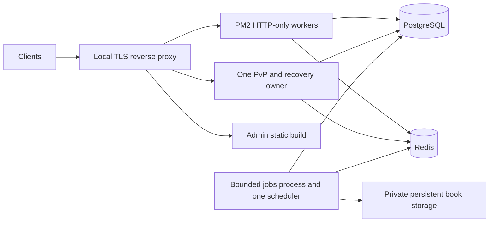

# AptiQu — Backend hardening implementation plan

**20 October 2026 · Review proposal only · No stage authorized for implementation.**

Canonical evidence: [Backend security/performance audit](/Users/shagunkumar/Desktop/aptiqu/docs/BACKEND_SECURITY_PERFORMANCE_AUDIT.md), baseline `9bdcd64`. This plan covers backend code, contracts, database-change preparation and future single-VPS operations. It does not authorize source/config edits, migrations, database/service setup, VPS access, deployments, external AI calls or frontend changes. This task produced only these two documents.

The audit inventories 116 HTTP endpoints, 8 inbound WebSocket commands and 15 significant job types. It records 41 findings: 0 Critical, 17 High, 22 Medium, 2 Low. 21 HTTP endpoints have meaningful conditional cache proposals, including two existing Ranked caches. Fix release-boundary and mutation integrity before using caching to mask expensive or incorrect paths. No embedded production source secret was verified; do not invent credentials to rotate or print existing values.

## 1. Priorities, stages and review gates

Four substantial implementation stages are proposed. Priorities describe risk; stages also respect technical dependencies. Any later approval should identify its scope. Completion of this planning task authorizes none of them.

| Stage | Priority and exact scope | Dependencies / expected changes | Verification and completion | Meaningful risks |
|---|---|---|---|---|
| **1 — Secure identity, content and learning outcomes** | P0 urgent: A01–A08, privacy policy/enforcement portion of A13, safe error/body baseline in A18. Fence dangerous deletes and unsafe publication first; lesson/Daily/practice/friendly integrity; shared abuse and realtime expiry | Agree published-content, friendly reveal/timing and session revocation contract; prepare additive session/idempotency fields/constraints if required. Existing Ranked settlement remains authoritative | Inert unit/API contract tests; separately authorized disposable-DB race/rollback tests. No cross-account cache replay, premature friendly reveal, REVIEW playback, split XP commit or invalid daily deadline accepted. Sensitive responses generic/no-store; public launch gates closed | DTO/timing changes require client compatibility; existing active sessions need pinned-version/reveal migration policy; do not silently add sequential learning prerequisites |
| **2 — Reliable jobs, catalog and efficient queries** | P1: A09–A14 and A19; durable shared config/cancellation, publish-triggered sync, queue failures/reconciliation, metric correctness, SQL projections/index evidence | Stage 1 contracts; isolate runtime factories/DB ownership. Resolve manual schema workflow before applying any future DB change. No production schema execution implied | Job outage/retry/cancel tests; grouped-query equivalence; read paths perform no global catalog mutation; verified index proposals on authorized staging; SQL/native constraint inventory reconciled | Removing implicit sync exposes data drift that old GET self-healing hid; preserve admin workflow and historical evidence |
| **3 — Single-VPS lifecycle and bounded caching** | P2: A15–A18 and A20; per-role startup, graceful drain/readiness, pool budget, validated ENV/provenance, operational/artifact controls; only selected measured cache candidates | Stages 1–2 atomicity, ownership and publication rules; explicit process roles and compatibility. Start with one PvP owner; HTTP cluster activation depends on tests/load evidence | Authorized staging HTTP reload with role overlap; planned PvP drain/reconnect test; restore drill; pool/memory/Redis budgets; cache account-isolation/invalidation tests. Proposed rollout runbook reviewed | PM2 reload cannot hand off live sockets or guarantee machine HA; worker separation adds pool/resource overhead; no all-core default |
| **4 — Optional measured optimizations** | P3: A21 and any deferred C01–C21 candidate justified by evidence; deeper query/index tuning, summaries, PgBouncer only on pressure | Stable metrics from stage 3 and representative staging history/traffic | Compare p95/query time/buffers/heap/write overhead; retain correctness and rollback. Complete only selected optimization, not every speculative item | Extra indexes/caches add invalidation/write/disk cost; defer cross-process PvP ownership, multiple VPS, microservices/Kubernetes/sharding |

Before public availability, close B01–B10/B14/B41, fence B15, verify required schema and one-owner runtime (B18/B24/B25/B35), and establish essential key/privacy/error/network/restore protections B11–B13/B32/B34/B36/B40. Full caching, all proposed indexes and multicore HTTP are not prerequisites for a small controlled launch.

## 2. Actionable remediation register

Paths below are relative to the repository root for compact scope descriptions; evidence links resolve to absolute local files in the audit. “DB changes” means prepare/review a change for a future authorized isolated test and deployment, not execute one now. New components are small modules inside the existing monolith unless stated otherwise. Each item lists compatibility/security, tests and an objective acceptance gate.

### A01 — Enforce a single learner publication rule

**Findings:** B01, B16, B41. **Stage / priority / complexity:** 1 · P0 · Large.

**Objective and technical approach:** Replace lesson deletion-based node serialization with a recursive public-field allowlist that withholds incorrectExplanation and every private variation field until authorized reveal. Build one service resolver that accepts learner identity/context plus script/step and returns only an active hierarchy with a pinned same-script PUBLISHED version. Remove REVIEW/direct cross-topic fallback and latest-any-version recovery. When resuming, load the original session version; never silently substitute the newest definition. Explicitly separate admin preview from learner delivery. Book publishing must operate on an approved manifest of reviewed versions/questions, not publish every historical version. Enforce question publication and active hierarchy at new Daily/PvP admission as well; preserve already-admitted frozen match evidence under its pinned policy. Preserve current free choice among available published topics.

**Files / components:** lesson-session.service.ts, script-cache.service.ts, roadmap-progression.service.ts, admin-syllabus.service.ts, book-publishing.service.ts, LiveCurriculumService. New: shared publication resolver and explicit public node DTO allowlist.

**Database / indexes:** Consider a relational constraint for valid version pointer and an assignment unique identity after duplicate audit; publication revisions if needed. Do not migrate existing sessions to new versions silently.

**Security, compatibility and trade-offs:** Authorized admin previews may return full solutions; learner resolver must never share that cache namespace. Existing published-but-inactive/review assignments need a reviewed cleanup report. Update response contract only where needed; do not invent paid entitlements.

**Tests and acceptance criteria:** Fixtures with incorrectExplanation and nested variations across start/active/get/action/history; archived question inside published PvP set and inactive Daily hierarchy; DRAFT/REVIEW/ARCHIVED/inactive hierarchy, wrong-script version pointer, stale slug cache, version switch mid-session and explicit admin preview. Accept when all learner entry points resolve the same publication decision and resumption uses the pinned version.

**Dependencies:** None; native constraint preparation coordinated with A19.

### A02 — Make lesson state, rewards and idempotent responses one transaction

**Findings:** B02, B07. **Stage / priority / complexity:** 1 · P0 · Large.

**Objective and technical approach:** Validate all lesson and roadmap-start inputs. Authorize owner/resource before cache access; scope action identity to user+operation+session and bind a canonical request hash. Under an owned session row lock or CAS, re-read status/version/node, evaluate, record attempt/mastery/XP, append event and advance state atomically. Persist replayable result/event evidence so Redis outage/lost ACK cannot strand an action. Move derived completion work into the same commit where required or an idempotent durable recovery task. Interrupt requests need idempotency; pause/resume need honest no-op/not-found semantics.

**Files / components:** lesson DTOs/controllers; roadmap.controller.ts; lesson-session.service.ts; mastery.service.ts; xp.service.ts; redis.service.ts. New: durable idempotency/result helper and transaction-aware mastery/progression entry points.

**Database / indexes:** Prepare owner/request-binding idempotency storage or reuse correctly scoped Event evidence; unique session sequence/CAS as appropriate. Audit existing globally unique action keys before changing uniqueness.

**Security, compatibility and trade-offs:** Keep clientActionId/stateVersion compatibility; old events remain replayable. Reject same key with different payload, do not overwrite another owner. Redis optional cache must not be authoritative lock fallback. Keep transactions short; no AI/external work inside them.

**Tests and acceptance criteria:** Cross-user known-key and cross-session/key-reuse tests; duplicate/lost-ACK action; crash after attempt/XP before advance; Redis unavailable/lease expired; mastery concurrent attempts. Accept exactly one state/reward/event commit or complete rollback and stable retry outcome.

**Dependencies:** A01; A19 for additive schema; A05 transaction API can be shared.

### A03 — Bound content extraction and close friendly-duel reveal/timing gaps

**Findings:** B03, B04. **Stage / priority / complexity:** 1 · P0 · Large.

**Objective and technical approach:** Define minimum current-question DTO and a small optional authorized prefetch unit. Practice creation should not preload unrestricted future banks. Starting a friendly question must atomically authorize and establish server start/deadline before its prompt is released. Require friendly source terminal/reveal eligibility on replay create/read/answer, including replay-of-replay chains; preserve frozen snapshot provenance. Add per-user new/active-session and distinct-question budgets plus suspicious-catalog-traversal telemetry. Allow legitimate high-volume study through measured allowances.

**Files / components:** practice-session.service.ts, practice-selection.service.ts, practice.controller.ts/routes; social/duels.service.ts; public question DTO. New: delivery/reveal policy helper and bounded content-delivery counters. Backend contract work only; identify separate client compatibility requirement.

**Database / indexes:** Persist delivery/deadline state and immutable replay source identity/snapshot reference if needed. Stable atomic active-session admission guard; do not copy large snapshots unnecessarily.

**Security, compatibility and trade-offs:** Unreleased explanations/answers never enter shared response caches. Delivered content remains copyable; do not propose obfuscation/pinning as extraction prevention. Existing ten-question client contract needs capability/version transition; avoid breaking active sessions. Product must decide offline/prefetch allowance.

**Tests and acceptance criteria:** Recursive DTO hidden-field tests; future question unavailable until authorized; active friendly replay denied at every chain depth; terminal replay uses frozen source after question edits; new-session budget and learning UX checks. Accept no solution/reveal shortcut before contest eligibility and bounded distinct delivery.

**Dependencies:** A01/A02; A06 shared quotas; product delivery contract.

### A04 — Make Daily Challenge timing and completion authoritative

**Findings:** B05, B06. **Stage / priority / complexity:** 1 · P0 · Large.

**Objective and technical approach:** Use a persisted server delivery/start/deadline for the current question and explicit IST-day membership. Under a participation row lock, recheck ownership/date/status/sequence/options, record or replay one answer and calculate/finalize the participation with streak/coins/XP in the parent transaction. Serialize create/resume per user/day and return existing participation after uniqueness race. Add bounded recovery for all-answered-but-unfinalized, expired and interrupted participations; reconcile once by stable completion identity.

**Files / components:** daily-challenge.controller.ts/service.ts; shared date helper; xp.service.ts; cron/recovery worker. New: Daily state/recovery helper with public errors and retry contract.

**Database / indexes:** Add current-question delivery/deadline/version fields and any completion fence needed. Retain existing user/date and participation/sequence uniqueness; no blanket data rewrite.

**Security, compatibility and trade-offs:** Client responseTimeMs becomes optional telemetry; scoring does not trust it. Define what happens to existing IN_PROGRESS participations lacking deadline fields. Shared-tier content can still be copied between accounts; do not promise prevention.

**Tests and acceptance criteria:** Negative/NaN/huge time, invalid option, out-of-order question, yesterday participation, midnight cron outage; two final distinct answers racing; duplicate start/answer, reward rollback/lost ACK. Accept one terminal result with internally consistent totals/rewards and safe recovery.

**Dependencies:** A05 XP transaction contract; A19 additive schema; A11 scheduler ownership.

### A05 — Propagate the parent transaction into regular-practice XP

**Findings:** B08. **Stage / priority / complexity:** 1 · P0 · Small.

**Objective and technical approach:** Pass the existing transaction client to awardXp for regular practice completion, matching Daily/Ranked/friendly call patterns. Keep final answer, summary, completion and XP ledger in one commit. Audit helper calls made from interactive transactions for accidental global Prisma use, including admin hydration, without broad refactoring.

**Files / components:** practice-session.service.ts:511; xp.service.ts supported txClient interface; transaction-bound helper callers. No new service required.

**Database / indexes:** No schema/index change expected.

**Security, compatibility and trade-offs:** Preserve exactly-once XP idempotency and existing replay/friendly no-regular-XP semantics. Do not treat a previously committed stray XP event as new evidence to overwrite history; any repair requires separate reviewed data task.

**Tests and acceptance criteria:** Inert propagation test; authorized isolated PG failure after XP/just before session commit and pool-size 1 transaction case. Accept no new connection/standalone commit for nested award and full rollback on failure.

**Dependencies:** Existing XP txClient API; coordinate A02/A04.

### A06 — Set small input budgets and shared abuse controls

**Findings:** B09, B10. **Stage / priority / complexity:** 1 · P0/P1 · Medium.

**Objective and technical approach:** Apply a small ordinary body parser budget and authenticated route-specific larger admin import budgets; keep streamed PDF upload distinct. Implement typed Redis per-user/session/operation budgets and a broad per-IP admission circuit breaker before expensive work. Preserve Social policies; replace or properly bound local admin/Ranked counters before multiple workers. Add WS upgrade/byte/message/in-flight/reconnect caps, queue backlog limits and generation admissions. Tune proposals from audit section 8; thresholds are not yet measured.

**Files / components:** app.ts, auth routes/validation, admin-auth.controller.ts, Ranked rate-limit/controller, practice/lesson/daily routes, pvp.socket.ts/social.socket.ts, queue/provider entry points. New: reusable limiter/config with explicit outage policy.

**Database / indexes:** No relational schema required unless durable distinct-content accounting is selected. Redis counters bounded by TTL/cardinality; no raw token keys/logs.

**Security, compatibility and trade-offs:** Trust only known proxy hops; never set trust proxy=true blindly. Shared mobile NAT needs generous IP limits plus per-user budgets. Required coordination fail-closed/503; optional reads can degrade under a safe documented local circuit breaker. Avoid indiscriminate CAPTCHA.

**Tests and acceptance criteria:** 413 before costly parse/auth;429 Retry-After; multiple worker shared limit, spoofed-forwarded-IP, NAT fairness, Redis outage, malformed WS flood bounded in-flight tasks. Accept no unbounded local maps and no per-process multiplication of advertised account limits.

**Dependencies:** A16 validation; A03 delivery budgets; A11 provider global budget.

### A07 — Tighten identity, token lifecycle and WebSocket expiry

**Findings:** B11, B12, B13, B14. **Stage / priority / complexity:** 1 · P0/P1 · Medium.

**Objective and technical approach:** Remove admin verification fallback to user secret. Validate algorithm/issuer/audience/purpose and payload types; use distinct strong signing keys. Require configured Google audience and reviewed verified-email/link policy with subject identity. Rotate opaque refresh tokens through atomic one-time consume/create with retry/replay-family policy; use one TTL. Define access revocation/logout guarantee and implement bounded session version/check if required. PvP must track and enforce expiry/re-auth like Social; remove/deprecate URL tokens after compatible clients use AUTH_INIT.

**Files / components:** utils/jwt.ts, utils/google.ts, auth service/controllers/validation, auth/admin middleware, both socket servers, env.ts. New: shared token payload/session-policy helpers; session metadata only if needed.

**Database / indexes:** Optional refresh session-family/revocation/version metadata and cleanup index reuse. Existing refresh hash/expiry indexes sufficient for basic maintenance.

**Security, compatibility and trade-offs:** Key/profile changes can invalidate outstanding clients; use bounded transition/rotation window with explicit token purpose, never cross-role fallback. Atomic rotation must account for lost response rather than accidentally logging users out forever. Require no raw token logging.

**Tests and acceptance criteria:** Wrong role/issuer/audience/algorithm/payload; old fallback-signed admin rejection; verified-email/link fixtures; concurrent refresh and failure between consume/create; expired/logged-out/deleted-account WS; fixed TTL effect. Accept role isolation and no privileged messages beyond session expiry.

**Dependencies:** A06 limits; A16 ENV; product revocation/linking contract.

### A08 — Fence destructive admin actions and preserve historical integrity

**Findings:** B15. **Stage / priority / complexity:** 1 fence;2 full policy · P0/P1 · Large.

**Objective and technical approach:** Immediately gate hard-delete operations against historical/active dependencies and prefer archive/deactivate. Design reviewed identity anonymization/retention rather than cascading immutable Ranked evidence. Replace book 150ms guess with actual durable cancellation/worker acknowledgement; narrow ownership by immutable IDs, not title matching. Any justified purge should be transactional where bounded or a resumable staged task with durable progress, explicit scope and recoverable backup.

**Files / components:** admin-questions.service.ts deleteQuestion; admin-users.service.ts hardDeleteUser; admin-syllabus deletion; admin-books cascade/delete; book storage/queue/cancellation. New: delete eligibility/report and retained-history anonymization policy.

**Database / indexes:** No dropping ledger/answer RESTRICT or immutable triggers. New archival fields only if needed after current status review. Separate reviewed repair of existing partial deletions.

**Security, compatibility and trade-offs:** Admin authorization does not make accidental data loss acceptable. User erasure must not quietly alter opponent history/policy ledgers; decisions may require user/product/legal input, with endpoints safely fenced meanwhile. No data deletion authorized by this plan.

**Tests and acceptance criteria:** Active match/deck, legacy completed history, rated immutable evidence, same-title different book, worker not yet stopped, mid-purge failure. Accept no partial destructive changes on a denied operation and a reviewed historical retention contract.

**Dependencies:** A11 durable cancel; A19 real constraint inventory; backup/restore A18 before any future purge.

### A09 — Unify privileged validation and versioned shared settings

**Findings:** B16, B23. **Stage / priority / complexity:** 2 · P1 · Large.

**Objective and technical approach:** Use strict runtime schemas/field allowlists for every admin write. Reuse shared question options/answer/semantic/hierarchy validation and ScriptValidator across create/update/import/manual routes; consolidate weaker duplicate route semantics without silently removing clients. Bind book/topic/subtopic IDs in query/body to the path resource. Enforce list/item/length bounds and expected version for edits/publish. Make timing a reviewed persisted policy with valid range and pinned active-match contract; version/cache prompt publications consistently across processes.

**Files / components:** All admin controllers/services, question structural validator, script validator/cache, ai-prompt.service.ts, inventory.config.ts, match admission. New: typed admin DTOs and small versioned settings repository.

**Database / indexes:** Optimistic edit version fields and persisted settings only where absent; prompt uses existing version but needs expected-version guard. No new generic enterprise config service.

**Security, compatibility and trade-offs:** Existing data may violate stronger validators: report it and block publishing instead of coercing a wrong default answer. Do not move reward/rating/timing rules into independently mutable per-worker ENV. Preserve active match policy snapshots.

**Tests and acceptance criteria:** Unexpected/nested ORM properties, hierarchy mismatch, duplicate/equivalent options, missing answer, invalid graph, stale editor publish, wrong-book IDs, negative timing and cross-worker prompt publish tests. Accept identical content gate across authoring routes and bounded shared configuration freshness.

**Dependencies:** A01 gate; A16 operational configuration; A19 schema preparation.

### A10 — Remove global mutations from reads and make catalog reconciliation owned

**Findings:** B17, B18. **Stage / priority / complexity:** 2 · P1 · Large.

**Objective and technical approach:** Trigger bounded reconciliation after successful publication/link/reorder changes through one durable revision/job identity. Use idempotent upserts/unique assignment identity and expose only completed catalog revision to learner reads. Remove generic GET synchronization and post-listen automatic imports; make the RS import explicit operator task/disabled-by-default job with stable run identity and source root. Build map/active responses from projected metadata, not whole version JSON.

**Files / components:** roadmap-progression.service.ts, lesson-session.service.ts, admin publication hooks, rs-aggarwal-startup-sync.service.ts, server.ts. New: curriculum revision/reconcile job factory and status projection.

**Database / indexes:** Unique assignment pair after duplicate report; catalog revision/job completion marker if required. Decide how to present old stable revision during update rather than partial tree.

**Security, compatibility and trade-offs:** Saved read behavior currently self-heals missing data; replacement needs explicit publish feedback and recovery. Existing authored scripts/approved scopes remain untouched. No source-book question-bank workflow is introduced.

**Tests and acceptance criteria:** Concurrent reads/publish/jobs, duplicate delivery and process restart; no global writes from GET traces; bounded queries with growing catalog; two roadmap IDs do not share wrong throttle. Accept repeat reconciliation gives same complete graph with no duplicate assignments.

**Dependencies:** A01/A09 publication semantics; A11 job factories; A19 constraints.

### A11 — Make jobs, Redis configuration and AI work retry-safe

**Findings:** B18, B19, B20, B21, B22. **Stage / priority / complexity:** 2 · P1 · Large.

**Objective and technical approach:** Replace import-time Queue/Worker construction with explicit factories and close ownership. One scheduler and bounded content worker initially; stable book/run/stage uniqueness, durable cancel epoch checked before commits and worker stop acknowledgment. Throw real failures, allowlist job names, distinguish cancelled/skipped/completed; propagate Daily preparing 503/code/Retry-After. Add periodic/startup reconciliation for due friendly seats, missed Daily work and required post-import invalidation. Use a single validated full Redis URL factory. Put external generation behind global provider concurrency/request/token/spend limits and renewable lease/DB fences; abort timed-out calls if SDK supports it and clear timers.

**Files / components:** server.ts, queues/*.ts, social.worker.ts/duels.service.ts, book-cancellation/storage/content services, concurrency-lock.service.ts, redis.service.ts, Gemini provider and generation call sites. New: explicit runtime job role, bounded reconciler and generation admission helper.

**Database / indexes:** Durable book cancellation/run identity/status and scheduling progress; optional small outbox only where periodic reconciliation cannot meet critical delivery requirement. Reuse existing DB uniqueness/Redis; no new job infrastructure.

**Security, compatibility and trade-offs:** Keep explicit no-automatic-billable-book-retry policy unless separately approved. Competing BullMQ consumers are safe for distinct jobs, not whole-book singleton ownership. Normal notifications may drop; critical rewards cannot. Full URL must preserve TLS/ACL/DB/escaped credentials without printing them.

**Tests and acceptance criteria:** Duplicate same-book stages, worker overlap, cancellation during AI, Redis outage between commit/enqueue, lost schedules, malformed job, provider timeout/quota/failure, bounded failed retention. Accept one owner per operation, honest queue states and recovery without duplicate critical effects.

**Dependencies:** A04/A08 domain recovery; A16 runtime config; A19 durable metadata.

### A12 — Correct metric identity and remove avoidable aggregate/JSON work

**Findings:** B27, B28, B29. **Stage / priority / complexity:** 2 · P1 · Medium.

**Objective and technical approach:** Define each metric (attempts vs distinct solved, replays/friendly/timeout treatment, lifetime vs IST day) and use canonical identity per source. Fix cross-script nodeID collisions and DB-reference double count; use frozen match difficulty/provenance for history when available. Replace all-profile JS grouping and per-bucket count loops with SQL aggregates; narrow Social profile facts; remove full-definition loads from totals/map; SQL AVG and bounded histories. Keep a shared query/projection boundary for overlapping user screens.

**Files / components:** user.service.ts, home queries/service/metrics, achievement service/analytics, social profile/activity, admin dashboard/users/books projections, daily/practice histories. New: small canonical stats projection helpers.

**Database / indexes:** No durable rollup initially. Metadata fields/materialized summaries only after A21 proves need. Index changes reviewed via A14.

**Security, compatibility and trade-offs:** Correct results may differ from legacy displays; preserve intentionally different attempted/unique-solved concepts and label contracts clearly. IST remains product day; host/database/session UTC remains unchanged. Do not recalculate immutable rating/XP history to improve a chart.

**Tests and acceptance criteria:** Same nodeID in two scripts; repository-bound inline node; edit question difficulty after match; replays/timeouts, month/year/midnight, Non-Binary/special dictionary keys; grouped-vs-reference fixtures. Accept correct results, bounded payload/heap and reduced query counts on representative synthetic fixtures.

**Dependencies:** A01/A04 stable source contracts; A13 private field policy; A14 measured plans.

### A13 — Make social profile, presence and email discovery policy explicit

**Findings:** B31, B32. **Stage / priority / complexity:** 1 privacy;2 search · P0/P1 · Medium.

**Objective and technical approach:** Agree which fields are discoverable to registered users, which require friendship, and whether email search is exact opt-in discovery. Enforce policy inside profile/activity/presence services, not only route checks. Revalidate watched friend set on relationship change/renewal or invalidate subscriptions; profile presence must obey same policy as search/list. Prefer prefix name and exact email lookup if product allows; preserve relevant-result ordering.

**Files / components:** social.routes.ts, friends.service.ts, friend-search.ts, social.socket.ts/transport.ts. New: reusable visibility projection/authorization helper; optional privacy preference field only if chosen.

**Database / indexes:** Only add privacy fields if policy requires per-user control. Search indexes chosen after semantics, not before; reuse normalized-name prefix index where suitable.

**Security, compatibility and trade-offs:** Broad profile viewing is not automatically IDOR if explicitly intended; avoid silently removing an approved public feature. Until policy chosen, presence/activity should use conservative consistent friend-only projection. No caching of visibility-sensitive results before contract.

**Tests and acceptance criteria:** Unrelated/friend/removed/self visibility, guessed target ID, email substring vs exact match, WATCH then unfriend, account deletion, Redis outage. Accept identical visibility across HTTP and websocket with no stale watcher retention.

**Dependencies:** User/product privacy decision; A06 budgets; A14 search plan if substring retained.

### A14 — Budget database connections and tune real query/index shapes

**Findings:** B26, B30, B31. **Stage / priority / complexity:** 2 measurement;3 config · P1/P2 · Medium.

**Objective and technical approach:** Inventory role/pool counts and overlap, PG limits/reserves, then choose bounded role connection_limit/pool_timeout. Fix nested transaction use first. Verify deployed native/Prisma indexes and obtain authorized SELECT plans for practice anti-probes/random selection, live board ordinals, histories, friendly expiry and global analytics. Review IX01–IX08 individually; apply only a justified subset later. Improve page/ordinal query work before shared-cache expansion.

**Files / components:** config/prisma.ts/env.ts; role bootstrap; practice selection; PvP set/board queries; social search; Prisma/native SQL change preparation. New: documented pool budget and small query rewrites, not a new ORM/pool service.

**Database / indexes:** Prepare selected indexes with measured write/storage cost; unique assignment integrity belongs A10. Existing Ranked qualified-order partial index must be verified, not duplicated. PgBouncer conditional A21.

**Security, compatibility and trade-offs:** Count old+new pools, realtime/jobs/scheduler/backup/admin connections. More connections can lower throughput; no all-core or universal 5-pool claim. Keep deterministic ranking/ties and question-selection fairness.

**Tests and acceptance criteria:** Authorized staging plans/buffers and query correctness; connection saturation/timeout plus reload overlap; no per-request PrismaClient; unique/unseen ten-question and deep page tie cases. Accept documented budget below usable PG limit and improved measured target without extra privacy/consistency risk.

**Dependencies:** A05/A11 role counts; A19 schema catalog; A16 config.

### A15 — Make PM2 roles, readiness and graceful deployments explicit

**Findings:** B24, B25. **Stage / priority / complexity:** 3 · P2 · Large.

**Objective and technical approach:** Keep one application/PvP owner first. After inert factories, define HTTP-only, realtime/recovery and bounded jobs/scheduler responsibilities with explicit localhost ports/roles. Do not start combined server in cluster. Implement startup readiness and PM2 ready signal, draining status, one-shot bounded shutdown, schedule/admission stop, accepted HTTP/DB work drain, worker checkpoint/close then socket/Redis/Prisma closure. Route `/ws/pvp` to one owner; Social existing bus may be tested on more than one process. Define version-compatible deployment/rollback and documented reconnect semantics.

**Files / components:** server.ts/app.ts, socket close handlers, worker factories, Redis/prisma lifecycle; future PM2 ecosystem and local proxy config only in later approved implementation. New: role bootstrap/lifecycle coordinator and readiness endpoint.

**Database / indexes:** No schema from process separation alone; compatible additive state/version changes may be prerequisite. Retain recovery/settlement on old admitted matches throughout rollback.

**Security, compatibility and trade-offs:** HTTP can roll after all gates; PvP sockets cannot transfer by pm2 reload. Drain new matchmaking and finish games on old owner, then planned reconnect/restart; no server HA claim. HTTP load sharing supplied by PM2; TLS/path proxy useful but second app balancer unnecessary.

**Tests and acceptance criteria:** Authorized staging long/idle HTTP requests, active game, SIGINT twice, worker job/AI in flight, Redis/PG down, timeout forced kill, old/new overlap, rollback with pending settlement. Accept no accepted mutation lost/duplicated, readiness honest, fixed bounded drain and documented remaining PvP interruption.

**Dependencies:** A02–A05 atomicity; A10/A11 owner factories; A14 pool budget; A19 version/schema compatibility.

### A16 — Centralize validated operational ENV and accurate generation metadata

**Findings:** B37, B38. **Stage / priority / complexity:** 3 (required key validation in1) · P1/P2 · Medium.

**Objective and technical approach:** Implement one typed config parser for required secrets, role/features, URLs/protocols, numeric bounds and conditional Google/AI config. Wire actual refresh/admin TTL, preserve zero thinking budget with nullish/default logic, remove unused refresh-secret requirement, route direct Ranked ENV reads through validated config. Externalize deployment roots/role/body/provider/resource knobs listed in section 4. Persist actual resolved Gemini model and published prompt identity/version/checksum from execution, not duplicated literals.

**Files / components:** config/env.ts, .env.example, utils/jwt.ts, admin middleware, ranked config/runtime/matchmaking/cursor, storage/source import paths, Gemini/generation services. New: typed config schema and returned execution metadata.

**Database / indexes:** Provenance fields may already exist; use them. Add prompt checksum/id fields only if necessary; preserve historic unknown values as legacy, not fabricated accurate metadata.

**Security, compatibility and trade-offs:** Never read/print real values during code changes; templates contain placeholders. Provide deprecation notes for JWT_REFRESH_SECRET/EXPIRATION semantics; consistent role overrides. Business rules/curriculum data stay versioned in code/DB.

**Tests and acceptance criteria:** Invalid/missing/nonfinite/out-of-range values, equal/weak secrets, protocol/role feature mismatch, empty Google audiences, zero budget, TTL effect and different model/prompt execution fixtures. Accept startup fails safely with key names only, documented effective nonsecret configuration and truthful provenance.

**Dependencies:** A07 token contract; A11 role/resource ownership; ENV register below.

### A17 — Repair internal cache semantics; add only justified response caches

**Findings:** B23, B27, B33. **Stage / priority / complexity:** 3 selective;4 expansion · P2/P3 · Medium.

**Objective and technical approach:** Separate immutable content/query data caches from authorization, locks and response reveal state. Fix definition whole-script hydration-on-hit with a clear pinned question revision contract, safe per-key single-flight/owner-token lock and dependency invalidation. Bound memory fallback/expiry sweeping; locks never silently fall back. Make prompt/version changes propagate by revision/TTL/invalidation. Insert only the approved concise cache annotations from section 3, then implement individually selected C01–C21 after measuring.

**Files / components:** script-cache/hydration/redis service, admin question/script/publish hooks, ai-prompt.service.ts, ranked cache/query service, selected controllers/services. New: small cache metadata/revision helpers using existing Redis.

**Database / indexes:** Publication/question/config revision if needed for correct invalidation. No new external cache product; no separate cache DB unless memory/isolation evidence calls for it.

**Security, compatibility and trade-offs:** Authenticate and authorize before lookup. Mixed private/catalog responses must split or use complete user/policy keys; HTTP no-store remains for private responses. Existing Ranked cache correctness/fresh bypass/season cap retained. Avoid caching errors/pending settlement/authoritative answers.

**Tests and acceptance criteria:** User A/B, role/publication change, answer reveal state, fresh bypass, season transition, failed load, invalidation during in-flight read, Redis outage, capacity/eviction and restored cache. Accept no unauthorized/stale reveal, bounded keyspace, known invalidation owner and measured benefit.

**Dependencies:** A01/A02/A09; A12 corrected projections; A18 headers/metrics; caching register is proposal only.

### A18 — Standardize safe errors/logs and production/artifact recovery baseline

**Findings:** B34, B36, B40. **Stage / priority / complexity:** 1 essential privacy;3 full baseline · P1/P2 · Medium.

**Objective and technical approach:** Use public error taxonomy/generic 5xx plus consistent retry codes, sensitive no-store, origin/CORS/security headers and trusted-proxy policy. Structured logs use request ID/route template/coarse error and redacted actor identity, not tokens/raw query strings/content/SQL values. Add lightweight latency/event-loop/RSS/pool/Redis/queue/settlement/content telemetry and rotation. Move private storage outside releases, exclude tracked runtime PDF/page copies from deployment artifacts without blindly deleting sources. Bound/temp-clean uploaded data and use async IO in isolated worker. Prepare private listeners/roles/ACLs/TLS/permissions and encrypted off-machine backup/restore runbook with verified evidence.

**Files / components:** app.ts/controllers/middleware, Gemini/provider errors, worker/storage modules; artifact/package rules; future proxy/PM2 ops config. New: minimal structured logger/error mapper/metrics and safe temp cleanup; no enterprise observability platform.

**Database / indexes:** No schema needed for basic metrics; admin actor audit/delivery counters may be DB/Redis with explicit retention. Do not store complete tokens/content for diagnostics.

**Security, compatibility and trade-offs:** Global header changes must accommodate admin browser assets separately; no backend static root to repository/storage. Confirm production controls without dumping secrets. Backup destination may be off-machine while one serving VPS remains. Deleting Git history/rotating unknown secrets requires separate evidence/authorization.

**Tests and acceptance criteria:** Parser/unhandled/Prisma/AI errors contain no SQL/path/content/credentials; private responses no-store; artifact manifest excludes private runtime files; disk-full/temp expiry; alerts on actual failure; separately authorized restore drill. Accept observable recoverable failure without new privacy leak.

**Dependencies:** A06 input boundaries; A11 worker isolation; A16 roots; A19 rollout docs.

### A19 — Reconcile schema/native SQL and release instructions

**Findings:** B35, B15. **Stage / priority / complexity:** 2 · P1 (launch prerequisite) · Medium.

**Objective and technical approach:** Replace contradictory db-push/destructive historical README guidance with one explicit source-of-truth workflow: inspect target schema, baseline/drift review, additive native constraints/indexes, isolated DB validation, schema-before-code, compatibility and rollback duty. Document what Prisma does not represent. Require actual catalog evidence of deployed Ranked guards and explicit native SQL revision before activation; no assumptions from file presence. Preserve UTC convention and deliberate default-off Ranked flags.

**Files / components:** backend/README.md, prisma/changes/README.md and prepared SQL metadata, package operational scripts, release/rollback instructions. No CI/CD pipeline. New database migration baseline only if separately approved after target review.

**Database / indexes:** No SQL execution in planning. Any future baseline/constraint/index change needs explicit isolated DB and production authorizations; no blind db push or stale cleanup.

**Security, compatibility and trade-offs:** Deployment docs currently say no user deletion endpoint while admin delete exists; update against actual routes. Rollback cannot downgrade away from settlement of admitted rated matches. Never remove immutability just to make deletes succeed.

**Tests and acceptance criteria:** Static doc/script consistency; authorized catalog/constraint integration tests, old/new DTO/state/schema compatibility and rollback with pending matches. Accept a single reviewed runbook whose guarantees match actual verified schema.

**Dependencies:** A08 retention choices; A14 index review; separately supplied target evidence.

### A20 — Separate inert verification from service integration and dependency checks

**Findings:** B39. **Stage / priority / complexity:** 3 · P2 · Small.

**Objective and technical approach:** Change default test entry point to inert unit/contract suites only after later approval. Gate all DB/Redis-writing scripts with explicit allow flag and dedicated URL validation; never fallback to ordinary DATABASE_URL. Add missing authentication/lesson/Daily/friendly/reload regression coverage identified above; preserve strong existing Ranked tests. Capture fresh lockfile advisory results and supported Node/dependency runtime compatibility from official sources; review high-risk parser/auth/WS packages before release.

**Files / components:** package.json test scripts; roadmap/XP/book tests; existing opt-in Ranked guards; new focused auth/session/serialization fixtures. New components limited to tests/check scripts after implementation authorization.

**Database / indexes:** Tests do not create local databases or migrate automatically. Isolated service setup is a separate explicit task; destructive cleanup must never target user DB.

**Security, compatibility and trade-offs:** Current npm test writes users, so do not run it as a supposedly safe audit check. Typecheck/mocks/skip-mode are not SQL or Redis runtime proof. No package installation needed merely to inspect/report advisories.

**Tests and acceptance criteria:** No credentials/env loaded by inert tests; integrations reject ordinary/nonlocal/nondedicated targets and skip by default; regression suite matches acceptance gates, typecheck passes. Accept accurate distinction between tests actually run and unverified integration guarantees.

**Dependencies:** Behavior fixes define expected contracts; A19 supplies correct disposable schema.

### A21 — Apply optional performance infrastructure only after evidence

**Findings:** B27, B29, B30, B31, B26. **Stage / priority / complexity:** 4 · P3 · Variable.

**Objective and technical approach:** Use stage 3 metrics to select remaining private/shared cache candidates or SQL/index rewrites. Consider small durable user summaries/season ranking snapshots if repeated source aggregation remains expensive; update summaries transactionally/idempotently with reconciliation. Consider PgBouncer only if tuned pools still waste scarce slots. Cross-process PvP ownership/transport redesign is a separate measured roadmap decision, not included by default.

**Files / components:** Only measured hot query/cache modules and optional new summary/query layer; possible reviewed PgBouncer config later. Existing monolith/PM2/PostgreSQL/Redis remain stack.

**Database / indexes:** Optional summaries/indexes/pooler require plan, backfill/reconciliation and controlled rollout/rollback. Do not pre-create dozens of indexes or duplicate current native partial indexes.

**Security, compatibility and trade-offs:** Caching/rollups must not hide stale publication/rewards or reveal private accounts. Live rank position may move; derived snapshots explicitly timestamped. Avoid distributed serving architecture for an aspirational registered-user milestone.

**Tests and acceptance criteria:** Before/after representative authorized staging measurements, summary-vs-source reconciliation, failure/replay/backfill and write-overhead tests. Accept a selected optimization only when it improves measured bottleneck with bounded resources and preserved correctness.

**Dependencies:** Stage 3 stable metrics and specific justification; separate user approval for selected work.


## 3. Dedicated caching implementation and annotation register

**All candidates remain proposed.** This planning document does not approve insertion of flags or caching code. The audit classifies all 116 HTTP endpoints; the register below selects 21 meaningful candidate endpoints. C12/C13 already have bounded process caches;19 candidates describe potential new response/fragment caching. Implement only after publication/privacy/atomicity prerequisites and measured value. Fragment TTL/key detail must be preserved from audit section 9.

### Concise comment convention

Place one comment immediately above the responsible handler or shared service method, as listed. Prefer the service method when multiple handlers share the data/cache; avoid duplicate annotations in route, controller and service. `ref=Cxx` points to this register, so comments need no paragraphs.

```ts
// CACHE_CANDIDATE ref=C05 scope=user layer=redis ttl=5s owner=stats
// CACHE_EXISTING ref=C12 scope=user layer=memory ttl<=5s owner=ranked
// CACHE_NOT_RECOMMENDED ref=NX03 reason=authoritative-reveal
// CACHE_REVIEW_REQUIRED ref=RV01 reason=visibility-policy
```

`ttl` is a proposal for candidates, a current bound for existing cache. `scope` cannot be omitted for user/role data. `owner` identifies the module responsible for versioning/invalidation; full key contract stays in this document/audit. Do not annotate every trivial mutation or add a comment that sounds implemented before implementation is approved.

### Exact candidate endpoints and annotation locations

Source anchors are the inspected checkout; line positions will move after fixes. Symbols are authoritative annotation targets. For repeated scopes below, mandatory authorization occurs **before** lookup and role/user values come from verified session, never request-selected userId. Key cardinality is bounded, and failures/auth errors are not cached.

| Ref / exact endpoint | Proposed marker and exact source target | Key / layer / TTL proposal | Invalidation owner and safety | Verification |
|---|---|---|---|---|
| C01 `GET /api/v1/practice/topics/live` | CACHE_CANDIDATE above PracticeController.getLiveTopics, practice.controller.ts:11 | `catalog:live:<revision>:<visibility>:<locale>` Redis or bounded memory 30–60s | Curriculum publish/activity/link invalidates revision; metadata only; authenticated gate | Revocation/publish reflected; no tree/answer fields; warm hit avoids catalog query |
| C02 `GET /api/v1/roadmaps` | CACHE_CANDIDATE above RoadmapController.listRoadmaps, roadmap.controller.ts:11 | `catalog:roadmaps:<revision>` shared server fragment 60s + separate own selection | Curriculum owns static revision; User selection invalidates private overlay; remove GET writes first | Two users different selected markers; catalog shared safely |
| C03 `GET /api/v1/roadmaps/:roadmapId` | CACHE_CANDIDATE above RoadmapController.getRoadmap, roadmap.controller.ts:73 | `catalog:roadmap:<resolvedID>:<revision>` fragment 60s + user marker | Same owner as C02; do not key raw arbitrary slugs or return whole list unnecessarily | ID/slug normalize; same ownership and publication; one-roadmap query |
| C04 `GET /api/v1/roadmaps/:roadmapId/subjects/:subjectId/map` | CACHE_CANDIDATE above RoadmapController.getSubjectMap, roadmap.controller.ts:103 | `map:<roadmap>:<subject>:<catalogRevision>`60s + `mapProgress:<user>:<progressVersion>`5–10s | Curriculum and learning own respective fragments; no mixed shared-user response | Complete lesson/update catalog while cached; account-switch isolation |
| C05 `GET /api/v1/user/home` | CACHE_CANDIDATE above HomeService.getHome, home.service.ts:8 | `home:<user>:<ISTday>:<metricVersion>` private Redis/coalesce 5–10s | Stats/learning writes, Daily rollover and badge edits; preserve asOf and immediate result refresh | Concurrent Home callers coalesce; no userB data; midnight freshness |
| C06 `GET /api/v1/user/achievements` | CACHE_CANDIDATE above userAchievements, achievement.service.ts:29 | Own facts `achievementFacts:<user>:<metricsVersion>`5–10s; definitions by revision 60s; bounded page/limit | Achievements owns definition version, source services progress version; do not recompute facts/page | Rule edit/restore, progress write and pagination produce correct unlocks |
| C07 `GET /api/v1/user/profile` | CACHE_CANDIDATE above UserService.getProfile, user.service.ts:10 | `profile:<user>:<summary>:<ISTday>:<profile/metricsVersion>` private 5–10s | Auth/onboarding and stats own invalidations; sensitive demographics no-store at HTTP; remove read initialization races | Different summary flags; onboarding/award/account-switch invalidation |
| C08 `GET /api/v1/user/progress` | CACHE_CANDIDATE above UserService.getProgress, user.service.ts:263 | `progress:<user>:<version>` private 5s/coalesce | XP commit; no initialization side effect inside reused cached read; after-award bypass | Latest absolute balance after award; no additive duplicate award semantics |
| C09 `GET /api/v1/user/stats` | CACHE_CANDIDATE above UserService.getUserStats, user.service.ts:160 | `stats:<user>:<metricVersion>:<catalogRevision>`10–30s | Stats/curriculum changes; B28 corrected before cache; catalog totals server-internal | Cross-script node identities/refs correct; cold/warm memory bounded |
| C10 `GET /api/v1/practice/history` | CACHE_CANDIDATE above PracticeSessionService.getHistory, practice-session.service.ts:748 | `practiceHistory:<user>:<boundedPage/limit or cursor>:<version>`5–10s | Practice create/answer/complete/abandon/replay invalidation; summary fragment can share private facts | New session/reward appears; deep inputs bounded; replay metrics preserved |
| C11 `GET /api/v1/daily-challenge/history` | CACHE_CANDIDATE above DailyChallengeService.getHistory, daily-challenge.service.ts:698 | `dailyHistory:<user>:<boundedPage/limit>:<version>:<ISTday>`5–30s | Daily finalization/rollover; SQL AVG first; history private | Midnight/terminal attempt invalidation; no unbounded cache keys |
| C12 `GET /api/v1/pvp/ranked/me` | CACHE_EXISTING above RankedQueryService.me, ranked-query.service.ts:46 | Existing `me:<user>:<season or current>` memory<=5s; future Redis key adds resolved policy/version | Ranked admission/settlement/archive; preserve fresh bypass, season deadline cap, in-flight epoch; local invalidations documented | Existing cache/epoch tests plus multiple-process bounded-staleness test |
| C13 `GET /api/v1/pvp/ranked/leaderboard` | CACHE_EXISTING above RankedQueryService.leaderboard, ranked-query.service.ts:75 | Existing top `board:<season or current>:<limit>` memory<=5s; Redis only measured; add resolved policy/live-final dimensions | Ranked outcomes/profile/season changes; auth before shared public-field cache; cursor pages uncached initially | Live movement, signed cursor expiry, finalized branch, profile change, no private standing |
| C14 `GET /api/v1/pvp/ranked/seasons` | CACHE_CANDIDATE above RankedQueryService.seasons, ranked-query.service.ts:98 | `rankedSeasons:<user>:<before>:<limit>:<archiveVersion>`10–30s | Settlement/finalization/new season; only immutable archived row fragments may have long TTL | Current/finalizing month never falsely terminal; own seasons only |
| C15 `GET /api/v1/admin/dashboard/stats` | CACHE_CANDIDATE above AdminDashboardController.getStats, admin-dashboard.controller.ts:8 | `admin:dashboard:<role>:<ISTday>:<metricRevision>`15–60s | Admin analytics snapshot owner; asOf; grouped SQL first; no raw user rows | Same metrics vs uncached reference; non-admin denied on warm hit |
| C16 `GET /api/v1/admin/achievements/options` | CACHE_CANDIDATE above AdminAchievementsController.options, admin-achievements.controller.ts:19 | Immutable build enum value/ETag; build lifetime in process | Deployment invalidates; admin gate retained; tiny benefit so low priority, Redis unnecessary | Enum/build changes; unauthorized cache hit denied |
| C17 `GET /api/v1/admin/achievements` | CACHE_CANDIDATE above AdminAchievementsController.list, admin-achievements.controller.ts:20 | `admin:achievementFacts:<metricSnapshot>`30–60s + normalized role/search/status/page/definitionRevision | Analytics/achievement owners; cache distribution rather than every arbitrary response; private admin only | Edit/archive/restore and fresh answer metrics; keyspace/search bounded |
| C18 `GET /api/v1/admin/syllabus` | CACHE_CANDIDATE above AdminSyllabusController.getSyllabus, admin-syllabus.controller.ts:5 | `admin:syllabus:<role>:<catalogRevision>`10–30s | All admin syllabus/script/link/publish edits; drafts separate from learner namespace; editors use expected version | Unpublished data inaccessible to learner; stale editor conflict instead of overwrite |
| C19 `GET /api/v1/admin/questions/stats` | CACHE_CANDIDATE above AdminQuestionsController.getStats, admin-questions.controller.ts:14 | `admin:questionStats:<role>:<inventoryRevision>`15–60s | Question import/generate/update/archive/delete; totals only, no answer payload | Inventory changes/count equivalence; gate before lookup |
| C20 `GET /api/v1/admin/users/stats` | CACHE_CANDIDATE above AdminUsersController.getUserStats, admin-users.controller.ts:14 | `admin:demographics:<role>:<schema/aggregateRevision>`30–60s | Onboarding/registration/approved erasure; aggregated groups; no raw demographic rows | Correct enum/special keys; removal/registration freshness |
| C21 `GET /api/v1/admin/books/:id/status` | CACHE_CANDIDATE above AdminBooksController.getStatus, controllers/admin-books.controller.ts:179 | `admin:bookStatus:<role>:<validatedID>:<runVersion>` coalesce 1–3s | Book run/progress/cancel/delete; compact latest state; never cache queue failure as successful completion | Cancel/failure/next run immediate version change; bounded polling query count |

Additional selective exclusions/reviews (not included in21 candidates):

| Ref / endpoint(s) | Exact proposed annotation target | Marker / reason |
|---|---|---|
| NX01 `POST /api/v1/auth/google`, `/refresh`; `POST /api/v1/admin/auth/login` | AuthController.googleLogin/refreshToken (auth.controller.ts:13,73); AdminAuthController.login (:15) | CACHE_NOT_RECOMMENDED reason=credentials; HTTP no-store; no token response caching |
| NX02 `POST /api/v1/lessons/sessions/:id/actions` | LessonSessionService.submitAction, lesson-session.service.ts:569 | CACHE_NOT_RECOMMENDED reason=mutation; scoped durable idempotency replay is a separate correctness mechanism |
| NX03 `GET /api/v1/pvp/matches/:matchId` and WS SUBMIT_ANSWER | PvpMatchService.getMatchSnapshot/submitAnswer, pvp-match.service.ts:275,328 | CACHE_NOT_RECOMMENDED reason=authoritative-reveal; internal immutable question cache is allowed but full match DTO isn't shared |
| NX04 `GET /health` and future readiness | app.ts health registration:40 and future readiness handler | CACHE_NOT_RECOMMENDED reason=live-health; no synthetic healthy cache |
| RV01 `GET /api/v1/social/profiles/:id`, `/activity` | FriendsService.profile/activity, friends.service.ts:62,75 | CACHE_REVIEW_REQUIRED reason=visibility-policy; A13 first; presence not stale shared content |
| RV02 `GET /api/v1/lessons/active`, `/sessions/:id` | LessonSessionService.getActiveSession/getSession (:916,544) | CACHE_REVIEW_REQUIRED reason=session-version; optimize immutable data rather than stale session response |
| RV03 `GET /api/v1/admin/ai-prompts`, `/:key` | AiPromptService.listPrompts/getPrompt (:362,380) | CACHE_REVIEW_REQUIRED reason=draft-version; repair execution prompt cache first; keep editor freshness |

## 4. Concrete ENV migration and hardcoded-value register

**No values are moved during this task.** Existing secrets stay in a private environment/secret provisioning mechanism, never source or these files. No actual `.env` value was opened. Environment templates must contain placeholder names and nonsecret examples only. Environment-specific paths/budgets are suitable ENV settings; authoring content and game policy are not.

| Current literal/setting and evidence | Proposed configuration / type | Requiredness/default and migration | Verification / owner |
|---|---|---|---|
| PORT/NODE_ENV (env.ts:13) and unbound server.listen | `PORT` bounded integer; `NODE_ENV` enum; proposed `HOST` IP/hostname | Keep explicit dev default 5001/loopback if appropriate; production bind chosen by topology, e.g. loopback behind proxy; reject invalid/NaN | Startup config tests; lifecycle owner |
| CORS `cors()` (app.ts:17) | Proposed `CORS_ALLOWED_ORIGINS` normalized allowlist | Explicit production list for admin/browser clients; mobile auth does not depend on Origin; empty/default semantics documented; no reflected wildcard credentials | Allowed/denied/null origin tests; security owner |
| req.ip/proxy assumption | Proposed `TRUSTED_PROXY_CIDRS` or a reviewed fixed hop policy | Default no trust; production known local proxy only; never unqualified trust all forwarded headers | Spoofed XFF/trusted-hop tests; ops/security |
|150MB ordinary/80KB Social parsers | Proposed `HTTP_JSON_LIMIT_BYTES`, `SOCIAL_JSON_LIMIT_BYTES`, `ADMIN_IMPORT_LIMIT_BYTES`, `HTTP_URLENCODED_LIMIT_BYTES` | Small reviewed defaults with finite hard upper bounds; larger admin import mounted after auth; Social can retain 80KB initially |413/order/memory tests; API owner |
|150MB upload (admin-books.routes.ts:30) and temp expansion | Proposed `BOOK_UPLOAD_MAX_BYTES`, `BOOK_MAX_PAGES`, `BOOK_MAX_EXTRACTED_TEXT_BYTES`, `BOOK_TEMP_RETENTION_HOURS` | Max 150MB only if measured need; documented conservative bounds and disk allowance; existing files not deleted by config migration | Oversized/corrupt/expanded PDF, temp cleanup/disk tests; ingestion owner |
| CWD `storage/books`/`storage/temp` | Proposed `BOOK_STORAGE_ROOT`, `BOOK_TEMP_ROOT` absolute private directories | Required production paths outside release/static root; local nonsecret defaults for dev; validate real containment/permissions and persistent volume | Restart/release-path/storage preservation tests; ingestion/ops |
| RS startup source root and automatic import | Proposed `CURRICULUM_SOURCE_ROOT`, `CURRICULUM_STARTUP_SYNC_ENABLED` (defaultfalse) | Root environment-dependent; explicit operator import preferred; no automatic all-worker import; target subject identity from reviewed data | Missing-root/disabled/two-worker behavior; curriculum owner |
| Combined startup imports/cron/worker creation | Proposed `BACKEND_ROLE` enum and/or narrowly validated explicit role switches | Roles: combined initial owner, http, realtime, jobs; scheduler exactly one by topology. Reject incompatible role/feature combinations. No role change until factories exist | Role starts only its owned work; overlap tests; lifecycle |
| Hardcoded 7day refresh TTL; dead ENV keys | Keep `JWT_REFRESH_EXPIRATION` as canonical validated duration **or** migrate once to `REFRESH_TOKEN_TTL_SECONDS`; do not support two conflicting active knobs | Single default 7days; wire actual call sites; deprecate/remove unused `JWT_REFRESH_SECRET` requirement because tokens remain opaque; clear template/runtime docs together | Expiry/rotation test; auth owner |
| Hardcoded 24h admin token | Proposed `ADMIN_JWT_EXPIRATION` validated bounded duration | Review shorter privileged session lifetime; preserve existing tokens only through explicit transition; remove fallback to user key permanently | Expiry/cross-role tests; auth owner |
| Access/admin/cursor keys and OAuth config | Existing `JWT_ACCESS_SECRET`, `ADMIN_JWT_SECRET`, `JWT_ACCESS_EXPIRATION`, `GOOGLE_*`; existing `RANKED_CURSOR_SECRET` centralized | Strong distinct secret validation; OAuth audiences mandatory when auth enabled; cursor key separate recommended 32+chars. Admin credential ENV already exists; no literal found to move. Web client secret only retain if actual auth mode needs it | Key-name-only startup errors; equal/short secrets reject; no value output |
| DATABASE_URL pool options | Existing `DATABASE_URL` with explicit per-role `connection_limit`/`pool_timeout`; optional proposed role-specific secret URLs | Do not independently configure same pool in two competing places. Document pool budget; role URL override private; no credentials logged | Aggregate pool+reload budget; PG plan validation; DB/ops |
| Redis local fallback/manual parser | Existing `REDIS_URL`; full URL/TLS/ACL/DB validated | Production explicit required; safe dev loopback default only; invalid URL fails instead of silently changing endpoint | Full URL options including nonzero DB and rediss supported; Redis owner |
| Gemini key/model/budget (env.ts:29) | Existing `GEMINI_API_KEY`, `GEMINI_MODEL`, `GEMINI_THINKING_BUDGET` in template/parser | Required only for enabled generation role/features; budget 0 valid; model resolved once for call/provenance. No real key or secret default | Disabled feature starts; enabled missing key rejects; budget 0 retained; AI owner |
| Provider spacing/retries/timeouts | Proposed `AI_MAX_CONCURRENT_REQUESTS`, `AI_REQUESTS_PER_MINUTE`, `AI_MAX_TOKENS_PER_MINUTE`, `AI_DAILY_COST_LIMIT`, `AI_REQUEST_TIMEOUT_MS`, `AI_MAX_RETRIES` | Validated global limits matched to actual provider agreement; current 2.5s comment inconsistent with 15RPM. No invented provider quota; per-call 90s overrides have bounded approved maximum | Fake provider concurrency/cancel/retry/cost tests; AI owner |
| Worker concurrency 2/1/20, retention and backlog | Proposed `CONTENT_WORKER_CONCURRENCY`, `BOOK_WORKER_CONCURRENCY`, `SOCIAL_WORKER_CONCURRENCY`, `QUEUE_FAILED_RETENTION_COUNT/AGE`, `QUEUE_MAX_BACKLOG` | Preserve initial total book concurrency 1 across role, not just per process; retain manual book retry policy; bounds from RAM/provider budget | Global same-book idempotency and retention/backlog; jobs owner |
| Admin/login/read/scrape numeric thresholds | Proposed typed rate-policy ENV keys e.g. `AUTH_LOGIN_IP_LIMIT`, `PRACTICE_CREATE_USER_LIMIT`, `CONTENT_DISTINCT_DAILY_LIMIT`, `WS_USER_MESSAGE_LIMIT` plus explicit windows | Defaults only proposals from audit section 8; central named policy schema validates sensible relationships and finite bounds; avoid 100 independent magic numbers | Shared counters/Redis failure/NAT and UX checks; security/content owner |
| Shutdown/startup timeouts and role memory budget | Proposed `SHUTDOWN_TIMEOUT_MS`, `READINESS_TIMEOUT_MS`; future PM2 role `kill_timeout`, `listen_timeout`, `max_memory_restart` | Coordinate rather than duplicate competing timeouts; measured drain+margin; content jobs may need checkpoint rather than very long timeout | Bounded shutdown/reload; lifecycle/ops |
| Ranked ENV scattered reads | Existing `RANKED_ADMISSION_ENABLED`, `RANKED_LAUNCH_SEASON`, `RANKED_LEAGUES_READ_ENABLED`, `RANKED_SKILL_MATCHMAKING_ENABLED`, `RANKED_ADMISSION_DRAIN`, `RANKED_CURSOR_SECRET`, `RANKED_QUEUE_NARROW_WINDOW`, `RANKED_QUEUE_EXPAND_INTERVAL_MS`, `RANKED_QUEUE_EXPAND_BY`, `RANKED_QUEUE_MAXIMUM_WINDOW` | Central validated parser/template. Preserve default-off and chosen launch season; validate narrow/expand/max relationships. No launch month selected by this plan | Flag matrix/season boundary/invalid numeric settings; Ranked owner |
| Log level/sampling/retention/diagnostic thresholds | Proposed `LOG_LEVEL`, `HTTP_LOG_SAMPLE_RATE`, metrics/slow-route thresholds; log rotation in supervisor/ops config | Redaction mandatory independent of log level; no DEBUG flag that prints secrets. Retention may be supervisor setting, not app ENV if that owns it | Secret-field canaries, safe route IDs and disk growth; ops |

**Do not move these into ENV merely because they are literals:**

- Approved Ranked rating/league/qualification/round policy, XP/reward formulas, challenge streak tiers and 10-question contracts. These are code-reviewed/version-pinned rules or shared DB settings; independent process ENV would cause fairness/ledger drift.
- Curriculum titles/descriptions, subject/topic/default roadmap IDs and seed data. Resolve reviewed database defaults/manifests; remove accidental hardcoded fallbacks such as `ga-qa-01`/`qa-foundations` when unavailable. Keep initialization 0XP/coins/level values as intentional defaults.
- `Asia/Kolkata` learner-day contract and UTC DB/host convention. Use one shared date helper. Do not let separate modules choose arbitrary independent timezone ENV values.
- Stable protocol/event names, ADMIN role discriminator, validation invariants, internal versioned key namespaces and cryptographic algorithms. These belong in code/contracts.
- AI generation provenance. Store actual resolved model and prompt metadata; adding `GENERATION_MODEL_LABEL` ENV would merely create another false source of truth.
- Editor-managed prompts and timing. Use shared versioned DB settings with bounded refresh/invalidation and match snapshots; do not copy long templates into `.env`.

Environment rollout procedure: add typed schema and placeholder template documentation; map existing variable semantics/deprecations; make a key-only compatibility report; validate per-role config without opening secrets in logs; test invalid/zero/boundary settings; provision actual private values through the owner's existing mechanism in a separately approved deployment; restart/reload roles only after lifecycle and compatibility gates. Application `.env` files should have private owner permissions and remain outside public artifacts. No secret-value copying is part of implementation review.

## 5. Practical PM2 and single-VPS deployment target

PM2 remains appropriate. Start with **one combined application/realtime process** after urgent fixes. Separate one bounded content worker as soon as explicit factories/roles exist to protect interactive event loop/RAM. Only add HTTP workers after actual request/DB metrics justify them. Never enable `instances:max` on the present combined server.

A prepared later topology on one serving VPS is:



This is a target after source changes, **not the current architecture**. Social WS can initially remain with realtime owner; later its existing pubsub architecture may permit multiple socket hosts after connection/privacy/backpressure tests. PM2 balances HTTP-only workers on their shared port; local proxy handles TLS/path separation and `/ws/pvp` routing to the single owner. Another application load-balancer is unnecessary. Static serving/proxy paths must exclude storage, backend source, `.git`, ENV, backups and content-authoring directories. Existing actual proxy settings remain unknown.

Singleton responsibilities: PvP socket/matchmaking/timer/recovery owner, curriculum import/reconciliation coordinator, cron scheduler and global AI budget. BullMQ may have multiple distinct-job consumers later, but domain-level dedupe/cancellation must remain durable and global. One scheduler is easiest at this stage; if topology ever overlaps schedulers, require a DB/Redis lease or a durable run identity. Optional notifications remain best effort; outcomes and awards remain database transactions.

### Pool and memory budget

Use the audit formula with **actual** max_connections/reserves and all process pools. For `H` simultaneous HTTP pools (including replacement overlap), `PH` each pool, worker counts/pools `Wj/Pj`, other-client budget `O`, reserve `R` and PG limit `M`:

`H × PH + Σ(Wj × Pj) + O <= M − R`

Select a lower practical concurrency ceiling from CPU/RAM/I/O tests, leaving headroom for restore/maintenance/SSH/operator diagnostics. A4-core/8GB example might start with 1–2 HTTP workers, one realtime owner and one low-concurrency jobs process **only after** measuring shared PG/Redis/OS/Node/PDF memory; it is not a capacity promise or sizing recommendation. On a smaller VPS keep fewer processes. Increasing cores does not require allocating every core to Node. Bound Redis queue/cache memory, PG per-query memory and worker input expansion; include log/backup disk I/O and off-machine copy windows.

Consider PgBouncer only when tuned process pools materially waste the available connection budget or unavoidable process count cannot fit; validate Prisma 6 compatibility, transaction-mode/prepared-statement behavior and transaction advisory locks. It will not improve a CPU-bound query or fix standalone XP nested transactions.

### Safe application deployment sequence (future approved runbook)

1. Verify recoverable backup, compatible additive schema/native constraints and role configuration using sanitized evidence. Never run the old README cleanup/db-push blindly. Stage schema-before-code with old-version compatibility; do not combine breaking contract and destructive schema changes.
2. Build/test an artifact excluding private source/storage/config. Run inert verification and explicitly authorized isolated integrations. Verify versioned DTO/policy compatibility and rollback binary still settles admitted matches.
3. Start replacement HTTP-only worker, wait for real DB/required Redis readiness and ready signal; proxy/PM2 routes to it only when ready. Drain old HTTP admission, finish accepted writes and await cleanup within measured deadline. Budget overlap connections/memory and reloaded ENV explicitly.
4. Scheduler/jobs update separately: stop new admissions/claims, checkpoint/drain in-flight work, transfer durable ownership after stop acknowledgement; retain retries/idempotency and one scheduler. A long uncancellable AI request is not safely fixed by supervisor force-kill.
5. For realtime owner update, set admission drain, finish or reconcile existing games using old process, communicate reconnect/restarting state through protocol, then close/restart owner with bounded reconnect behavior. **No continuous PvP socket handoff is claimed.** If a process crashes, use durable recovery with original deadlines and published system-interruption policy; no new outcome policy is invented here.
6. Verify readiness, error rates, pool pressure, Redis/queue lag, settlement reconciliation and privacy behavior; rollback HTTP to compatible code if needed. Never roll back DB/ledger constraints destructively or discard already admitted rating obligations. Keep a manual restart/restore runbook, not a CI/CD buildout.

A correct future `pm2 reload` may support uninterrupted HTTP service after these gates. Current combined application cannot honestly promise it. Active PvP always needs a separate continuity/drain contract. VPS failure/reboot/PG outage still interrupts this one-machine system; encrypted off-machine backups and tested restoration are recovery, not high availability.

## 6. Finding-to-remediation cross-check

Every important finding has at least one concrete action; repeated IDs mean related responsibilities, not duplicate findings.

| Finding IDs | Required actions |
|---|---|
| B01 | A01; A10; A17 |
| B02 | A02 |
| B03 | A03; A06 |
| B04 | A03 |
| B05, B06 | A04 |
| B07 | A02 |
| B08 | A05 |
| B09, B10 | A06; A11; A18 |
| B11, B12, B13, B14 | A07; A16 |
| B15 | A08; A19 |
| B16 | A01; A09 |
| B17 | A10 |
| B18 | A10; A11; A15 |
| B19, B20, B21, B22 | A11 |
| B23 | A09; A17 |
| B24, B25 | A15 |
| B26 | A14; A15; conditional A21 |
| B27 | A12; A17; conditional A21 |
| B28, B29 | A12 (B29 optional expansion A21) |
| B30 | A14; conditional A21 |
| B31 | A13; A14; conditional A21 |
| B32 | A13 |
| B33 | A17 |
| B34, B36 | A18 |
| B35 | A19 |
| B37, B38 | A16 |
| B39 | A20 |
| B40 | A18 |
| B41 | A01; A03; A17 |

## 7. Verification boundaries and approval-ready outputs

Implementation work should leave reviewable source/test/config/SQL proposals and updated contract/runbook notes. It must not silently run migrations, provision services, query real accounts, connect to VPS, call AI or deploy. Exact safe follow-up evidence procedures are in audit section 20. `EXPLAIN ANALYZE` executes a query: only authorized staging SELECTs with limits/timeouts and representative synthetic data; never casually wrap writes in it. Database and Redis integrations require separate allowed disposable targets and explicit flags, with no ordinary ENV URL fallback.

Required checks per approved stage:

- **Behavior/security:** owner binding, correct publication/reveal, strict inputs, role/key isolation, expiry/revocation, shared quotas, private cache keys/headers, no secret-bearing logs.
- **Integrity:** duplicate/lost-response/retry, post-XP rollback, concurrent final answers, lock-order/deadlock, canceled/deleted job, schema/native trigger consistency and historical records preserved.
- **Efficiency:** query count/payload/heap bounded; real plans only when authorized; measure before/after on the selected bottleneck; no claimed numerical speedup without data.
- **Lifecycle:** explicit role starts only owned work, readiness/draining true, accepted mutations complete, queues/connections closed in correct order, bounded shutdown and compatible rollback; active PvP continuity documented separately.
- **Artifacts/recovery:** only intended public static assets deployed; private storage and config outside releases; tested restore; bounded queue/log/temp retention.

Primary technical references checked for this plan: [PM2 cluster/reload](https://pm2.keymetrics.io/docs/usage/cluster-mode/), [PM2 readiness and shutdown](https://pm2.keymetrics.io/docs/usage/signals-clean-restart/), [Prisma v6 pools](https://www.prisma.io/docs/orm/v6/prisma-client/setup-and-configuration/databases-connections/connection-pool), [PostgreSQL connection budgets](https://www.postgresql.org/docs/current/runtime-config-connection.html), [PostgreSQL EXPLAIN](https://www.postgresql.org/docs/current/using-explain.html), [BullMQ failed-job retries](https://docs.bullmq.io/guide/retrying-failing-jobs). These explain platform behavior; repository evidence establishes AptiQu-specific findings. No dependency vulnerability clearance, production performance benchmark or deployment validation is implied.

**Review boundary:** approve a specific implementation stage or revision in a future request. Current task ends with the two documents; no source, ENV, infrastructure, SQL or database changes were made.
