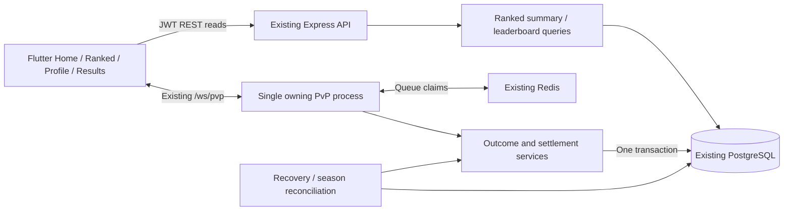

# AptiQu Ranked Leagues — Implementation Plan

**Status: Phase 1 complete; Phase 2 source implementation authorized and completed, with real PostgreSQL verification pending explicit DB authorization. Phases 3–4 remain unauthorized.**

**Prepared: 19 October 2026 (IST).**

**Scope: Flutter → Express/WebSocket backend → PostgreSQL, including operations and rollout.**

The architecture was prepared as a planning-only deliverable. The subsequent Phase 1 instructions supersede the original nine-stage execution roadmap and authorize focused PvP integrity repairs, pure Elo/qualification helpers and monthly IST calendar utilities. Current implementation evidence and limitations are tracked in `docs/RANKED_LEAGUES_IMPLEMENTATION_PROGRESS.md`. The later “proceed with phase 2” request authorizes the Phase 2 source/schema/SQL preparation. The user also approved the proposed rating values, monthly carry, and system-failure voids without Elo/XP. Database execution, migrations, VPS access and deployment remain restricted; unrelated working-tree changes remain protected. The subsequent “proceed with phase 3” request authorized backend read APIs and skill matchmaking; their implemented contracts are in `docs/RANKED_LEAGUES_PHASE_3_API.md`. After the interrupted run, the user asked to finish Phase 3 and request approval before Phase 4. The subsequent “proceed with the next phase” authorized Phase 4, now implemented and ready for manual review; see `docs/RANKED_LEAGUES_PHASE_4_HANDOFF.md`. See `backend/prisma/changes/README.md` for the prepared change and opt-in test workflow.

## 1. Executive summary

Extend the existing Ranked PvP implementation. Keep its 10-question, 60-second-round gameplay, JWT identity, PostgreSQL/Prisma persistence, Express routes, WebSocket channel, Flutter GetX controllers, and approved design system. Reuse Redis, which is already present, for matchmaking; make PostgreSQL authoritative for outcomes, Elo, seasons, and history.

The recommended first release has:

- Exactly six visible states: **Unranked, Bronze, Silver, Gold, Platinum, Diamond**. Unranked means current-season qualification is incomplete.
- One Elo rating used for both skill matchmaking and league assignment. Initial proposal: 1,200; K=64 during the first 20 lifetime rated games, then K=32. Match outcome alone changes Elo.
- Ten initial qualification games and three seasonal qualification games for established players, with explicit handling of unfinished initial qualification. Qualification hides the public rating/standing but still updates internal Elo.
- Monthly IST calendar seasons, with half-open boundaries and UTC timestamp storage. **The VPS OS, Node process timezone, database/session timezone, logs, and transport instants remain UTC permanently.** No host timezone change is required or proposed.
- Carry-forward Elo with fresh monthly statistics and eligibility as the recommended initial reset policy. Modest compression is a documented alternative requiring approval. No separate hidden lifetime MMR initially.
- A PostgreSQL seasonal standings row per participating player, immutable per-match rating changes, and an idempotent settlement record. League is derived; leaderboard position is a different field.
- Existing-match fixes before rated rollout: sanitized snapshots, server-measured timing, frozen round transitions, atomic completion/rewards, correct completion delivery, and durable match recovery.
- Compact Home/lobby/Profile integration, seasonal leaderboard/history, authoritative result deltas, and a restrained native Flutter badge transition.
- A single owning PvP process initially, with bounded recovery workers and measured capacity. Redis matchmaking alone does not make today's socket/timer implementation safe across multiple PvP processes.

The Phase 2 user reply **“Use these defaults”** approved the proposed seed/K/qualification/threshold/rounding/no-floor values and carry-forward reset for immutable v1 persistence. Approved system failures use zero-Elo/zero-XP voids; ordinary disconnects retain timed play and exact score/time ties still draw. Other alternatives below remain proposals. The four-phase roadmap in §18 limits implementation to the authorized phase; no release or DB execution is implied.



## 2. Current codebase assessment

### 2.1 Verified implementation and reuse map

Paths are repository-relative in this document. Existing paths below were inspected; paths explicitly labelled **new** are proposed modules.

| Area | Actual files/symbols | What exists and how to extend it |
|---|---|---|
| Repository boundaries | `AGENTS.md`; `docs/UI_UX_DESIGN_PREFERENCES.md`; latest entries of `docs/UI_UX_REVAMP_PROGRESS.md`; `docs/FRONTEND_DESIGN_SYSTEM.md` | Planning only. Phase G is complete and approved; no release approval. Ranked outage/exit policy remains unresolved. Preserve approved theme/type/tokens and unrelated changes. Older phase entries are historical, not the current approval state. |
| Runtime | `backend/src/app.ts`, `backend/src/server.ts`, `backend/package.json`, `backend/tsconfig.json` | TypeScript strict/CommonJS, Express 4, shared HTTP server, `/ws/pvp` and `/ws/social`, `node-cron`, BullMQ workers. Extend the monolith. Lockfile resolves Prisma/client 6.19.3, ws 8.22.0, node-cron 4.6.0, BullMQ 6.3.11, ioredis 6.0.0. Do not copy newer Prisma-major APIs. |
| Persistence | `backend/prisma/schema.prisma`; `backend/src/config/prisma.ts` | PostgreSQL, Prisma multi-schema: `auth`, `users`, `gamification`, `learning`. Shared `PrismaClient`, raw parameterized SQL for locking/aggregations. No ranked rating/season/leaderboard model exists. |
| Schema deployment | `backend/README.md`, `backend/package.json`, `backend/prisma/` | Current workflow documents manual `db push` and client generation; there is no checked-in Prisma migration directory/baseline. A controlled additive SQL change process must be approved; do not assume `migrate deploy` is already operational. Do not execute README cleanup SQL. |
| Identity | `backend/src/modules/auth/auth.service.ts`, `backend/src/utils/jwt.ts`, `backend/src/middleware/auth.middleware.ts` | Google account linked to UUID `auth.users.id`, access/refresh JWT flow; REST Bearer authentication, socket `AUTH_INIT` or legacy query token. Reuse identity, never accept a caller-selected rating owner. |
| Matchmaking | `backend/src/modules/pvp/pvp.socket.ts`: `JOIN_MATCHMAKING`, `tryPairPlayers` | Redis sorted set `pvp:matchmaking` scored by enqueue time; Lua atomically pops two oldest users. Local queue fallback exists. No skill filter, repeat-opponent policy, or periodic widening pass. |
| Match lifecycle | `backend/src/modules/pvp/services/pvp-match.service.ts`; `pvp.socket.ts` | Persisted matches, two participants, question answers, server round deadline; in-process active map, socket map and timers. Ready countdown and transitions are three seconds. Reuse data, replace unsafe lifecycle coordination. |
| Existing outcomes | `PvpMatchService.finalizeMatch` | Higher correct-answer score wins; lower **total submitted response time** breaks equal scores; equal score/time is a draw. No separate authoritative forfeit operation. Elo must consume a frozen outcome, not redefine score. Timing/incomplete-answer defects require explicit correction. |
| Rewards | `backend/src/modules/xp/xp.service.ts`, `xp.policy.ts` | Winner bonus 100 XP, draw bonus 50 XP, correct-question XP via policy. XP has unique idempotency keys, progress locks and an optional parent transaction client. Reuse it transactionally. No Ranked coin award was found. |
| Cross-mode exclusions | `backend/src/modules/social/friends.service.ts`: `lockUsers`; `social/duels.service.ts` | Ordered `auth.users` locks protect Ranked creation versus friendly-duel seats. Keep this shared ordering and update all active/unsettled checks together. Friendly duels and Practice replays must never change Elo. |
| Existing APIs | `backend/src/modules/pvp/pvp.routes.ts`, `pvp.controller.ts` | Authenticated `GET /api/v1/pvp/matches/:matchId`, `GET /history`, `POST /replay/:matchId`. Participant check on REST match read. Extend these instead of creating another result/history system. |
| Home backend | `backend/src/modules/home/home.service.ts`, `home.queries.ts`; `modules/user/user.routes.ts` | `/user/home` uses Repeatable Read, shows latest completed PvP result, not competitive standing. Preserve its existing `ranked` payload and add `rankedLeague`. |
| Profile backend | `backend/src/modules/user/user.service.ts`, `user.controller.ts`, `user.routes.ts` | `/user/profile` includes identity, XP, learning/daily stats. Add a compact optional ranked summary, independent of XP/coins. Public social payloads use their own whitelisted selects. |
| Flutter transport/state | `lib/features/pvp/services/pvp_socket_service.dart`; `controllers/pvp_lobby_controller.dart`, `pvp_arena_controller.dart`; `models/pvp_models.dart`, `pvp_history_model.dart` | Singleton socket, broadcast events, GetX feature controllers, queue/cancel guards, answer selection and reconnect UI. Extend typed models and centralize authoritative result application. |
| Flutter screens | `lib/features/pvp/views/pvp_lobby_view.dart`, `pvp_arena_screen.dart` | Working themed queue/history/replay/arena/result surfaces. Result currently shows XP; recovered completion redirects users to history. Keep main Find match action prominent and preserve immediate answer submission. |
| Home/Profile callers | `lib/features/home/presentation/widgets/home_dashboard_view.dart`; `presentation/controllers/home_controller.dart`; `models/home_dashboard_model.dart`; `lib/features/profile/presentation/screens/profile_screen.dart`; `lib/features/auth/domain/models/user_model.dart` | Home already has a Ranked section and action to tab index 3. Profile fetches `/user/profile` with account/stale-result guards. Extend those real consumers. |
| Navigation | `lib/core/routing/app_router.dart`, `app_routes.dart`; `lib/features/home/presentation/screens/home_screen.dart` | Five tabs Home → Topics → Practice → Ranked → Friends; typed `/pvp-arena` entry. Add leaderboard/history routes without disturbing lesson/tab state. |
| Presentation system | `lib/core/theme/{aptiqu_theme,aptiqu_typography,aptiqu_tokens,appearance_theme}.dart`; `lib/shared/widgets/`; `lib/core/presentation/global_overlay_gate.dart`; `lib/core/progression/controllers/xp_controller.dart` | Material 3 light/dark, Outfit headings, Plus Jakarta Sans reading text, reusable buttons/state/sheets/metrics, overlay coordination and XP celebration. Reuse the components and respect account/lifecycle ownership. |
| Redis/jobs | `backend/src/modules/lesson/services/redis.service.ts`; `social/social.transport.ts`, `social.worker.ts`; `queues/content-generation.queue.ts` | Redis/BullMQ already used. Lesson Redis wrapper falls back to local state; social transport demonstrates fail-closed shared state and user pub/sub. Reuse infrastructure selectively, not fallback semantics for rated admission. |
| Content supply | `backend/src/modules/ai/services/pvp-set-generation.service.ts`; `config/inventory.config.ts` | Published 10-question sets, reuse history, live-curriculum checks; match creation can wait for AI generation. Keep generation outside live match transactions and prewarm inventory. |
| Tests | `test/phase_e_social_competitive_test.dart`, `test/phase_g_app_review_test.dart`, Home/navigation/font tests; `backend/src/modules/home/tests/`, `social/tests/` | Existing frontend behavior/visual fixtures and backend Node-test conventions. No focused backend PvP lifecycle/rating suite was found. Existing UI QA success does not certify live competitive integrity or capacity. |

### 2.2 Current defects and dependencies to address before rating real users

These are the **pre-Phase 1 baseline findings**, from source inspection rather than production incident reproduction. Consult the progress document for repaired paths and the remaining Phase 2 dependencies; this table is not a claim that every baseline defect remains present.

| Severity / finding | Evidence | Required plan change |
|---|---|---|
| Critical: full match read exposes answer-bearing/internal data | `getMatchDetails` returns full question objects (including `correctAnswer`, explanations), answers and full user objects; `PvpController.getMatch` sends that object to participants | Replace response serialization with a strict phase-aware DTO. Hide unreleased answers and all private user fields. Internal service queries are not API response models. |
| Critical: submitted timing is client-controlled | Socket passes `responseTimeMs` through; service adds it to the outcome tie-breaker without range validation | Compute outcome timing from authoritative question start/receipt, bounded to the round; client timing is optional telemetry only. Establish a timeout value for missing answers. |
| Critical: replay can be requested for a live match | `practice-session.service.ts:replayPvpMatch` checks membership and set size but not terminal match status before creating an untimed Practice replay | Require a completed/replay-eligible source match before creating or serving its replay; new rated sources also require committed settlement. Audit existing replay-session reads against an unfinished source to close alternate answer-preview paths. |
| High: completion event cannot be broadcast on normal completion | `completeMatch` deletes `activeMatches[matchId]` before `broadcastToMatch`, which immediately returns if the map entry is absent | Send committed DTO to captured recipients before cleanup, or route independently of the active map. Add durable result fetch for missed sends. |
| High: completion is not one atomic operation | `finalizeMatch` reads status, awards each player's XP separately, updates participant flags, then marks match completed | Freeze outcome, XP, both standings, ledger and settlement in one transaction. Status precheck alone is not idempotency. |
| High: AFK comments do not match outcome logic | `finalizeMatch` never considers AFK/connection status; missing answers add no response time. An inactive player can have zero time and win an equal-score tie | Approve explicit disconnect/AFK/timeout semantics. Do not turn `DISCONNECTED` into an automatic loss or preserve a misleading “active player always wins” claim. |
| High: round transition races | `endQuestionRound` does not persist `QUESTION_TRANSITION`; timers and answer handlers can both end a round; answer acceptance reads state outside its write transaction | Lock match state, close each round once, freeze after deadline/transition, conditionally advance once. Resolve the current one-second late buffer against the hard deadline. |
| High: restart loses match execution | Active matches and ready/transition timers are process-local; reconnect reads DB but does not rehydrate timers | Persist transition deadlines/revision, restore due work, and reconcile stuck matches. Closing a socket is not a durable cancellation. |
| High: identity/ownership checks are incomplete on WS paths | `SUBMIT_ANSWER` and `RECONNECT_MATCH` do not explicitly validate membership before service work; answer FK links user and match independently | Validate membership and payload at the service boundary; bind active answer rows to a participant with a composite FK. Re-authentication must not change a socket's owner. |
| High: multi-process pairing is unsafe | Redis queue is global; `userSockets`, `activeMatches`, broadcasts and timers are local | Operate one PvP owner initially. Multiple generic app replicas cannot independently pop this queue. A later shared routing/ownership design is a measured upgrade. |
| Medium: reconnect DTO is incomplete | `MATCH_RECONNECTED` lacks a complete result, own answer acknowledgement and transition state; arena explicitly treats completed snapshots as history-only | Reuse sanitized authoritative result/snapshot DTO for REST and WS. Account for lost ACK and lost completion. |
| Medium: socket replacement cleanup races | Old socket close unconditionally deletes `userSockets[userId]`, removes queue entry and marks disconnect | Only clear if socket/session generation still owns that mapping. Define one active PvP socket policy. |
| Medium: duplicate-answer response differs | Unique-answer precheck is outside transaction; two inserts can race. Duplicate path lacks `isCorrect`/`bothAnswered` used by sender | Return the original acknowledged answer for the same key; catch the expected unique conflict outside rollback and reread. Different answer retry must not overwrite. |
| Medium: XP display can be applied twice | Arena adds `xpAwarded` to current local XP on each completion event | Use authoritative XP totals and a per-result idempotency key in Flutter; recovery must not sum rewards again. |
| Medium: queue claims can strand players | No claim lease, stale-member TTL, periodic widening scan or reliable requeue on initialization error | Introduce bounded claims, heartbeat/generation checks, deterministic requeue/cancel responses and metrics. |
| Medium: content fallback and history guards | Fallback set queries omit the first query's exact-size filters; later validation can reject the selected invalid set. History page/limit are not bounded | Apply uniform valid-set filters, prewarm supply, validate pagination, and align rules copy with actual total-time scoring. |
| Deployment unknowns | No checked-in process-manager/proxy/capacity configuration or migration baseline establishes VPS resources, Postgres version, Redis durability, pool sizes, or replication topology | Collect operational evidence only in a separately authorized implementation phase. This plan claims neither present capacity nor production schema drift status. |

`startedAt` exists in the schema but is not populated by the inspected Ranked lifecycle. Populate it at actual gameplay start; use a separate immutable admission instant for season ownership.

## 3. Confirmed requirements and policy boundaries

**Confirmed:** planning only; exact six visible states; Elo preference; genuine skill rather than match-count progression; monthly IST calendar seasons; UTC hosting/database permanently; separate league and global seasonal position; server-authoritative outcomes/ratings; existing badges; approved Flutter visual system; Home/lobby/Profile/result/leaderboard integration; native promotion animation; 100,000 registered-user planning milestone; 1,000 simultaneous battles/approximately 2,000 players as an unproven load-test target; incremental phases with manual gates; preserve existing history; no remote/database actions now.

**Proposed:** all starting ratings, K values, qualification counts, thresholds, matchmaking windows, inactivity/abandonment rules, reset/requalification choices, retention horizons, SLOs and rollout dates. Review §20 before coding those policies.

**Out of scope initially:** extra leagues/divisions, score-margin or speed-weighted Elo, participation rating bonuses, new Ranked currency/rewards, lifetime leaderboard, spectator service, microservices, sharding, new event bus, new Redis deployment, mass historical re-rating, and unrelated UI redesign.

## 4. Proposed Elo rating design

### 4.1 Calculation and precision

Let `RA` and `RB` be both players' **pre-settlement internal ratings**, and `SA` be 1 for a win, 0.5 for a draw, 0 for a loss. `SB = 1 − SA`.

```text
EA = 1 / (1 + 10 ^ ((RB − RA) / 400))
EB = 1 − EA
rawDeltaA = KA × (SA − EA)
rawDeltaB = KB × (SB − EB)
newRatingA = oldRatingA + roundedDeltaA
newRatingB = oldRatingB + roundedDeltaB
```

The backend computes both expectations from the same pre-match pair. Never use A's updated rating to calculate B. Use JavaScript double precision for exponentiation, then deterministically round **the delta once to an integer, half away from zero**, with an explicit helper (native `Math.round` has asymmetric negative-half behavior). Store integer Elo and integer deltas; display those same values everywhere. Test exact half cases independently. Do not round expectation before computing delta, add a minimum win gain, clamp rating differences at 400, or add streak/participation bonuses.

Proposed integer `rating` has **no floor** and no upper cap. A negative rating, though unlikely near launch, remains in Bronze. This avoids floor-driven rating creation. A zero floor is an approval alternative with a recorded applied-delta adjustment and inflation monitoring; do not silently clamp it. Validate finite calculations; impossible policy/config values fail settlement safely.

### 4.2 Starting values, qualification and K

| Policy | Proposed default | Reason / limitation |
|---|---|---|
| New-user internal seed | 1,200 | Convenient coordinate for a proposed cohort mean, not a claim about ability. Its meaning is defined jointly with thresholds/calibration, never borrowed from a different game's population. |
| Initial qualification | 10 lifetime rated outcomes, plus current-season qualification condition below | Five games give a highly noisy initial estimate. Ten is a compromise, not proof of statistical certainty. Do not gate by wins. |
| Returning seasonal qualification | 3 rated outcomes in that season | Refresh seasonal participation while preserving learned skill; no automatic public rank for accounts with no games. |
| Per-season qualification target | On first seasonal admission, `max(3, 10 − careerRatedMatchesBeforeSeason)`; lower bound 3, upper bound 10 | New account needs 10; established account needs 3; account with eight earlier games needs three this month, finishing at eleven lifetime. Store this target once. No credit for void games. |
| Provisional adaptation | K=64 while lifetime rated count **before the match** is <20 | Faster adjustment for uncertain skill, including games after public qualification. This is separate from being visibly Unranked each month. |
| Established adaptation | K=32 from lifetime game 21 onward | Equal-rated win/loss moves 16; stability without permanent immunity to skill change. Monthly requalification does not reset lifetime K status. |
| Match result used | Server's frozen win/loss/draw | Existing correct-answer/time rules choose the result. Elo does not use accuracy, speed, XP, coins, margin or number of attempts independently. |

Both participants can have different K values. **That is not zero-sum**: at equal ratings, a new K64 winner gains 32 while a K32 opponent loses 16. This is intentional provisional adaptation, not an unnoticed conservation claim. Record each K, track cohort mean/sum and provisional transfers, and simulate persistent new-account inflow. If inflation is material, evaluate common K32 or symmetric match K before launch; do not “repair” it by silently subtracting arbitrary points from everyone.

For equal K, compute one rounded delta and use its exact negative for the other participant to conserve points despite rounding. For mixed K, round each independently and record the resulting net transfer. Zero deltas are allowed, especially at extreme gaps/draws. Matchmaking limits gaps rather than falsifying Elo expectations.

### 4.3 Independently checked examples

Established K=32 for both unless specified. Values in parentheses are rounded stored changes.

| Ratings / result | Expected score for first player | First player's raw delta | Stored new pair |
|---|---:|---:|---|
| 1,200 vs 1,200; first wins | 0.500000 | +16.000000 | 1,216 / 1,184 |
| 1,200 vs 1,200; first loses | 0.500000 | −16.000000 | 1,184 / 1,216 |
| 1,200 vs 1,200; draw | 0.500000 | 0 | 1,200 / 1,200 |
| 1,600 vs 1,200; stronger wins | 0.909091 | +2.909091 (+3) | 1,603 / 1,197 |
| 1,200 vs 1,600; weaker wins | 0.090909 | +29.090909 (+29) | 1,229 / 1,571 |
| 1,600 vs 1,200; draw | 0.909091 | −13.090909 (−13) | 1,587 / 1,213 |
| 1,200 K64 vs 1,200 K32; first wins | 0.500000 | +32 / opponent −16 | 1,232 / 1,184 |

At 1,700 versus 1,200, the stronger player's expected score is about 94.68%. Winning only half of those matches produces a strongly negative expected rating change. Average skill does not receive a positive drift merely by playing more. Random variation can still produce temporary peak badges; monitor final tier and persistence as well as peak tier. Do not promise Elo eliminates luck or cheating.

### 4.4 Outcome eligibility and incomplete matches

Elo applies only to a new-system match admitted as rated, with exactly two distinct eligible participants and one settled authoritative outcome. Draws count for qualification and W/L/D totals. Void/cancelled games do not. Practice, friendly duels and historical legacy games are excluded.

Phase 2 policy update: the user approved monthly carry and recovery-first system-failure voids without Elo or XP, with a 15-minute ceiling for unrecoverable unfinished matches. Valid final-round evidence settles normally even after that ceiling. Ordinary inactivity/disconnects continue the score/time rules, including equal-total draws. No `BOTH_INACTIVE` void or Forfeit is implemented. The following older alternatives are historical proposals where they differ:

- A brief disconnect is not an instant loss. The match clock continues, reconnection resumes the same deadlines, and opponents retain their run.
- For normal timed completion, unanswered rounds count as incorrect with 60,000 ms for the total-time tie-breaker. Both players' total time covers every round; bounded server receipt time covers submitted answers. This repairs the zero-time inactivity advantage and requires scoring-policy approval.
- If neither player makes any valid submission over the match, void it as `BOTH_INACTIVE`, with zero Elo/qualification/win-bonus XP. Any alternative must define farming/timeout effects.
- A player who submits some answers then becomes inactive normally loses unanswered points/time under the same rules. Do not invent an AFK loss that contradicts a legitimately higher final score. Repeated abandonment is flagged separately.
- If an explicit Forfeit action is approved, it freezes a loss for the forfeiter and win for the opponent, uses normal Elo, and cannot be undone by reconnecting. The active opponent's existing ability to finish the question run and the XP policy need a deliberate choice before introducing this operation.
- Known server/content failure or a match whose authoritative state cannot be recovered produces `VOID_SYSTEM_ERROR`, not a guessed winner or disconnect penalty. Preserve answer evidence and do not revoke existing earned question XP without an approved reward policy.
- Proposed safety expiry: 15 minutes after admission (normal scheduled maximum is about 633 seconds: 3 ready + 600 question + 30 transition seconds, including the final three-second completion delay). This is a stuck-match recovery ceiling, not a new user countdown. Approve whether expiry voids unrecoverable games; never auto-void a valid settled result because a timer fired late.

No new AFK or forfeit loss is approved. Phase 2 permits Return to Ranked after a server-confirmed `SYSTEM_VOID`; a client-side timeout alone remains insufficient. Broader pending-result exit, client capability and release behavior remain future decisions.

## 5. League threshold recommendations and calibration

### 5.1 Candidate boundaries, not final cutoffs

Unranked is qualification status. Once qualified, derive league from the current integer Elo under the season's frozen policy:

| Visible state | Proposed eligibility / rating band | Illustrative share of qualified players |
|---|---|---:|
| Unranked | Current-season rated count below stored qualification target | Separate population; no fixed percentage |
| Bronze | Rating <1,000 | 21.19% |
| Silver | 1,000 ≤ rating <1,200 | 28.81% |
| Gold | 1,200 ≤ rating <1,450 | 34.13% |
| Platinum | 1,450 ≤ rating <1,700 | 13.59% |
| Diamond | Rating ≥1,700 | 2.28% |

Those percentages are **analytical illustrations**, calculated from an assumed normal distribution with mean 1,200 and standard deviation 250. They are not measured AptiQu data, a simulation result, enforced quotas, or a claim that Elo naturally creates this distribution. They show why Diamond at two assumed standard deviations is a plausible small upper tail, while ordinary players cluster in Silver/Gold. At launch, everybody begins near the seed and the distribution will initially be much narrower.

A 250-point gap implies about 80.83% expected score for the higher player; a 500-point gap implies about 94.68%. These are meaningful separation hypotheses. Starting at 1,200 does not mean a newly qualified Gold player is already accurately measured. Do not introduce fixed rank floors or Diamond exceptions just to hide early uncertainty.

Promote/demote immediately after committed rating changes cross boundaries. No shield, grace matches, separate promotion series, or loss protection initially; those would make visible league diverge from rating. Maintain seasonal peak rating separately. First qualification is `PLACEMENT_COMPLETE`, a rank reveal rather than a competitive promotion. Subsequent upward crossing is `PROMOTION`; downward crossing is `DEMOTION`. If multiple cutoffs are crossed, show only the earned final badge.

For Silver through Platinum, progress is `(rating − lowerBound)/(nextBound − lowerBound)`, clamped for rendering. Bronze has no finite lower bound: show **“N Elo to Silver”** rather than inventing a percentage starting at zero. Diamond shows **“Highest league”** and a real rating/standing, with no seventh tier or false 100% progress destination. Server supplies thresholds/progress; Flutter does no authoritative tier calculation.

### 5.2 Calibration/simulation before approving policy v1

**Deferred validation proposal, not Phase 1 work:** if separately authorized before broad rated rollout, build an isolated, seeded, pure in-memory simulator without app startup or DB clients. Generate synthetic latent skill populations of 10k and 100k players, compare normal, skewed and mixed-skill cohorts, and sample outcomes from a known skill model. Simulate the **actual proposed queue windows, provisional K, qualification rules, rating precision, churn and seasons**, not only random all-pairs Elo.

Compare seeds 1,000/1,200, K32 versus K64→32, initial qualification 5/10/15, and carry-forward versus compression `1200 + round(α × (previous − 1200))` for α=0.8/0.9. Run months 1–6 with variable match counts, skill improvement, strong new players, sparse Diamond queues, selective inactivity and repeated-opponent attackers.

Measure: tier shares among qualified users; qualification completion rates; expected-score calibration and Brier score; correlation/error against known synthetic skill; games until a true top-2% new player approaches its appropriate band; frequency of average-skill users reaching/remaining Diamond at 20/100/1,000 games; mean rating/inflow drift; tier oscillations; queue waits and gaps by cohort; losses caused by incorrect AFK policies; attacker profitability. Include confidence intervals and multiple random seeds. Suggested review goals: Diamond around 1–3% after stabilization, average-skill final Diamond uncommon, and strong new-player convergence within a reasonable tens-of-games budget. These are product targets to review, not theorem-backed guarantees.

Publish results when that study is separately authorized. Phase 1 intentionally implements only small deterministic mathematical sanity checks, not this population study. Freeze version 1 only after reviewing results; never move cutoffs silently midseason to force a percentage. Live anonymized outcome calibration may later replace synthetic assumptions under a separately authorized data review.

## 6. Monthly IST season lifecycle with permanently UTC infrastructure

### 6.1 Time contract

| Layer | Required behavior |
|---|---|
| VPS / runtime / database sessions | Remain UTC. Never set OS timezone, process `TZ`, Postgres `TimeZone`, or connection timezone to IST. |
| Authoritative instants | UTC `timestamptz(3)` in new tables, epoch/UTC `Date` in Node, ISO-8601 `Z` over REST/WS. |
| Business calendar | Explicit IANA `Asia/Kolkata` conversion only when determining calendar month/boundaries or formatting season dates. |
| Season identity | `YYYY-MM` of the IST calendar; `2026-10` is a business key, not a UTC month bucket. |
| Membership | `starts_at <= admitted_at AND admitted_at < ends_at`; exactly one season. |
| Flutter display | Calendar labels/deadlines explicitly IST, regardless of phone timezone. Countdown is a duration from server-synchronized UTC instants. Never call device-local formatting and label it IST. |

New timestamp fields use Prisma `DateTime @db.Timestamptz(3)`. Existing fields are plain `DateTime`, which map to PostgreSQL timestamps without timezone in this provider. Preserve their established UTC convention and normalize explicitly in SQL comparisons; do not reinterpret them as IST or convert the entire application schema for this feature. PostgreSQL stores timezone-aware instants internally and applies the session timezone for display; UTC sessions remain correct. See [PostgreSQL date/time semantics](https://www.postgresql.org/docs/current/datatype-datetime.html) and [Prisma 6 PostgreSQL type mapping](https://www.prisma.io/docs/orm/v6/overview/databases/postgresql).

Examples independently checked with IANA timezone conversion:

| Season | IST interval `[start,end)` | Stored UTC start | Stored UTC exclusive end | Days |
|---|---|---|---|---:|
| 2026-10 | 1 Oct 2026 00:00 → 1 Nov 2026 00:00 | `2026-09-30T18:30:00.000Z` | `2026-10-31T18:30:00.000Z` | 31 |
| 2026-11 | 1 Nov 2026 00:00 → 1 Dec 2026 00:00 | `2026-10-31T18:30:00.000Z` | `2026-11-30T18:30:00.000Z` | 30 |
| 2026-02 | 1 Feb 2026 00:00 → 1 Mar 2026 00:00 | `2026-01-31T18:30:00.000Z` | `2026-02-28T18:30:00.000Z` | 28 |
| 2028-02 | 1 Feb 2028 00:00 → 1 Mar 2028 00:00 | `2028-01-31T18:30:00.000Z` | `2028-02-29T18:30:00.000Z` | 29 |
| 2026-12 | 1 Dec 2026 00:00 → 1 Jan 2027 00:00 | `2026-11-30T18:30:00.000Z` | `2026-12-31T18:30:00.000Z` | 31 |

Use calendar-month construction, never `start + 30 days`, `+31 days`, server-local `getMonth()`, `CURRENT_DATE` under UTC, or fixed eight-week windows. Recommended boundary helper uses PostgreSQL's timezone-aware conversion with parameterized year/month:

```sql
-- Illustrative read-only expression, not an executed migration or query.
make_timestamptz(year, month, 1, 0, 0, 0, 'Asia/Kolkata')
(make_date(year, month, 1) + interval '1 month') AT TIME ZONE 'Asia/Kolkata'
```

Derive the IST year/month from a trusted UTC instant with `Intl.DateTimeFormat(..., {timeZone:'Asia/Kolkata'}).formatToParts` or the equivalent explicit SQL expression. Capture admission using database `date_trunc('milliseconds', clock_timestamp())` **inside the admission transaction after any wait**, then use that exact same captured value for membership and storage. Truncating first avoids a higher-precision instant rounding into the next millisecond/month when stored in `timestamptz(3)`. Transaction-start `now()` could otherwise assign a match to the old month after blocking across midnight. Keep NTP operational; this plan does not inspect or change VPS clock settings.

### 6.2 Creation, activation and rollover

Precreate the current and next two calendar seasons through an idempotent `ensureSeason(yearMonth)` service. On a key conflict, verify boundaries and immutable policy hash match; conflicting definitions are an error, not an update. An absent approved next-season policy fails new rated admission safely and alerts operators. It must not extend the old season.

Catch-up fills every missing calendar month from the configured league-launch month through the requested future month, including empty months during a long outage. A short transaction-scoped creation lock can serialize this infrequent operation; it is not taken during ordinary settlement. Do not create prelaunch rating history. Policy preassignment for future months must be deliberate: a future policy revision cannot silently overwrite an already-precreated season. Repinning an unused future season, if required, is a separately reviewed/audited change permitted only before its start and with zero assigned matches; current/past/used seasons remain pinned.

Activation is computed from time. There is no cron-dependent `isActive` toggle. The existing `node-cron` pattern already supports explicit `timezone:'Asia/Kolkata'`; use it for precreation/reconciliation, keeping the process UTC. A modest reconciliation interval plus startup catch-up finds all elapsed unfinalized seasons. Cron is a convenience; the admission path ensures the applicable approved season exists transactionally.

Persist settlement lifecycle `OPEN → FINALIZING → FINALIZED`. UI status combines time with it: upcoming, active, closing, finalized. Old `OPEN` after its exclusive end means closing, never still admitting games. There can be many future `OPEN` rows, but only one calendar interval containing any instant. Do not add a singleton active flag that creates a rollover race.

### 6.3 Matches crossing midnight

Recommended default: **season is fixed at successful rated admission**, after inventory preparation and eligibility checks, in the same transaction that creates the match/participants. A queued user is not assigned a season merely by joining the queue.

Example: admitted 31 October 23:59:58 IST, ends 1 November 00:08 IST → entire outcome and Elo go to October. A match admitted exactly 1 November 00:00 belongs to November. Queue claims are revalidated if initialization crosses midnight. `startedAt` records first-round start; it is not the season key.

Keep the old season writable for its assigned in-flight games after the calendar interval ends. New month is active immediately for other players. A player cannot start a new match, including a new-season match, while any previous match/outcome/rating is unresolved. This lets their November seed use their fully settled October rating, without waiting for every other October match. Friendly-duel guards must also respect the revised unresolved-match definition.

No scheduled global matchmaking pause is needed if these invariants hold. A temporary operational drain for deployment/recovery is a separate feature flag. If product instead chooses completion-time membership, the settlement/queue/seed design must be revised before coding; do not mix both rules.

### 6.4 Finalization and race prevention

After the end instant, reconcile all assigned matches until every one is terminal with an immutable settlement disposition (`RATED`, `VOID`, or `LEGACY_UNRATED`). Use the approved hard-expiry/system-failure policy for genuinely unrecoverable matches, not a blindly timed season close. Alert if closure remains pending beyond the proposed 20-minute operational target.

The finalizer obtains an exclusive season-row lock; admission/settlement use compatible shared locks as detailed in §9. After obtaining it, reread time and unresolved count. If anything remains unresolved, release and retry later. Otherwise, set `FINALIZING`, assign frozen final positions from qualified standings, write per-player final rating/league/eligibility snapshots and season eligible count, then set `FINALIZED` atomically. A crash rolls the transaction back. A duplicate job sees `FINALIZED` and returns the stored result. No rewards or external sends occur inside this transaction.

For at most 100k seasonal rows, a single set-based snapshot transaction is a reasonable starting design; benchmark it under a rollover workload. If it exceeds lock/SLO budgets, introduce resumable snapshot batches with a frozen version and a final publication marker before implementation of that scaling revision. Never expose a partially finalized leaderboard as final. Rollover correctness must not depend on Redis locks or job deduplication alone.

### 6.5 Reset alternatives and recommendation

| Approach | Benefit | Cost / fairness trade-off | Recommendation |
|---|---|---|---|
| Carry last settled Elo; reset seasonal eligibility/statistics | Simplest; preserves skill, good matchmaking, no monthly regrind | A returning Diamond can regain display eligibility after three games; monthly competition is standing/results, not guaranteed numerical climb | **Preferred v1.** Explain this clearly in season UI. |
| Compress toward 1,200: `1200 + round(0.9 × (previous − 1200))` | Creates modest monthly recovery/progression | Diamond 1,700 becomes 1,650; weak players move up too; temporarily distorts expectations and threshold shares | Reasonable approved alternative after simulation. Requires an auditable seed transform. |
| Stronger compression α=0.8 | More visible reset | 1,700 → 1,600; active players repeatedly re-earn rating, more mixed-skill games | Avoid initially unless product values restart effort over stability. |
| Reset everyone to 1,200 | Easy to explain | Forgets skill, unfair early matches, strong players grind again | Reject. |
| Hidden persistent MMR plus separate seasonal rating | Can preserve matching while resetting visible progress | Two diverging values, more tuning/explanation and exploitation risk | Defer unless single-rating simulation demonstrates a real unmet need. |
| Carry Elo without seasonal qualification | Minimal friction | Idle users can occupy a fresh season before playing | Inferior to carry plus requalification for this product. |

Carry-forward has no seed reset delta; rating history starts with the last known value, not a fake match. If compression is approved, record seed rating, source season, transform/version and elapsed-season policy. Decide whether it applies once on return or once per missed month; those produce different incentives and must not be left implicit.

Create seasonal player rows lazily on actual match admission, not for all registered users at midnight or on Home reads. Players who never play have no current-season standing, no win/loss changes and no rewards. UI shows Unranked/“Play this season”; prior results remain available. For a player who starts but fails qualification, retain their internal final rating/history, show Unranked and no final public position; that rating still seeds their next season. Returning-player eligibility does not erase an unfinished initial qualification requirement.

## 7. Matchmaking and competitive integrity

### 7.1 Extend the existing queue

Replace FIFO-only pairing with one-owner, skill-aware candidate selection while retaining the existing socket messages. Queue entry contains server-derived user/season/policy, effective Elo, career/provisional state, enqueue time, socket generation and expiry. Clients cannot submit Elo or choose a season/opponent.

**Updated Phase 3 requirement:** retain a configurable narrow similar-Elo window for the entire first 60 seconds. Only after 60 seconds gradually widen in both directions. The wait is a broadening trigger, not proof that no similar player is online. Phase 3 implements configurable defaults of ±100 for the first 60,000 ms, first expansion to ±150 at 60,000 ms, then +50 every 15,000 ms up to ±600; both players' waiting windows must admit the gap. These values are configurable; the original fast-widening/40-second proposal is superseded. League boundaries are not absolute matchmaking walls. Preserve wait/cancel behavior and Redis claim safety, and apply ordinary Elo with no extra upset bonus. Provisional players may prefer similar provisional candidates without starving a small early population. **No matchmaking change is implemented in Phase 1.**

Run a bounded matching pass about once per second plus join/cancel triggers so widening can work without new arrivals. Oldest eligible entry gets priority, with a deterministic nearest-rating candidate and FIFO tie-break. Use Redis indexes for rating and enqueue time plus expiring metadata; a short Lua claim validates exact candidate generations and atomically removes/leases both. Candidate discovery may run in Node; Lua must recheck candidates, not trust a stale snapshot. Cap scanned candidates and pass work per tick.

Implemented Phase 3 ownership: queued tickets refresh every 15 seconds and expire after 45 seconds; claims renew every 15 seconds with 120-second leases. Process IDs prevent a new host from claiming another owner's tickets. On failed or uncertain initialization, claimed tickets are dropped and the client is directed to refresh/resume or search again; automatic requeue is not attempted while a commit might be unknown. A winning claim returns `PAIRING` on cancellation and later delivers/recoverably persists the match. User-row DB guards are the final protection against double matches, not Redis.

Prefer failing new rated queue admissions temporarily when Redis is unavailable. Existing matches and SQL result retrieval continue; do not split users between local and shared queues and later merge uncertain claims. A local fallback can remain only for explicitly unrated development/testing. Monitor the wrapper's `ready` state rather than assuming its `connect` event means all operations are ready.

### 7.2 Manipulation controls

- No opponent selection for rated games, no Elo from friendly duels/replays, one active/unsettled match per player, server-derived timing and sanitized questions.
- Avoid the immediately previous opponent for a proposed five-minute period when other candidates exist. This is a queue preference, not a secret post-result deduction. In a sparse pool, allow an explicitly defined rematch policy rather than leaving the queue permanently stuck.
- Track unordered pair counts, win direction, early forfeits, new-account losses, gap distribution, repeated content exposure and suspicious high-K transfers. Proposed alert: four same-pair rated games within 24 hours or concentrated reciprocal outcomes; an alert alone is not proof of abuse.
- Do not reduce only the winner's Elo for repeat opponents, since asymmetric treatment changes expectations and incentives. If a future hard pair limit is approved, decide eligibility **before** admission and disclose it; do not surprise a player after a win. Multi-account rings need more than a pair cap.
- Use existing Google identity and registration-complete checks; rate-limit queue/answer/reconnect/forfeit actions. Never ban solely on shared IP/device signals; collect minimal operational evidence with an approved retention policy.
- Intentional forfeit is normally a loss, never a draw/void to escape a rating deduction. Penalizing network loss requires the approved server-observable policy in §4.4. System-wide outage should not manufacture thousands of losses.
- Question reuse is already possible and practice replay reveals explanations. Prefer unseen valid sets, remove AI generation from the hot queue, verify immutable question versions for active matches, and measure repeat exposure. A strong league claim is limited if memorization or leaked answers can determine outcomes.

These changes preserve answer-count/total-time game structure. Revised timing, AFK, forfeit and outage rules are explicit dependencies, not silently authorized product changes.

## 8. Proposed database schema and indexes

### 8.1 Ownership and conventions

Add five models under the existing `learning` schema: policy, season, player-season standing, settlement, and rating change. Extend `PvpMatch`/participants rather than duplicate gameplay. Use existing UUID user/match keys, snake_case `@map`/`@@map`, and explicit relations. Season's `YYYY-MM` key sorts chronologically for four-digit supported years, allowing efficient latest-season lookup per user.

`PvpMatch` remains the canonical outcome owner. `ranked_player_seasons` owns current seasonal Elo/counters and its seed/career snapshot. `ranked_rating_changes` owns immutable rating evidence; `ranked_match_settlements` owns the exactly-once disposition/result snapshot. No authoritative Redis rating, `GameStats.rank`, periodically recomputed match-history total, or stored live position is required.

League derives from qualification, integer rating and immutable season policy. Store league only in historical transition/final snapshots where the historical meaning is useful. One policy contains explicitly versioned Elo, tier, qualification and outcome rules; changing any creates a new immutable policy row. Pin it on the season and use that version for every assigned match. Do not mutate active-season thresholds via an admin form.

### 8.2 `learning.ranked_policies` — new `RankedPolicy`

| Column | SQL type / constraint | Purpose |
|---|---|---|
| `id` | `varchar(64)` PK | e.g. `ranked-v1`; not an unvalidated request input |
| `elo_version`, `league_version`, `outcome_version` | `varchar(32) NOT NULL` | Human-readable version names for audit/replay |
| `config` | `jsonb NOT NULL` | Typed validated seed/K/lifetime windows/qualification/reset/threshold/matchmaking/outcome settings |
| `config_hash` | `char(64) NOT NULL UNIQUE` | Canonical config digest; immutable comparison |
| `approved_at`, `created_at` | `timestamptz(3)`, approval nullable until approved | Operational policy approval evidence/time |

Configuration must include exactly five ordered tier bands plus Unranked qualification semantics, rounding identifier, reset identifier, timing/void rules, and repeat-opponent policy. Validate with Zod and pure tests before activation. Repository-reviewed configuration is the initial change mechanism; no new policy-edit API. Insert once per policy; retain permanently with referenced seasons. An application convention plus restricted write paths protects immutability; an audited SQL trigger/role restriction is an optional enforcement enhancement, not something Prisma does automatically.

### 8.3 `learning.ranked_seasons` — new `RankedSeason`

| Column | SQL type / constraint | Purpose |
|---|---|---|
| `id` | `varchar(7)` PK, validated `YYYY-MM` | IST month key |
| `timezone` | `varchar(32) NOT NULL`, CHECK `='Asia/Kolkata'` | Calendar contract; no effect on DB/session timezone |
| `starts_at`, `ends_at` | `timestamptz(3) NOT NULL`, unique individually, CHECK end > start | UTC instants for exact month boundaries |
| `policy_id` | FK → policies, `NOT NULL`, `ON DELETE RESTRICT` | Frozen policy |
| `settlement_state` | small enum `OPEN/FINALIZING/FINALIZED`, default OPEN | Archival lifecycle, not admission eligibility |
| `eligible_count` | `integer NULL`, CHECK ≥0 | Frozen final leaderboard count |
| `finalized_at` | `timestamptz(3) NULL` | Completion marker; present iff finalized |
| `created_at` | `timestamptz(3) NOT NULL` | Creation evidence |

Indexes: `(settlement_state, ends_at)` for reconciliation; PK handles current lookup. Enforce nonoverlap with a named SQL exclusion constraint on `tstzrange(starts_at, ends_at, '[)') WITH &&` using GiST (no extra scalar equality key or `btree_gist` extension needed). This exclusion prevents overlap, not gaps. Approved month-generation logic plus adjacency tests and a reconciliation check enforce exact boundary equality with neighboring months. Do not use a cross-row CHECK constraint for that. Ensure stored boundaries equal the calendar helper for their key. [PostgreSQL constraints](https://www.postgresql.org/docs/current/ddl-constraints.html) documents the relevant distinction.

### 8.4 `learning.ranked_player_seasons` — new `RankedPlayerSeason`

| Column | SQL type / constraint | Purpose |
|---|---|---|
| `season_id`, `user_id` | composite PK; FKs → season and `auth.users` | One projection per participant/season |
| `seed_source_season_id` | nullable FK → seasons | Last played source; null for a new player |
| `seed_rating`, `rating`, `peak_rating` | `integer NOT NULL` | Auditable seed, authoritative current Elo, maximum achieved within this season |
| `qualified_peak_rating` | nullable `integer` | Maximum rating at/after current-season qualification; null until qualified |
| `career_rated_before` | `integer NOT NULL CHECK >=0` | Lifetime rated games before this season; copied from fully settled previous record's career-before + played |
| `placements_required` | `smallint NOT NULL CHECK BETWEEN 3 AND 10` for proposed v1 | Frozen season target, not repeatedly recomputed after each game |
| `played`, `wins`, `losses`, `draws` | `integer NOT NULL DEFAULT 0`, CHECK nonnegative; played=wins+losses+draws | Rated settled games only; void games remain in match history |
| `qualified_at` | `timestamptz(3) NULL` | Set once when played reaches target; eligibility indicator |
| `version` | `integer NOT NULL DEFAULT 0` | Monotonic projection version, increment once per rated settlement |
| `last_match_id` | nullable FK → `pvp_matches` | Reconciliation/debug pointer |
| `last_played_at`, `created_at`, `updated_at` | UTC `timestamptz(3)`; first nullable | Activity and operational timestamps |
| `final_rating`, `final_peak_rating` | nullable `integer` | Frozen current/qualified-peak snapshot; final peak stays null if never qualified |
| `final_league` | nullable visible-state enum of the exact six states | Includes Unranked for an unfinished qualification |
| `final_position` | nullable `integer CHECK >0` | Unique ordinal only for qualified final entries |
| `finalized_at` | nullable `timestamptz(3)` | Snapshot publication evidence |

`peak_rating` includes the seed for internal audit continuity. The proposed public “Season peak” uses `qualified_peak_rating`: initialize it to the qualifying game's resulting rating, then take the maximum after each later rated outcome. It never turns a higher unqualified seed into a claimed earned peak league. Derive highest qualified tier from this value and the season's pinned thresholds. No automatic lifetime achievement badge is inferred. This extra nullable field is proposed explicitly because seed-inclusive and earned peaks have different meanings.

Constraints: `peak_rating >= rating`, and `peak_rating >= seed_rating`; qualification implies played≥target and a non-null `qualified_peak_rating >= rating`; an unqualified record has null qualified peak. Final snapshot fields change only in finalization. Use `ON DELETE RESTRICT` for audit relationships initially; account-erasure/anonymization must be reconciled with existing cascading user deletion before rollout. Do not add new restrictions without reviewing deletion callers. Composite FK `(seed_source_season_id,user_id)` → `(season_id,user_id)` can enforce that a seed belongs to the same user; null is allowed. The source season must precede the destination in service validation.

Indexes:

```text
PRIMARY KEY (season_id, user_id)
INDEX (user_id, season_id DESC)                 -- latest state / own season history
INDEX (season_id, rating DESC, user_id ASC)
  WHERE qualified_at IS NOT NULL                -- live qualified leaderboard
UNIQUE (season_id, final_position)
  WHERE final_position IS NOT NULL              -- frozen ordinal integrity
```

For live position, qualification is the only proposed leaderboard eligibility filter. If bans/disqualification are introduced, add an explicit auditable eligibility field and update every relevant query/index/finalization path together. Do not silently hide rows from only one endpoint.

Lazy initialization occurs under the same ordered user lock as match creation. Reads synthesize Unranked/seed preview without inserting rows. Updates occur once per rated match, plus final snapshot once per month. There is no duplicate `current_league`, leaderboard rank counter, or second lifetime rating table. Latest fully settled standing gives seed and career count without a full historical match aggregation.

### 8.5 Existing `PvpMatch` and participant changes

| Proposed addition/change | Type / integrity | Reason |
|---|---|---|
| `season_id` | nullable FK → seasons, RESTRICT | Null for legacy matches; immutable for rated admission |
| `rating_mode` | enum `LEGACY_UNRATED/RATED`, default LEGACY_UNRATED for compatibility | Frozen admission choice; turning a feature flag off does not erase obligations for admitted rated games |
| `season_assigned_at` | nullable `timestamptz(3)` | Trusted admission instant; required with rated season |
| `outcome_reason` | nullable enum/string restricted to policy values | Canonical reason: normal, forfeit, both inactive, system void, etc. |
| `state_version` | integer default 0 | Conditional transitions and stale-message protection |
| `transition_deadline` | nullable `timestamptz(3)` | Recover ready/inter-round transitions after restart |
| `hard_expires_at` | nullable `timestamptz(3)` | Bounded stuck-match recovery, subject to approved policy |
| `question_snapshot` | nullable `jsonb` internal-only, immutable | Freeze ten prompts/options/correct IDs/scoring metadata for rated matches against admin edits; never expose this raw blob |
| `startedAt` behavior | existing field, populate on first round | Distinguish admission, gameplay start, end and settlement |
| Participant `disconnected_at` | nullable `timestamptz(3)` | Observed connection state for recovery; not proof of deliberate AFK |
| Participant acknowledgement | derive own accepted answer from existing answers | No second answer-submission store |

Add indexes `(season_id, status, id)` for closing-season sweeps, and a bounded active-deadline index (e.g. `(status, current_question_deadline)` plus transition/hard-expiry lookup as EXPLAIN justifies). Preserve existing participant `(user_id, joined_at DESC)` and answer uniqueness. Add a composite FK from answers `(match_id,user_id)` to participants' existing unique pair, after checking legacy orphan rows. Check exactly two distinct participants in admission/settlement and assert outcome winner is one of them; a simple CHECK cannot count rows in another table.

Add a unique `(match_id,question_index)` round-close claim only if persistent transition/version conditions cannot express the existing single-current-round lifecycle cleanly. Preferred v1 uses the locked match row and conditional state transition, avoiding a new round table. Rebuild answer timing/timeout aggregates from immutable answer evidence in the transaction; do not trust previously mutable participant totals blindly.

The internal question snapshot duplicates only the necessary immutable match rules/content version; gameplay/history still belongs to existing tables. If a stable immutable question-version model is introduced independently first, reference those versions instead of duplicating the snapshot. Store no generated content twice merely for UI convenience.

### 8.6 `learning.ranked_match_settlements` — new `RankedMatchSettlement`

| Column | SQL type / constraint | Purpose |
|---|---|---|
| `match_id` | UUID PK/FK → PvpMatch, RESTRICT | Exactly one disposition per match |
| `season_id` | nullable FK → seasons | Set for rated/void new-system match; null legacy |
| `policy_id` | nullable FK → policies | Pinned interpretation |
| `disposition` | enum `RATED/VOID/LEGACY_UNRATED` | Whether two Elo changes exist |
| `outcome_hash` | `char(64) NOT NULL` | Digest of canonical frozen result/participants/reason/content version |
| `result_schema_version` | smallint NOT NULL | Contract version for durable recovery |
| `result_snapshot` | `jsonb NOT NULL`, size/schema validated | Immutable compact outcome, per-user Elo/qualification/tier change, XP totals returned by award service; no question answers/private profiles |
| `settled_at` | `timestamptz(3) NOT NULL` | Actual transaction settlement instant |

The header's unique match key is the settlement idempotency boundary. It is inserted in the same transaction as the canonical outcome/projections, never as an independently committed “processing” marker. Rated disposition requires exactly two ledger rows; void requires zero. Assert this in service/reconciliation tests (optional deferred SQL trigger if operationally approved). No settlement header is needed for every old historical match; legacy status/mode is sufficient until one is explicitly recovered by the new lifecycle.

Index `(season_id, settled_at)` for reconciliation; retain while historical match/season evidence is retained. A result send failing after commit cannot undo this row.

### 8.7 `learning.ranked_rating_changes` — new `RankedRatingChange`

| Column | SQL type / constraint | Purpose |
|---|---|---|
| `id` | UUID PK | Stable per-user event/animation identity |
| `match_id`, `user_id` | UUID, UNIQUE pair; FK → settlement and composite FK → participant | Once per rated player/match |
| `season_id` | FK plus composite FK `(season_id,user_id)` → player-season | Projection ownership |
| `opponent_id` | UUID composite FK with match → participant, not equal user | Audit/reference; validate opponent is the other participant |
| `rating_before`, `opponent_rating_before`, `delta`, `rating_after` | integers; CHECK after=before+delta | Reproducible calculation |
| `score` | `numeric(2,1)` CHECK IN (0,0.5,1) | Elo outcome input, not question score |
| `expected_score` | `numeric(12,10)` CHECK BETWEEN 0 AND 1 | Rounded audit display only; calculator uses original double expectation |
| `k_factor` | smallint CHECK >0 | K applied to this participant |
| `career_count_before`, `season_version_after` | integers CHECK ≥0 / >0 | Detect gaps/order and reproduce provisional status |
| `league_before`, `league_after` | exact six-state enum | Historical display transition under pinned policy |
| `change_kind` | enum `NONE/PLACEMENT_COMPLETE/PROMOTION/DEMOTION` | UI never infers a promotion from an unrelated stale summary |
| `created_at` | UTC `timestamptz(3)` | Ledger time |

Indexes: unique `(match_id,user_id)`, unique `(season_id,user_id,season_version_after)`, index `(user_id,created_at DESC,id DESC)` for audits/history. Policy is reached through settlement/season, not copied as editable config into every event. Insert two rows per rated match, never update them. Do not delete/rewrite a bad event in place; a later authorized correction needs explicit compensating/rebuild semantics and a preserved audit record.

### 8.8 Retention, DDL and backfill strategy

Keep policy definitions and compact final season/player summaries long-term. Proposed online detailed match/rating/answer evidence retention is at least 12 months, followed by an approved archive policy; do not purge the existing history or break Practice replays as part of this feature. Actual retention depends on storage/load estimates in §15 and privacy requirements. Preserve seed/rating chains in cold archives if details eventually leave the primary DB.

During an authorized DB phase:

1. Inspect a sanitized production-schema description, PostgreSQL version, existing constraints, row counts, orphan answers and UTC conventions with explicit permission. Do not infer the deployed state solely from Prisma.
2. Prepare reviewed additive DDL in the repository's approved manual-change workflow. Decide whether to introduce a migration baseline as a separate task; never blindly create one or delete `_prisma_migrations`.
3. Add new tables/nullable columns, immutable policy definitions and explicit native timestamp types. Defaults leave all existing matches `LEGACY_UNRATED`, with `season_id=NULL`. Do not rewrite old outcomes/XP.
4. Backfill only necessary data integrity fields, if safely available; do not fabricate old timing, season ownership, placements or Elo. Historical retrospective calculation cannot fix client-trusted timings or leaked answers.
5. Create large-table indexes concurrently where supported; SQL features such as partial indexes/exclusion/check constraints need explicit reviewed SQL and drift documentation for the current Prisma version. Do not claim schema.prisma alone represents every native constraint. Concurrent index creation is outside a transaction and needs a resumable deployment checklist.
6. Validate constraints after orphan remediation is reviewed, generate compatible Prisma client, deploy read-compatible code with flags off, and verify a backup/restore rehearsal before activation. Use expand-first rollout; delay any stricter NOT NULL/destructive cleanup to a separately approved phase.

No DDL or migration file is created by this planning task. “Rollback” initially means disabling new admissions/UI and retaining additive data/code support, not dropping tables or undoing awarded outcomes.

## 9. Transactional match settlement and recovery

### 9.1 Invariants

- Every rated match has exactly two distinct participants and an immutable admission season/policy.
- At most one active **or unresolved** Ranked match per player. A terminal-looking row without required settlement is unresolved, so a new game cannot race its rating.
- Only authoritative frozen answers/deadlines/approved forfeit evidence choose the outcome. Clients never provide winner, score, Elo delta, K or season.
- One settlement header per match; either both Elo/projections/ledger/XP/outcome commit, or none do.
- Qualification, W/L/D, peak, version and rating change together. A draw increments draws; void increments none of those rated counters.
- Season seed reads only fully settled earlier player state. Career count determines K before the match, including provisional-vs-provisional cases.
- Publishing an event is an after-commit convenience. REST/snapshot recovery reads the same stored result.

### 9.2 Lock order and transaction design

Use a short Prisma 6 interactive transaction with explicit PostgreSQL row locks, initially `READ COMMITTED`. Correctness depends on this protocol and constraints, not a read-then-write status check. Serializable is an alternative if implementation needs unprotected predicate reads, with whole-transaction retries; do not assume it replaces unique constraints or consistent lock order.

Canonical order for every Ranked write that can conflict with admission, answer timing, connection changes, forfeit, recovery or settlement:

```text
1. Both auth.users rows, UUID order
2. Existing pvp_matches row (if present), FOR UPDATE
3. Owning ranked_seasons row, FOR SHARE
4. Both ranked_player_seasons rows, UUID order, FOR UPDATE
5. XP progress rows, UUID order; then affected gamification stats rows
```

Admission locks users then season before inserting a new match. Ordinary round/answer/connection operations need users + match, and skip later locks when irrelevant. Never obtain a user lock after holding the match lock. Find candidate participant IDs first, then lock/revalidate membership; user input is not the participant list.

Reuse ordered `lockUsers`, but audit all callers and prefer **`FOR NO KEY UPDATE`** for user mutexes: it still serializes those operations while allowing foreign-key `KEY SHARE` checks. The existing helper uses `FOR UPDATE`; blindly combining that with unrelated XP inserts can create avoidable FK/lock cycles. Any future shared-helper change requires cross-mode tests within its authorized phase; Phase 1 retains the existing user mutex and uses match-row locks for current match writes. Standardize the protocol across creation, social seats, finalization and recovery, and review existing XP/daily/friendly lock order. Prelock both XP progress rows in sorted order before calling per-player award operations; never parallelize two award calls in one transaction or open nested transactions.

Season finalization takes the exclusive season lock before snapshotting standings and does not obtain user/match mutexes afterward. It only proceeds once all assigned games have dispositions. Settlement's shared season lock makes finalization wait for an in-flight transaction, while allowing unrelated match settlements to proceed concurrently. A plain unlocked state check would not provide that guarantee. PostgreSQL supports these row lock modes; see [explicit locking](https://www.postgresql.org/docs/current/explicit-locking.html).

### 9.3 Settlement sequence

1. Receive an internal completion trigger (last closed round, approved forfeit, or recovery). REST/WS callers can request a refresh/forfeit only; they cannot submit an outcome. Load minimal participant IDs and retry transaction on approved transient errors.
2. Acquire ordered locks; reread the match, participant rows and settlement. If a stored disposition exists, return its immutable result. Verify exactly two participants, match phase, pinned season/policy, content snapshot and terminal eligibility.
3. Freeze/verify all round evidence. Derive score and bounded total timing, include missing-answer penalties, and determine one normal/forfeit/draw/void result. A duplicate trigger cannot replace it. Any conflicting late trigger is logged against the stored hash and returns the committed result or a diagnostic conflict to internal tooling.
4. For rated disposition, load/create both season projections under the user mutexes (normally initialized at admission), confirm previous unresolved games are absent, and capture both ratings/career counts. Never calculate from queue snapshots or stale client summaries.
5. Compute both Elo changes using one pre-match pair and pinned precision/K rules. Compute W/L/D, qualified-at, peak, version and change kind. New-season Unranked→tier is a placement reveal; below-threshold numeric movement cannot celebrate a public promotion during qualification.
6. Apply XP through `XpService.awardXp(input, tx)`, preserving existing per-match/per-user keys. Use the parent transaction for both participants; keep coins untouched. Precompute question XP from frozen question difficulty. Define void/forfeit rewards before coding. Catch unique/transaction failures outside the transaction; a transaction aborted by Postgres must not be treated as successfully continuing inside the XP helper.
7. Write canonical match/participant outcome, both projections, one header/result snapshot, and two ledger rows (zero ledger rows for void/legacy). Fill the header snapshot with authoritative XP totals and current-user-specific rating evidence. Verify consistency before commit. `endedAt` is gameplay termination; `settled_at` is financial/rating completion and may be later.
8. Commit. Send `MATCH_COMPLETED` to captured participants independent of map cleanup, with match revision/settlement key and server time. Then remove timers/active state safely. Emission failure never retries the rating mutation blindly.
9. Invalidate bounded summary/top caches. TTL and versions are the fallback if invalidation fails. Do not update an external leaderboard as part of this critical transaction.

Keep network requests, AI, Redis, large leaderboard counts and animation decisions outside this transaction. Pool acquisition and DB work have bounded timeouts. Start with at most three retry attempts using small jitter for known `P2034`/serialization/deadlock errors; classify raw SQL errors by underlying SQLSTATE. Return retryable pending/error if exhausted and let the persisted match/reconciler resume. Do not retry validation/authorization/conflicting outcome errors as if transient. [Prisma 6 transaction documentation](https://www.prisma.io/docs/orm/v6/prisma-client/queries/transactions) describes interactive transactions and retryable conflicts.

Same-player games should never overlap normally; under adversarial/legacy data, ordered user locks serialize mutations and revalidation rejects invalid admission. Independent matches do not take a global settlement mutex. Career/season-version sequence records the serial order; do not promise a universal wall-clock ordering among independent matches. Cross-season seed cannot overtake an unresolved earlier game.

### 9.4 Failure recovery

| Failure point | Durable state and recovery |
|---|---|
| Before commit / transaction throws | No outcome/XP/Elo partial commit. Retry from persisted answer/state evidence. |
| DB commit outcome unknown to caller | Query settlement by match key. If found, return it. If still unavailable, show pending/retry; never generate a second key or guess failure. |
| Commit succeeds, socket dies | `GET /pvp/matches/:id` or `RECONNECT_MATCH` returns identical result/ledger IDs. Flutter applies each authoritative result once. |
| Result sent twice / listener rebuilt | No additional XP/Elo; local dedup + authoritative totals prevent display duplication. |
| Process restarts during ready/active/transition | Startup/repeating sweep reads persisted phases/deadlines, rehydrates one owner, and advances overdue work using conditional revisions. No timer starts a fresh 60 seconds for an old question. |
| Both-answer/timeout handlers race | Locked state transition succeeds once; duplicate trigger reads current revision. An old timer cannot advance the next round. |
| Late answer after close | Reject as closed or return earlier immutable acceptance. No score change after `QUESTION_ENDED`. |
| Redis fails | Pause new rated claims; continue DB-backed active games/results where possible. Do not award defaults due to queue outage. |
| PostgreSQL fails | Pause admission; buffer only bounded transport retries, not unacknowledged “successful” answers. On recovery reconcile persisted evidence and apply approved system-outage rules; no local rating fallback. |
| Season finalizer repeats/crashes | Exclusive season lock + final marker makes duplicate settlement harmless; unfinished transaction rolls back. |
| Cache/invalidation fails | SQL projection remains authoritative. Rebuild caches from it, never replay Elo solely to repair a cache. |

For initial scale, an indexed DB reconciliation sweep and durable result retrieval are sufficient; no new event bus/outbox is needed for cosmetic notifications. If guaranteed asynchronous rewards or external delivery are later approved, introduce an outbox in that scope. A BullMQ retry is useful but cannot replace persisted DB state: losing a Redis job must not strand a match.

## 10. Backend API and realtime integration

### 10.1 Common contract

Preserve existing `{success:true,data:...}` envelopes and v1 route prefix. All new ranked reads require valid Bearer JWT and completed registration; identity comes from JWT. Private summaries/results only describe the authenticated owner/participant. Leaderboard entries expose UUID/name/avatar and competitive values, never email, Google ID, DOB, religion, tokens or full Prisma User/Profile objects.

Return UTC instants, `timezone:'Asia/Kolkata'`, and `serverNow` for temporal responses. Errors use structured codes plus safe messages. Validate UUIDs, season keys, query bounds and cursor versions with Zod. Invalid keys/cursors → 400; unauthorized → 401; nonparticipant → 403 or privacy-preserving 404 consistently; missing season/match → 404; frozen/conflicting operation → 409; throttled → 429; temporary DB/queue unavailability → 503 with retry hints. Existing “all exceptions are 404” match handling must be narrowed.

### 10.2 Minimum route set

| Route / status | Request | Response / source | Authorization, errors, caching |
|---|---|---|---|
| **New** `GET /api/v1/pvp/ranked/me` | Optional `seasonId`; default current IST season; `fresh=1` bypasses private cache | Season + own standing, Elo, qualification, W/L/D, peak, next tier, active/pending match; player-season/policy plus standing and participant queries | JWT owner only. `private,no-store` when fresh; otherwise private short TTL ≤5s with `asOf`. Explicit old season 404 if unknown. Never create a player row on read. |
| **New** `GET /api/v1/pvp/ranked/leaderboard` | Optional seasonId, `limit` default 25/max 50, opaque cursor | Qualified entries, explicit ordinal positions, current season/policy/asOf, next cursor; §11 query | Authenticated public competitive data. Shared server cache for identical top pages ~5s; no shared cache of `me`. 400 invalid cursor; old final boards may cache long. |
| **New** `GET /api/v1/pvp/ranked/seasons` | `limit` default 12/max 24; optional before key | Current + own played seasons, final rating/league/position/stats; season/player-season snapshot | JWT owner; bounded history, private cache ≤60s; closing status refreshes quickly. No fabricated row for inactive months. |
| **Extend** `GET /api/v1/pvp/matches/:matchId` | Existing match UUID | Phase-aware sanitized snapshot; terminal snapshot includes immutable per-user rating/XP result | Participants only. `private,no-store`; no unreleased answer data. Live missing-ACK recovery included. Legacy result has `rating:null`/unrated reason. |
| **Extend** `GET /api/v1/pvp/history` | Existing page/limit now validated (page≥1, limit≤50); optional seasonId | Existing fields preserved; add season/rating disposition/before/delta/after/transition from ledger | JWT owner, private short TTL or no-store. Bound deep paging; add cursor variant later if history scale needs it. No N+1 opponent/ledger lookup. |
| **Extend** `GET /api/v1/user/home` | Existing | Preserve `ranked` last-match object; add optional `rankedLeague` compact summary using shared query service | Existing auth/learning metrics unchanged. Summary failure should degrade that section with explicit unavailable state rather than inventing zero Elo. |
| **Extend** `GET /api/v1/user/profile` | Existing | Optional `rankedLeague`, seasonal summary and last final result | Existing owner auth, no extra expensive history scan. Share DTO/query with `/ranked/me`; guard auth-account switches in Flutter. |
| **Preserve and secure** `POST /api/v1/pvp/replay/:matchId` | Existing | Existing solo Practice session, only after eligible terminal result | Participant/replay authorization plus completed-source/settlement guard; live source returns 409. Zero Elo and zero replay rewards. |
| **Conditional new**, only if approved: `POST /api/v1/pvp/matches/:matchId/forfeit` | Client action UUID; no winner/rating payload | Same authoritative result or accepted pending state | Participant, matching active state, rate-limited, idempotent. Explicit confirmation and policy needed; not currently supported. |

No separate season endpoint is needed initially: summary/leaderboard provide season data. No `/set-rating`, client settlement, public arbitrary-user competitive-history endpoint, or unauthenticated admin rating route is proposed.

### 10.3 Illustrative summary (proposed, not implemented)

Values are example contract data, not observed player records. This qualified player has exactly reached Platinum. `position` is an ordinal observed at `asOf`, not league or lifetime position.

```json
{
  "success": true,
  "data": {
    "serverNow": "2026-10-19T12:00:00.000Z",
    "timezone": "Asia/Kolkata",
    "season": {
      "id": "2026-10",
      "startsAt": "2026-09-30T18:30:00.000Z",
      "endsAt": "2026-10-31T18:30:00.000Z",
      "status": "ACTIVE",
      "policyId": "ranked-v1"
    },
    "activeMatch": null,
    "standing": {
      "league": "PLATINUM",
      "rating": 1450,
      "ratingIsProvisional": false,
      "position": 12450,
      "positionKind": "ORDINAL",
      "positionAsOf": "2026-10-19T12:00:00.000Z",
      "qualified": true,
      "placements": { "completed": 3, "required": 3, "remaining": 0 },
      "played": 24, "wins": 14, "losses": 8, "draws": 2,
      "peakRating": 1466,
      "version": 24,
      "nextLeague": { "league": "DIAMOND", "rating": 1700, "remaining": 250, "progress": 0 }
    }
  }
}
```

Unranked response has `league:'UNRANKED'`, `qualified:false`, `position:null`, qualification progress and `nextLeague:null`. Own authenticated rating may be returned as provisional, but primary Home/lobby presentation emphasizes placements; it is not a public leaderboard rating. Public opponent/profile presentation can omit the provisional value. Users with no season matches get an effective preview seed and `version:0`, not a persisted standing or an invented position. Distinguish no record/unqualified from temporary unavailable data.

Add top-level `activeMatch:null` or `{matchId,seasonId,status,stateVersion,recoveryState}` to the private summary, discovered from the caller's actual active/unresolved participation even if it belongs to the previous month. This small bounded query lets a fresh app session resume without saved route extras. It is independent of an optional historical `seasonId` filter. Include the same optional recovery reference in Home's ranked block; do not expose private active matches on leaderboard rows. `ratingIsProvisional` describes lifetime K uncertainty, which is separate from seasonal Unranked qualification; an established player requalifying this month can be Unranked with a nonprovisional internal estimate. `peakRating` means qualified peak and is null until qualification, not zero.

### 10.4 Result and socket contracts

Keep `{event,data,timestamp}`. Extend `MATCH_FOUND` with season/policy/admission and public opponent tier (Unranked when appropriate). `QUESTION_STARTED` includes matchId, questionIndex, revision, UTC deadline/serverNow and sanitized prompt/options. `ANSWER_ACCEPTED` includes matchId/index/revision/own selected ID and accepted timestamp; do not reveal correct answer before round close. Preserve the existing immediate-submit interaction while correcting the early-answer leak.

`QUESTION_ENDED` includes immutable round revision, scores and only now the released correct answer/explanation. `MATCH_RECONNECTED` uses the same phase-aware snapshot as REST, including own accepted answer, phase/deadline and full terminal result. A delayed event cannot replace a newer revision or another match/account.

Illustrative **current-user result block** embedded in both completed snapshot and completion event:

```json
{
  "matchId": "a-match-uuid",
  "seasonId": "2026-10",
  "stateVersion": 22,
  "settlementId": "a-match-uuid",
  "settledAt": "2026-10-19T12:10:30.000Z",
  "outcome": "WIN",
  "outcomeReason": "NORMAL",
  "rating": {
    "eventId": "a-rating-change-uuid",
    "status": "RATED",
    "before": 1434, "delta": 16, "after": 1450,
    "leagueBefore": "GOLD", "leagueAfter": "PLATINUM",
    "changeKind": "PROMOTION", "seasonVersionAfter": 24,
    "qualified": true
  },
  "xp": { "earned": 100, "previousTotal": 1000, "total": 1100 },
  "leaderboard": { "position": null, "status": "REFRESH_REQUIRED" }
}
```

The Elo example assumes equal pre-ratings and established K32. XP values are illustrative of a win with zero correct-question XP; production uses the full existing XP progress/level DTO from `awardXp`. Do not replace level math with this abbreviated shape. Broadcast a public result plus per-user private blocks, or send individualized result messages, so each client only applies its own progress. Legacy/void result blocks have explicit disposition and no fabricated `+0` rated victory.

Do not require a separate promotion event: `changeKind` plus stable ledger event ID is sufficient. A player can refresh global position after settlement; exact before/after leaderboard movement is omitted initially because concurrent games change the board too. If later shown, label both observation times and never claim all movement was caused by that single match.

Old clients tolerate additive fields, but sanitized live snapshots/ACK timing are a security correction requiring compatibility tests. A minimum ranked-capability version is recommended before rated admission; older clients may continue learning/legacy UI but must not enter a rated match they cannot recover. An already admitted match remains supported through completion even after feature flags or app versions change.

## 11. Global leaderboard architecture

### 11.1 Ranking semantics

Use one current-season global board of qualified participants, ordered by:

1. Integer Elo descending.
2. Canonical user UUID ascending as a stable tie-order key.

Displayed `#N` is a **unique ordinal position**, equivalent to `ROW_NUMBER()` under that order, not competition rank (`1,1,3`) or a dense rank (`1,1,2`). Equal-rated players have equal Elo and different deterministic list positions; explain the tie rule in a small info sheet. UUID order is an explicit neutral display tie-break, not a skill signal or arbitrary SQL row order. Avoid wins/total games/earliest grinding milestones as ranking tie-breakers. Shared competition ranks are an approval alternative, requiring different position and pagination labels.

League is independent: two Gold players can be #500 and #12,450. No season matches or uncompleted qualification → no global position. Qualified players remain eligible during the month even if inactive; no decay rule initially. Last month's #1 is not inserted into the fresh board without current qualification.

### 11.2 SQL query patterns

Top page: indexed ordered scan of qualified player-season rows joined to whitelisted public identity, `LIMIT 25`. No aggregation over all historical matches. For a player's exact current ordinal:

```sql
-- Illustrative parameterized query shape.
SELECT 1 + count(*) AS position
FROM learning.ranked_player_seasons
WHERE season_id = :season
  AND qualified_at IS NOT NULL
  AND (rating > :my_rating OR (rating = :my_rating AND user_id < :my_id));
```

Read own row and count in one Repeatable Read snapshot (or one statement with a CTE) so their rating/eligibility cannot disagree. Count is potentially O(number of entries ahead), even with the partial index: **an index is not an O(log N) rank data structure**. At ≤100k qualified rows, benchmark this count before adding another projection. Use private ≤5-second caching for ambient Home/Profile reads, invalidate after own match, and bypass on explicit fresh standing. Return `asOf` so exactness refers to that observation.

Pagination uses keyset cursor `(seasonId, policyId, rating, userId, positionAtIssue, issuedAt)` with version validation and integrity protection. Next-page predicate is lower rating or same rating/larger UUID. A live board can move between pages; do not call `positionAtIssue + rowIndex` an exact current rank. Compute each returned entry's ordinal in a single snapshot using a bounded page selection plus indexed count per row (≤50), then measure it. Phase 3 implements this bounded page plus correlated count shape. An alternative SQL window could scan more rows; query-plan comparison remains pending authorized PostgreSQL access. The chosen shape is provisional until measured; no performance claim is made.

`asOf` is the current page snapshot. Cursor pagination is live: movement can cause a player to reappear or be missed across successive requests; deduplicate by user ID and offer Refresh leaderboard. Do not claim stable snapshot pagination without retaining a versioned snapshot. Expired/incompatible cursors return a clear reset response; season rollover starts the new board explicitly, not by applying an old cursor to it. Finalized boards use frozen `final_position`, so pagination/rank is stable and inexpensive.

Return `entries`, `nextCursor`, `asOf`, `season` and `positionKind`. The sticky “You” row comes from `/ranked/me`; an ineligible user sees placement progress. If it accompanies a cached top page, expose each observation time rather than claiming one atomic snapshot. Avoid exact total counts on every live page unless the UI needs them; season final eligible count is stored once.

### 11.3 Cache evolution

Start with the PostgreSQL projection/index and bounded in-process top-page cache with 5-second TTL/single-flight. Existing Redis can hold identical response caches later without changing authority. No Redis sorted-set leaderboard is required at launch.

Consider a dedicated leaderboard projection/cache only if measured rank/page p95 exceeds the proposed 200 ms server target, top queries consume a substantial share of DB CPU, or sustained rank-read QPS makes 100k-row counts dominant after TTL/debouncing. Options: periodically versioned SQL ranking snapshot for bounded staleness, or Redis ZSET plus exact tie semantics/rebuild logic. A future ZSET must handle integer Elo ties deliberately; Redis member lexicographic behavior must not accidentally reverse the approved UUID order. SQL ledger/projection remains recoverable authority. Specify consistency/TTL and replay/checkpoint recovery before adding it; do not dual-write an unreliable cache and call it settlement.

## 12. Flutter screen-by-screen specification

Phase 4 is now implemented. The original composition/animation examples below remain specifications; current component/route behavior and any scoped adaptations are recorded in `docs/RANKED_LEAGUES_PHASE_4_HANDOFF.md`. Native/live integration remains pending and the existing live-match exit restriction is retained.

### 12.1 State, models and shared presentation

Extend the current GetX/Dio/go_router architecture. Proposed new files under `lib/features/pvp/`:

| Proposed file | Responsibility |
|---|---|
| `models/ranked_models.dart` | Typed six-value league enum; season/status; qualification; standing; next-tier data; leaderboard page; season summary; immutable rating result/transition. Unknown/missing data has an explicit fallback, never silently Diamond/Bronze/zero. |
| `repositories/ranked_repository.dart` | Existing Dio client, validated typed parsing and summary/leaderboard/history calls; no new HTTP stack. |
| `controllers/ranked_controller.dart` | Account-scoped summary cache, deduplicated refresh, rollover timer, request-generation guards; consumes result versions. Clear state on account change/logout. |
| `controllers/ranked_leaderboard_controller.dart` | Page/season cursor ownership, deduplication, load-more/error state and explicit Refresh; no polling while hidden. |
| `widgets/ranked_badge.dart` | Typed map to exact existing assets, sized rendering, fallback + semantic label. Reused in Home/lobby/Profile/results/leaderboard. |
| `widgets/ranked_standing_summary.dart` | Compact supplied league/qualification/rating/position grouping with fit-driven layout; data/callbacks in, no math/requests/reward ownership. |
| `views/ranked_leaderboard_screen.dart`, `ranked_season_history_screen.dart` | Routed scrollable board/history, own row and seasonal results. |
| `widgets/rank_promotion_transition.dart` | Finite optional cosmetic transition keyed to an actual rating event (§14). |

Register the account-scoped ranked state alongside existing services in `lib/core/bindings/initial_binding.dart` or with a deliberate auth-lifetime binding. Do not make another global socket. A single service owns result dedup; Home/Profile/lobby reflect that state without each opening a new socket/listener. Independent widgets consume DTOs and callbacks, not auth globals.

Refresh on visible entry, explicit pull, terminal result, account switch and season boundary; coalesce simultaneous Home/Profile calls. Ambient TTL proposal 15–30 seconds in Flutter, server-cache bound disclosed by `asOf`; a new result invalidates immediately. Resume from background refreshes season/current active match and server clock. Never poll every second for season countdown or leaderboard position. A `Timer` updates a countdown label locally; hidden-screen timers pause and recompute on return.

Use serverNow plus monotonic elapsed time for countdown, not a trusted device wall clock. At zero, refetch the current summary; until it succeeds show “Updating season” with the old season label, not a negative countdown/new guessed standing. All absolute season dates use explicit IST formatting. Current dependency `intl` formats text but is not a general timezone database; for modern IST season display use a small tested UTC-to-IST calendar helper (UTC instant +05:30 represented as a UTC date for formatting, never `.toLocal()`). Backend remains responsible for IANA boundary construction. If requirements expand beyond modern IST, use a suitable timezone library in a separately reviewed dependency change. Do not introduce one just to change the host timezone.

### 12.2 Preserve the actual design system

Use `AppearanceTheme`'s inner themed context and existing `AptiquTheme`, `AptiquTypography`, `AptiquSpace`, `AptiquRadius` roles. Palette/type sizes are unchanged: Outfit section/result headings; Plus Jakarta Sans body/labels. Use existing `titleSmall/titleMedium`, `bodyMedium/bodySmall`, and `headlineSmall` for selective result emphasis. Do not create a “competitive neon” theme or import unrelated dashboard fonts.

Inspect/reuse `AptiquButton`, `AppStateView`, `SessionNotice`, `SessionMetrics`, `LearnerAvatar`, appropriate `SocialSurface` groupings, `showAppSheet`/sheet framing, and `textFits`. Current removed legacy `AptiquBadge` is not a usable league badge widget. Introduce only the focused artwork/standing components above; avoid a new generic design framework.

Use existing 4/8/12/16/24/32 spacing and 8/12/16/24 radius vocabulary where appropriate, content-driven heights and ≥48 px hit targets. Related values share rows/groups when readable; reflow at actual text scale. No font shrinking, fixed-height clipped cards or space-aligned columns. Accessible labels distinguish league, Elo, global position, and XP; color/art alone never identifies state. Preserve keyboard/focus traversal and screen-reader announcements.

### 12.3 Home dashboard

Replace the content of the **existing** Ranked section in `home_dashboard_view.dart`; do not append another competing Ranked card or move learning behind it. Preserve Continue learning, Daily, performance, achievements and consistency priority. Keep its existing navigation callback to Ranked tab index 3.

Normal phone composition, one selective surface:

```text
[league badge]  Platinum                 Open Ranked →
               1,450 Elo · Global #12,450
250 Elo to Diamond                  October season
```

Badge roughly 48–56 logical px, identity beside it, action retains 48 px hit target. Use the semantic progress bar for finite intermediate bands only if it adds information without enlarging the section. Season context can be a quiet trailing label. Avoid listing full W/L/D, rules, countdown seconds or season history on Home.

Unranked: Unranked badge + “Placements 2 of 10” / “8 matches to qualify”; action “Play Ranked”. No fabricated global `#0`; provisional seed need not occupy the primary metric line. Qualified but position pending: show Elo and “Global position updating” or an em dash with an accessible explanation. First-visit/network failure: compact loading/unavailable/retry inside this section; learning remains usable. A cached value is labelled as stale when relevant. Last-match snippet can remain a small optional line, not replace competitive standing.

Extend `HomeDashboardModel` with optional `rankedLeague`; do not repurpose the existing `HomeRanked(result,correct,questions)` model. Home backend shares the ranked query service; client updates from committed results while a background Home refresh fetches authoritative learning/XP data.

### 12.4 Ranked lobby

Modify `pvp_lobby_view.dart` and `PvpLobbyController`:

1. Page title, compact month context and Leaderboard icon/action.
2. Badge (~72 logical px) beside league/placement, Elo and global position in one group; next-band progress/remaining when relevant.
3. **Find match immediately after this compact group**, before rules, full stats/history. Keep it reachable without scrolling on a normal 390×844 phone; large text uses natural scrolling rather than hiding controls.
4. During search, replace only the action region with wait duration/cancel state, preserving status context. Existing join/cancel/match-found guards remain. Show widened-search/low-population information only when it is real server state.
5. Quiet season line: “Ends 1 Nov, 00:00 IST” plus appropriate days/hours countdown; clear exclusive end semantics. Do not say October ends 1 November at 23:59.
6. W/L/D and season peak in compact wrapping metrics; history link/action and recent rows. Extend rows with actual `+16 Elo`, `−13 Elo`, draw delta, or “Before league launch”/“Unrated”/“Void” labels. Replays remain Practice/no rewards/no Elo.
7. Match rules expansion accurately explains correct answers then **total server-timed response duration**. Existing “first correct answer” wording does not describe the current total-time implementation and must be corrected with the approved scoring semantics.

On returning from arena, refresh history and summary together with a shared in-flight guard. Pagination must become reachable in UI if the API returns more than the current first history page; do not claim complete season history from a list of ten recent games. Queue errors and history/standing errors stay independent. A leaderboard outage does not disable Find match if match admission is healthy; a DB/policy/queue admission outage provides a clear retry state.

### 12.5 Own Profile

Extend `profile_screen.dart` and `UserModel` parsing; reuse `/user/profile` response and its account-stale checks. Place a compact “Ranked this season” group after the preserved Appearance setting or alongside progression where measured content fits. Appearance stays immediately under identity, per approved preference.

Show league emblem/name, Elo, global position, W/L/D and a quiet Season history action. “Season peak” uses an explicitly qualified peak definition; label previous-season final league/position separately. Do not silently label XP level as rank or add all-time leaderboard. A “Highest ever league” is optional and should derive from finalized/qualified seasonal summaries with a defined inclusion policy; defer it initially rather than scanning all match history during every profile refresh.

Profile rank data can be unavailable independently of learning/XP stats. Preserve identity, sign-out, appearance persistence, keyboard and refresh/error behavior. No public social profile expansion is required for v1; if desired later, reuse public competitive summary with no private history/internal provisional rating leakage.

### 12.6 Leaderboard and season history

New route constants in `app_routes.dart` and route entries in `app_router.dart` should open from Home's Ranked section, lobby and own Profile with the existing auth/onboarding guards. Suggested paths `/ranked/leaderboard` and `/ranked/seasons` are proposals, not existing contracts. Use the root navigator appropriately and retain underlying tab/lesson state.

Leaderboard: month selector/context, concise tie-rule info, ordered player rows (position, avatar/name, badge + league/Elo), and an own-standing strip near the bottom with safe insets. Names remain readable/wrapping; do not encode important position only in a tiny badge. Top three may have restrained emphasis using existing roles; no oversized podium that hides the list. Row selection need not open unrestricted profiles unless existing social authorization supports it.

Provide loading, empty/no qualified players, unqualified-own progress, cached failure, load-more retry, explicit refresh and closing/finalized states. Display page `asOf` when useful, and explain live movement in info text. Keep 25-entry default pages, virtualized list rendering and account/season cursor ownership. Historical boards use final positions; current-season absence is not a zero rating.

Season history: one row per played season with IST month, final league/rating/position, W/L/D and peak; unfinished placements read “Unranked · qualification incomplete”, closing season reads “Results finalizing”. Offer viewing that month's board without fabricating months where the player never played. Preserve a result earned in October even if it is delivered after November starts.

### 12.7 Arena and post-match result

Keep existing question layout, answer ID/order, immediate-submit semantics, score display, 60-second server clock and recovery actions. Badge is small supporting identity if used during play; no live league progress animation competes with the question.

Result after committed settlement:

```text
Victory
1,434  →  1,450 Elo
+16 Elo
[Platinum emblem]  Promoted to Platinum
XP earned: actual server value
[Return to Ranked]
```

Use genuine before/delta/after, not local addition. A draw can lose Elo against a weaker opponent; show outcome and signed delta independently. Zero delta is a legitimate rated result. Use plus/minus text and labels, not color alone. Unranked result emphasizes qualification progress; own provisional Elo can appear as a secondary detail, with “Placement complete” reveal on qualification. Demotion is calm information with the new emblem/name, no punishment animation or false “almost promoted”. Legacy/void outcome explicitly says why Elo did not apply.

If match ended but settlement is pending, show “Result updating” with recover/retry and safe navigation according to approved exit policy; do not show a guessed delta or completion promotion. The full committed snapshot replaces current recovered-completion/history-only behavior. Terminal state releases existing arena pop restrictions; cosmetic animation never controls result availability or navigation.

Recommended outage UX for approval: after connection recovery fails, allow **Return while reconnecting** as a presentation-only exit, keeping the match active/pending and queue admission blocked until settlement. Home/lobby show Resume match / Result pending. This requires summary `activeMatch` recovery data and deliberate changes to the currently blocked exit policy; it does not forfeit, void or reset timers. If not approved, retain current blocked exit until the chosen supported policy is implemented; do not call the permanent-outage release dependency resolved.

### 12.8 Refresh and accessibility rules

Requests/events carry owner, season, match and version. Ignore older versions and stale account responses. Separate current-summary state from historical result state so a late October result cannot overwrite November's summary. App restart discovers an active/pending match via summary, not only route extras or socket memory.

Use “Global position unavailable”/“Not qualified yet” distinctly. Do not announce a countdown every second to screen readers; announce meaningful transitions. Test wrap under long names, six-digit positions, negative/five-digit Elo, landscape, keyboard insets, 2× text and both themes. Touch regions stay at least 48 px and no action is obscured by the sticky own row or overlay.

## 13. Badge asset inventory and rendering requirements

All six actual files were visually inspected. `sips` reports **1254×1254 pixels, alpha transparency** for every file. Their central gem/frame variations correspond to the six names; preserve the existing artwork rather than generating replacements.

| State | Exact repository path | Approximate source size |
|---|---|---:|
| Unranked | `assets/images/ranked/rank_unranked.webp` | 87 KiB |
| Bronze | `assets/images/ranked/rank_bronze.webp` | 89 KiB |
| Silver | `assets/images/ranked/rank_silver.webp` | 95 KiB |
| Gold | `assets/images/ranked/rank_gold.webp` | 117 KiB |
| Platinum | `assets/images/ranked/rank_platinum.webp` | 130 KiB |
| Diamond | `assets/images/ranked/rank_diamond.webp` | 147 KiB |

Current `pubspec.yaml` registers `assets/images/` and the logo explicitly, but not the nested Ranked directory. No existing Flutter reference to these six assets or a current `RankedBadge` component was found. During authorized UI work, add `assets/images/ranked/` explicitly, verify the production asset manifest and test all six typed mappings. Do not invent PNG/SVG filenames or assume top-level folder registration recursively bundles it.

Use `Image.asset` with `BoxFit.contain` and consistent visual bounds; preserve alpha, no recoloring or added neon/glow. Inspect the small-size silhouette and alpha edges over both actual neutral themes. Source files have slightly different visual framing; review apparent size without destructive trimming/re-export. Use requested decode dimensions based on logical size × device pixel ratio (`cacheWidth/cacheHeight`) so a 48px badge does not retain a full 1254² decode unnecessarily. A full RGBA decode is about 6 MiB per asset; six at full resolution approach 36 MiB before additional cache overhead. Precache only the two appropriately sized promotion images near result presentation, not all full-size badges on boot.

Provide an error fallback icon with the correct textual league and accessible label; an asset failure cannot change tier. Avatar and league semantics should not announce decorative artwork twice. Artwork's own color variation is allowed; surrounding controls still use existing semantic roles. Check source provenance/licensing records before public redistribution if no separate existing record covers these supplied assets; this is a release evidence item, not a proposal to replace them.

## 14. Native Flutter promotion animation

Use an `AnimationController`/`CurvedAnimation` plus `FadeTransition` and `ScaleTransition`, or a keyed `AnimatedSwitcher` where it simplifies composition. No video, Lottie, game engine or particle dependency. `ValueKey(eventId)` controls a finite transition; league equality or widget rebuild is not a trigger. Flutter's [AnimatedSwitcher](https://api.flutter.dev/flutter/widgets/AnimatedSwitcher-class.html) supports keyed child transitions; custom timing can remain local to this focused widget.

Proposed sequence (total about 900 ms, then static result):

| Interval | Presentation |
|---|---|
| 0–180 ms | Keep old badge recognizable, fade toward zero while scaling 1.0→0.88. Rating/result text is already available. |
| 180–650 ms | New badge fades/scales 0.82→1.04 using a restrained ease-out curve. “Promoted to Platinum” appears with the actual final name. |
| 650–900 ms | Settle scale 1.04→1.0; optional one bounded ring or a few low-opacity painted accents, then stop. No looping/confetti shower. |

Default omit particles until the badge transition is reviewed; if added, use a tiny local CustomPainter and finite controller, repaint boundary and theme roles. Badge artwork is already bright. Keep result text stable, no moving reading area or delay before Return to Ranked becomes usable.

Only a committed `PROMOTION` event qualifies. Qualification completion uses a gentler Unranked→earned-badge reveal labelled Placement complete. Seasonal requalification is not a new earned promotion from last month's badge, and a numeric reset does not celebrate. Demotion uses a short crossfade/static new badge with neutral wording. Tier jumps animate old→final directly, not a sequence of unearned intermediate celebrations.

Maintain a bounded consumed-event store keyed by `(userId,seasonId,ratingChangeId)` using existing secure/local storage patterns. Mark the cosmetic event consumed before starting so rebuild/resume/duplicate WS/REST cannot replay it. At-most-once cosmetic presentation is preferable to repeated celebration; a crash may skip motion but the textual result/history remains. This does not require a server “award animation” endpoint or rating mutation. Clear account-specific pending state on logout without clearing unrelated appearance settings.

If an unconsumed current result is recovered shortly afterward, present once only when the result is visible/foreground and no conflicting modal is active. Do not replay old promotion motion when browsing history or after a later demotion/current-season change. If backgrounded mid-transition, stop and render the final badge on resume. Persisted consumption ensures app interruption does not change settlement.

Honor the established `MediaQuery.disableAnimationsOf(context)` and verify the shipping SDK/platform's reduced-motion signal, including iOS `AccessibilityFeatures.reduceMotion` where supported. Reduced motion shows the final badge/name immediately, with a semantic announcement and no scale/particles; do not rely on a shorter controller duration alone. See [Flutter animation accessibility behavior](https://api.flutter.dev/flutter/animation/AnimationBehavior.html) and [reduceMotion API](https://api.flutter.dev/flutter/dart-ui/AccessibilityFeatures/reduceMotion.html). Native verification is required for the actual bundled SDK.

Coordinate with `GlobalOverlayGate`, `XpController` and `SocialOverlay`: promotion stays inline in the arena result; a single explicit result presentation owner can sequence any XP level-up dialog afterward. The existing gate treats the arena as an active route, so blindly queuing a promotion modal through automatic global presentation would never be appropriate there. Defer invitations normally. Dismissing/skipping motion does not acknowledge rewards or gate navigation. A motion preference change while playing instantly settles to the final frame.

## 15. Scalability and infrastructure assessment

### 15.1 Separate concurrency from throughput

100,000 registered users is a database/user-base milestone, not 100,000 simultaneous sockets or battles. Assume a busy scenario with **1,000 active 1v1 matches, 2,000 player sockets, ten rounds, mean match length 300 seconds**, and both participants submit one answer per round. This is a workload model, not measured present capacity. Maximum normal scheduled duration is about 633 seconds; very fast players can produce higher throughput at the same concurrency.

| Work | Estimate at mean 300 s | Implication |
|---|---:|---|
| Match admissions/completions | 1,000/300 ≈ 3.33 matches/s | Low steady settlement rate; burst behavior matters separately |
| Round starts / ends | 10×3.33 ≈ 33.3 each/s | About 66.7 question-start and 66.7 question-end outgoing frames/s for two players |
| Submitted answers | 20×3.33 ≈ 66.7/s | Approximately 66.7 ACKs/s, plus database writes |
| Match found / completed | About 6.7 frames/s each | Total estimated application outgoing frames ≈213/s, excluding queue/reconnect/error traffic |
| Socket heartbeat | 2,000/15 ≈133 pings/s and 133 incoming pongs/s | Socket/network activity is distinct from HTTP RPS |
| Mean 120 s sensitivity | 8.33 matches/s; 166.7 answers/s | Same active-match count can require 2.5× throughput |
| Mean 600 s sensitivity | 1.67 matches/s; 33.3 answers/s | Lower throughput, more timeout-driven rounds |
| Admission/settlement burst | 1,000 finishes delivered in 5 s →200 triggers/s | Must bound transaction concurrency and show pending results, not open 1,000 DB transactions |

Assume answers are ~0.5 KiB and outbound application messages average 2 KiB: about 33 KiB/s inbound answers and 426 KiB/s outbound application frames before TLS/headers/reconnects/heartbeats. These are sizing hypotheses; actual long question/explanation payloads must be captured from safe fixtures. Spectators, social, Home, learning and admin traffic add separate demand.

For read traffic, 2,000 visible users refreshing summary every 30 seconds gives ~67 reads/s; 500 viewers refreshing a top page every 15 seconds gives ~33 leaderboard reads/s. They are proposed stress inputs, not a reason to implement that polling frequency. Coalescing/TTL should collapse repeated top-page queries; exact-own counts still need measured budgets.

### 15.2 Database throughput, connections and storage

At 66.7 answers/s, each answer minimally inserts evidence and updates a participant total, plus state locks/reads. That is already >133 row mutations/s before transitions, rewards, history and other features. Current broad `getMatchDetails` is invoked repeatedly and loads question sets, full user relations and all answers; avoid it in the hot path. Use minimal explicit selects, immutable set/match snapshot caching with bounds, and indexed per-question queries. Never cache mutable rating authority.

Roughly 33 rounds/s also change phase/deadline state; 3.33 settlements/s update two standings and insert three ranking records plus existing outcome/XP/progress/stats work. Initial expectation is hundreds of SQL statements/s, potentially much higher with Prisma relation fetches. Count actual statements/bytes per lifecycle operation during load testing rather than claiming a precise query rate from model calls. Read fanout and connection waits can dominate Elo arithmetic, which is trivial.

Do not allocate one DB connection per match/socket. Use the existing singleton Prisma client per process with explicit pool/timeouts and a global connection budget. Illustrative starting budget if Postgres permits 100 connections: reserve ≥20 for administration/recovery, start application pool around 10–20, account for every actual worker/admin/replica pool, and keep total configured pools below the DB limit. These values require real resource evidence and benchmarks. A larger pool can increase contention rather than capacity. Existing BullMQ Redis connections are not Postgres pools, but any separate worker importing Prisma has its own pool. PgBouncer is conditional on measured pool pressure/replica growth, not an initial requirement.

Use bounded settlement concurrency (candidate starting value 8) and a persisted due-work sweep. At burst load, queue completion work against persisted closed-round state; do not acknowledge an uncommitted rated result. Continuous recovery handles process loss without needing a new durable queue table. Measure transaction duration and throughput to tune concurrency against pool/CPU/WAL limits.

Sustained target concurrency all day is substantial storage: ~288,000 matches/day, 5.76 million answer rows/day, and 576,000 rating-change rows/day. Over a **30-day capacity-estimation window** (not a season definition): 8.64 million matches, 172.8 million answers, 17.28 million rating changes. A 20% duty factor gives about 1.728 million matches/34.56 million answers/3.456 million rating changes in that window. The real monthly season may have 28/29/30/31 days.

At an illustrative 200–600 bytes per answer including some index overhead, answers alone could consume ~1.15–3.46 GB/day at continuous peak; measure actual `pg_total_relation_size`, TOAST, indexes, WAL and backups before sizing retention. Existing answers/history, not the ≤100k season standings, likely dominate storage. Proposed 12-month detailed retention at sustained peak is not credible without an explicit archive/storage budget. Tier/season summaries are small enough for long-term retention; detailed online retention may need adjustment before rollout. No partitioning/sharding is needed for the first cohort; time-based archival/partitioning becomes a measured operational follow-up if actual volume approaches these sustained rates.

### 15.3 Current infrastructure limitations and minimal path

Current maps/timers/sockets require one PvP owner. Do not enable PM2 cluster mode or place multiple independent PvP workers behind round-robin upgrades and assume Redis has solved it. Keep `/ws/pvp` and its queue consumers routed to one owning process initially; ordinary API replicas are possible only with explicit ownership separation, shared-state invalidation and tested routing. No replicas are required for v1.

Prove a single owner can meet 1,000 active battles on a candidate staging VPS, for example 4–8 vCPU/16 GiB RAM/SSD with enough Postgres I/O headroom. That is a **benchmark candidate**, not a production recommendation or a statement of the actual host. If API and DB share one VPS, CPU/RAM/SSD contention and a single failure domain remain. Inspect authorized proxy WebSocket timeouts, file-descriptor limits, process restarts, TLS, DB backups and Redis persistence before claiming readiness.

Keep AI generation/prewarming and PDF/content work away from the timing hot path; async I/O does not prevent CPU-heavy parsing/serialization from blocking Node. If real measurements show interference, move existing workers to a separate process from the same codebase with explicit connection budgets. This is process isolation, not a microservice rewrite. Maintain a healthy stock of published valid sets; never hold user/season/DB locks while waiting for a model.

If one owner fails the target after query/payload/backpressure optimizations, the next step is a separately designed ownership lease/epoch for each match plus cross-instance socket routing/pub-sub, shared matchmaking claims, and persisted deadlines. Sticky sessions alone cannot pair players on different instances safely. Reuse existing Redis/social pub-sub capabilities where suitable; don't propose this distributed layer before evidence justifies it.

### 15.4 Proposed SLOs and instrumentation

Targets to validate/approve under realistic mixed traffic:

- Normal answer acceptance p95 ≤250 ms, p99 ≤750 ms at server ingress; report mobile network latency separately.
- Normal DB settlement p95 ≤250 ms, committed result available p95 ≤2 s after gameplay end; a full 1,000-completion burst makes ≥99% available within 60 s, with explicit pending state and zero duplicate awards.
- Summary/top-page p95 ≤200 ms server latency for intended cached/indexed paths; track cold exact-own counts separately and require p95 ≤300 ms at the 100k-row test size.
- Non-injected 5xx rate <0.1% during the accepted steady test; no lost acknowledged answers, duplicate ledger entries, misassigned seasons or negative/mismatched counters.
- Event-loop delay p99 <100 ms, process memory plateaus during soak, DB pool headroom ≥20%, and no unbounded pending socket buffers. These are starting targets to tune from actual evidence.

Metrics: active matches/socket connections/queue depth and age; admitted/settled/void counts by reason; matchmaking wait/gap/rematch/provisional cohorts; answer ACK/round transition delay; event-loop lag and timers overdue; DB query/transaction duration, lock waits/deadlocks/retries/pool wait; settlement backlog and oldest age; recovery count/age; season closure lag; cache hit/miss/query latency; RSS/CPU/GC, socket buffered bytes and slow sends; Postgres CPU/I/O/WAL/connection/storage growth; Redis readiness/errors; ratings mean/percentiles/K cohorts/tier shares and suspicious deltas.

Put match/user/settlement IDs in access-controlled structured logs, not high-cardinality metrics labels. Record policy/season/version/reason, timings and retry outcomes; redact JWTs, emails and answer secrets. Alert on duplicate/out-of-sync ledger assertions, |delta| above policy K, missing two-player evidence, stuck matches/closure, pool saturation and sustained latency. Health currently returns a static healthy payload; add readiness/degraded checks appropriate to DB/queue/owner health without making all learning unavailable because a cosmetic leaderboard cache fails.

## 16. Security, reliability and operational controls

| Threat/failure | Required safeguard and evidence |
|---|---|
| Client chooses rating/result/season | No mutation contract accepts these values. Resolve identity from JWT, membership from DB and policy/season from admission. Reject unknown payload fields where appropriate. |
| Match data leaks answers/private identity | One serializer shared by REST/WS with phase-based reveal; public user select whitelist. Snapshot tests inspect every nested field, not only top-level names. Internal `question_snapshot` never leaves the service. |
| Negative/forged time, reused answers | Server receipt/deadline clock, allowed option IDs, integer index bounds, participant FK, unique answer key and immutable acceptance. Client response time cannot affect winner. |
| Replay/duplicate completion | Settlement PK, unique per-player ledger keys, locked state revisions and authoritative result lookup. Retrying ACK/HTTP cannot repeat reward/rating. |
| Cross-account/socket takeover | AUTH_INIT allowed only for an unauthenticated socket; bind fixed user and generation, expire/re-authenticate under a documented token policy. Old close cannot remove a replacement. Rate-limit auth/reconnect frames. |
| Unauthorized result/history/forfeit | Service-level participant checks regardless of HTTP/socket entry; owner-only history; approved forfeit action only. UUID knowledge is not authorization. |
| Oversized/malformed WS messages | Explicit small max payload, message schema validation, per-socket/user rate limits and backpressure; reject invalid option/index/type/NaN/infinity. A generic 150 MB HTTP body limit is not suitable for Ranked commands; use scoped small limits. |
| Invalid/overlapping seasons | Validated key + immutable approved policy + SQL interval constraints + trusted admission time. Unknown policy/season fails closed rather than creating arbitrary rows. |
| Split-brain ownership | One rated owner initially, explicit deploy routing/drain, conditional DB revisions and one user admission mutex. Redis outages do not activate an independent local rated queue. |
| Inconsistent standings | Projection/ledger/outcome/XP atomicity, version chain, periodic reconciliation and auditable fixes. No cache is an authority. |
| DB outage and partial network delivery | Bounded retries, pending state, durable lookup, pause admissions, reconcile before guessing forfeits. A “healthy” TCP socket is not proof of a committed answer. |
| Question editing or reuse exploitation | Immutable snapshot/version for the active match; published valid-set filtering; minimize repeated exposure; no live AI dependency; audit timing/answer leaks before rating. |
| Unauthorized administrative changes | No general rating-update endpoint. Review policy changes/repair scripts under existing admin controls, require explicit scope, record actor/reason/reference. Do not expose admin credentials or SQL through app endpoints. |
| Excessive/suspicious rating movements | Compare deltas with policy inputs/K, record opponent/career versions, alert patterns and investigate before sanctions. Do not auto-ban by raw win streak. |

Operational reconciliation should verify (with bounded batches): rated matches have one disposition/two events; void matches have no events; each projection version and rating chain matches its ledger; W/L/D totals and qualification agree; final snapshot positions match approved tie semantics; season bounds are adjacent; no active match passes hard expiry without a resolution; legacy matches have not acquired Elo accidentally. A rating-chain audit starts from the persisted seed and ordered event versions, not current opponent ratings.

Repair procedures are read-first and separately authorized: disable new admissions if integrity is at risk, preserve rows/logs/backups, identify affected match/season/policy range, calculate a deterministic candidate repair offline, review it, then apply a transactional audited correction. Do not “reset the leaderboard” in Redis, delete bad history, or recompute all ratings from today's opponents' values. A wrong historical outcome can affect later matches; a repair may require replaying the affected version chain and both counterparties, which is a significant operation. Initial v1 should quarantine a disputed result for operator review rather than ship an unreviewed client-facing correction mechanism.

Proposed alerts: unresolved match >15 minutes (policy-dependent), season closing >20 minutes, normal settlement backlog oldest >10 seconds, burst oldest >60 seconds, sustained pool wait/transaction p99 growth, impossible ledger/count assertions, and DB/Redis/owner readiness loss. UTC structured timestamps support operations; incident dashboards may offer an explicitly labelled IST season view. A delayed worker must catch up safely after restart and never create an extra month or extend its interval.

## 17. Testing and validation strategy

This section specifies future tests. None of the database, load, migration, device or live-account tests below were executed in this planning task. Database-backed testing requires explicit authorization for an isolated disposable environment under the repository restrictions; never point a test command at the configured production URL.

### 17.1 Pure rating and policy tests

Proposed tests: `backend/src/modules/pvp/tests/ranked-rating.test.ts`, `ranked-policy.test.ts` (**new**), using existing `node --import tsx --test` conventions without importing app/server/queues.

- Independent oracle for the §4 example pairs; win/loss/draw and 100/250/400/500/1,000-point gaps in both directions. No zero-minimum gain or implicit 400-point cap. Finite values at supported integer extremes.
- Symmetry for equal K: deltas sum exactly to zero, swapping participants reverses signs, stronger expected win gains less than an upset, and drawing a weaker opponent can lose Elo.
- Explicit half-away-from-zero cases for +0.5/−0.5/+1.5/−1.5, near-half values, integer persistence and positive/negative display consistency. Test actual expected outputs rather than calling the same rounding helper as the oracle.
- Mixed K produces the intentionally documented net transfer. Career games 1/20 use K64; game 21 uses K32. Seasonal qualification does not restore K64.
- Initial qualification 0–10; established seasonal 0–3; interrupted initial counts (e.g. eight before season → target three); voids don't qualify; draws do; completed progress is capped at target for display while played retains all games.
- Every tier boundary at lower−1/lower/lower+1; no promotion before qualification; qualification reveal distinct from promotion; multi-boundary change; demotion; negative Bronze; Diamond no next tier; Bronze no fabricated zero-based percentage.
- Peak cannot fall; qualified peak begins on the qualification result; provisional seed alone cannot claim an earned peak tier. Policy schema rejects duplicate/missing tiers, unsorted thresholds, invalid K/counts and mutable hash mismatches.
- Seed/career carry across seasons and idle gaps; test each reset alternative only if approved. No legacy/friendly/Practice/replay contribution.
- Seeded multi-month distribution simulation from §5, reported with parameters/random seeds, confidence intervals, inflow/churn and adversarial strategies. Do not pass a “Diamond distribution” test merely because the thresholds were defined to make the fixture pass.

### 17.2 Season/time tests

Proposed `ranked-season.test.ts` (**new**), with an injectable trusted clock and an independent IANA calendar oracle:

| Case | Expected evidence |
|---|---|
| February 2026 / February 2028 | 28/29 calendar days, UTC boundaries exactly as §6; February→March adjacency |
| April/November vs January/October | 30/31 days without fixed-duration construction |
| December→January | Key/year rollover and correct UTC previous-day boundary |
| Leap-century cases if supported | 2000 leap; 2100 nonleap, no hand-written divisible-by-four-only logic |
| Boundary minus 1 ms / exact instant / plus 1 ms | Old/new/new membership respectively, no overlap/gap |
| UTC vs IST date disagreement | 31 Oct 18:29:59.999Z old month; 18:30Z new month, despite both being 31 Oct UTC |
| Host/device timezone variants | Pure business results identical under UTC, New York and Tokyo test contexts; deployed host/DB configuration remains UTC |
| Admission waits across midnight | Capture DB clock after lock wait; assign the actual admission month |
| Queued before boundary, admitted after | New season, not queue-entry season |
| Admitted before, completes after | Entire rating/result belongs to old season; current UI stays on new month |
| Delayed/missing/duplicate cron | Current admission still works; old finalization catches up once |
| Duplicate ensureSeason | Same row/interval/policy, conflicting config rejected |
| Zero/inactive participants | Empty finalized season valid; no fabricated player standings/rewards |
| Last game vs finalizer race | Shared/exclusive lock coordination; final snapshot contains the game exactly once |
| Crash during final snapshot | No partially published final board; replay finalizer safely |

Check database session timezone remains UTC during integration tests. Native `timestamp without time zone` historical comparisons must use the documented UTC interpretation explicitly; test both SQL and Prisma serialization. Verify all absolute Flutter season labels are IST even when device locale/timezone differs. A countdown crossing zero triggers one coalesced refresh and never locally mutates rating.

### 17.3 Database, lifecycle and API integration tests

Proposed `pvp-lifecycle.test.ts`, `ranked-settlement.test.ts`, `ranked-leaderboard.test.ts`, `ranked-api.test.ts` (**new**) against authorized disposable PostgreSQL/Redis, with two or more actual DB connections where concurrency is the behavior under test:

- Send 2/10/100 simultaneous completion requests for one match; assert one header, exactly two events, one XP key each, one counter increment, correct rating and identical result IDs.
- Settle independent matches concurrently and verify no global mutex bottleneck. Attempt invalid concurrent same-user games and friendly-duel admission races; assert one admission and no lost update.
- Force failures after outcome calculation, after first XP operation, after first standing update and before commit; all related rows remain unchanged. Simulate ambiguous commit success with dropped response, then retry/read; no extra awards.
- Inject serialization/deadlock/lock-timeout and pool-exhaustion errors. Verify bounded retries, correct classification, no swallowed aborted transaction and eventual recovery.
- Duplicate answer with same/different option, simultaneous duplicates, final-answer versus timer race, stale question index, early/late/out-of-range option, nonparticipant submission, negative/infinite client times, and server-based tie timing. No scores change after round close.
- Network disconnect/reconnect at ready/active/transition/final result; missed ACK snapshot restores own choice; no new timer budget; old close cannot remove the new socket; re-auth frame cannot change identity.
- Process termination before/after each persistent transition and settlement; startup/due sweep recovers deterministic progression or approved void. Both inactive, one inactive, all wrong, exact equal total time, approved forfeit race, system failure and hard expiry all have explicit expected results/rewards.
- REST/WS serialization recursively excludes private user fields and unreleased correct answers, including cached/reconnect/result paths. Revealed explanation only after close. Validate errors 400/401/403/404/409/429/503 independently.
- Legacy completed history/replay remains valid, no rating backfill; live-match replay attempts and reads of any prematurely created replay are rejected. Prelaunch active games finish unrated even if the flag changes midgame. Disabling new admissions preserves existing rated settlement.
- Leaderboard fixtures with deliberately equal Elo and shuffled insertion order: explicit UUID tie order, no ordinal gaps/duplicates, own rank equals ordered fixture, and exact rank uses one snapshot under concurrent rating updates.
- Keyset pages at season/cursor boundaries, invalid/expired cursors, rate changes between pages, client deduplication and truthful `asOf`; frozen final board stays stable.
- Reconciliation detects intentionally corrupted fixture counts/versions/missing events; cache loss/rebuild produces identical authoritative values without applying Elo again.
- EXPLAIN (ANALYZE, BUFFERS) against 10k/100k qualified standings and realistic match history; verify intended indexes, actual row visits/sorts, cold/warm rank counts and bounded query count (no N+1). Inspect native constraints/indexes after schema deployment; don't assume Prisma validation proves them.
- Backup/restore and additive-schema compatibility test with the previous client/server contract. Test account deletion/anonymization and FK restrictions before enabling them in production.

### 17.4 Load and fault testing

Build a staged authenticated bot harness that follows the real socket lifecycle with valid curated test question sets, varying answer times and W/L/D. Use only a separately authorized isolated environment. Disable external AI/provider calls; do not create 2,000 real Google identities or send real-user notifications. Seed user/standing fixtures through reviewed test mechanisms, not production auth bypasses.

Run 10→50→100→250→500→1,000 active battles, holding each stage long enough for several match cycles. At 1,000, include mean 300s and faster 120s profiles; mix 100k standing rows, exact-own rank reads, top-page cache hits/misses, Home/Profile/social/learning read traffic and content-worker interference.

Required scenarios:

- A ≥60-minute target soak plus a longer multi-hour memory/storage observation; stable RSS/timer/socket count after repeated match turnover.
- All 1,000 last rounds close inside five seconds; bounded worker/pool behavior, observed settlement drain time, no duplicate/missing results. Repeat during leaderboard refresh traffic.
- 10–30% socket loss/reconnect, app background/resume, slow receivers and invalid-message bursts. Test proxy heartbeat/idle timeouts and socket send backpressure.
- Process restart mid-round and mid-settlement; temporary Postgres unavailability; Redis restart/queue claim loss; delayed season worker at midnight IST; recovery after ambiguous commits.
- Rollover with old-season matches finishing while new users queue and returning users wait for their prior result. No old outcome seeds from stale state, no overlapping season close.
- Capacity beyond target until controlled saturation in the isolated environment: identify first bottleneck and ensure admission sheds load with clear retryable state rather than accepting unusable matches.

Report hardware/runtime/Postgres versions, pool sizes, process counts, input payload sizes, target/achieved concurrency, actual RPS/frame rates, answer/settlement latency distributions, errors, lock/pool metrics, cache ratios and row/storage/WAL growth. Compare to §15 targets and document headroom. “2,000 sockets connected” alone does not pass 1,000 active battles.

### 17.5 Flutter, animation and device validation

Add focused model/controller/widget tests under `test/` following existing real-font/asset fixtures; extend relevant E/G regressions without bulk replacing goldens. Test actual business responses and interactions, not only “widget renders”.

- Unranked initial/returning/no games, Bronze/Silver/Gold/Platinum/Diamond, provisional but qualified, zero/negative/large rating and all next-tier states.
- All six production assets load from the compiled manifest and map to the correct enum. Real light/dark captures at their actual compact and result sizes; no full-resolution decode explosion on list scroll.
- Home section preserves learning priority/navigation; lobby primary Find match and cancel/race behavior; profile Appearance position/identity/stats; leaderboard own strip, pages/refresh/error/ties; season history closing/finalized/incomplete states.
- Win/loss/draw with positive/zero/negative deltas, qualification reveal, promotion/demotion, pending settlement, old-season result delivered in new season, legacy/void/unrated replay labels.
- Duplicate completion, lost ACK/result and full reconnect snapshot produce one state/reward application; XP updates use authoritative totals; same event delivered by WS and REST doesn't replay animation.
- New account/logout switch clears owner-specific rank data; stale async response cannot repaint another account. Live theme changes preserve route/controller/queue/answer state.
- Promotion finite timing/final frame, event-consumed persistence, rebuilds, app interruption/resume, skipping/history viewing, new demotion, multiple events and XP/invitation conflicts. Reduced motion renders final state immediately and keeps navigation reachable.
- Layout matrix: 320×568, 390×844, 430×932, 844×390, 768×1024 at 1.0/1.3/2.0 actual text scale in both themes; long names, six-digit positions, keyboard/safe insets, content wrapping and normal-phone composition. Check ≥48px controls, meaningful labels/focus order, contrast, non-color outcome/delta cues and no every-second live announcements.
- Native two-device Android and supported iOS acceptance for auth/socket lifecycle, background/reconnect, clock/timezone changes, screen reader, font scale, reduced motion and result navigation. Desktop/web is not an assumed shipping target.

Run relevant Flutter tests, `flutter analyze --no-pub`, and an authorized build after implementation. Run backend focused tests and `npm run build`; avoid app startup in pure tests because it connects DB/queues. Preserve working unrelated tests/content and review any intended golden changes individually. No existing historical QA claim replaces fresh rendered evidence for new screens.

## 18. Four-phase execution roadmap (updated by the Phase 2 authorization)

The user's four-phase execution instructions supersede the original nine-stage roadmap. There are **four phases total**. Routine internal subtasks require no intermediate approval. Finish and verify the authorized phase, update progress, then stop. Database operations, migrations, VPS access and deployments retain their explicit restrictions.

| Phase | Scope and dependency | Relevant modules | Acceptance / relative complexity | Authorization |
|---|---|---|---|---|
| **1 — PvP integrity, Elo foundation and season mathematics** | Repair public DTO/answer/replay security, server timing and timeout treatment, round/answer/completion races, WS ownership and completed-result recovery; pure configurable Elo/qualification/league/calendar helpers. Preserve correct-count then total-time scoring and existing XP amounts. | Existing PvP service/socket/controller; Practice replay service; minimal XP parent-transaction error propagation; arena controller compatibility; `pvp/ranked/` pure modules and focused tests. | Focused mocked authorization/timing/race/result tests, independent Elo/calendar oracles, backend build and focused Flutter tests. No DB integration or capacity claim. Complexity L–XL. | **Completed.** |
| **2 — Database, seasons and rating settlement** | Approved additive schema/constraints and manual change workflow; immutable policy/season/player/ledger models; atomic Elo + XP settlement; persisted monthly rollover/history; durable restart recovery and reconciler. Depends on Phase 1 foundation and final policy decisions. | `schema.prisma`, reviewed SQL source only under approved workflow, ranked settlement/season/recovery modules, existing XP/match services and server worker integration. | Authorized isolated-DB integration tests, duplicate/rollback/unknown-commit/midnight/restart evidence; legacy history preserved. Complexity XL. DB execution needs explicit environment permission. | **Authorized; source implemented. DB integration pending separate permission.** |
| **3 — Ranked APIs, leaderboards and matchmaking** | Own rating/league/global position/history APIs, indexed SQL board and exact-rank semantics; skill-aware queue with narrow search for the first 60 seconds, gradual widening afterward; eligibility/claim safety. Depends on persisted authoritative Phase 2 state. | PvP routes/query/controller, Home/Profile additive contracts, existing socket/Redis queue and matchmaking service; targeted query/queue tests. | Contract, equal-rating tie order, qualification, pagination, query plans and queue/cancellation/reconnect tests. Precise queue windows and safety cap remain configurable. Complexity L–XL. | **Authorized; source and focused verification complete. Real SQL/Lua/query-plan checks pending separate environment authorization.** |
| **4 — Flutter experience, animations and final integration** | Actual badge registration/mapping; Home/lobby/Profile/results, leaderboard/history screens, finite promotion/demotion presentation, accessibility and end-to-end integration; controlled release checklist. Depends on stable Phase 3 contracts. | Existing theme/components and screens; ranked models/repository/controllers/widgets; router/assets and result presentation. | Focused automated/rendered/device evidence appropriate to scope; no assumed release permission. A 1,000-battle capacity campaign remains separately authorized work, not Phase 1 acceptance. Complexity XL. | **Authorized; Flutter source, fixture integration/renders and local build complete. Manual review/live integration pending; no release.** |

Phase 1 does not require large population simulation, 1,000-battle load infrastructure, VPS benchmarking or manual screen review. Later phases are not automatically authorized by Phase 1 completion. The technical sections above remain proposals except for the implemented Phases 1–3 scope/defaults explicitly approved in this conversation; use the Phase 3 API handoff for exact current routes, fields and queue behavior. Implementation evidence and remaining DB/release limits are recorded in the progress document.

### 18.1 Feature flags and release stages

Implemented server controls: `RANKED_LEAGUES_READ_ENABLED`, `RANKED_ADMISSION_ENABLED` with explicit `RANKED_LAUNCH_SEASON`, `RANKED_SKILL_MATCHMAKING_ENABLED`, and `RANKED_ADMISSION_DRAIN`, all defaulting off. Cursor signing uses a ≥32-character `RANKED_CURSOR_SECRET` or the existing `JWT_ACCESS_SECRET` fallback. Phase 4 consumes server capabilities and device reduced-motion settings for finite cosmetic presentation. Rated admission requires approved policy, healthy authority/queue and compatible client. Admission determines `rating_mode` permanently. Flags do not let an active rated match silently become legacy/unrated or skip its settlement.

1. **Flags off, additive compatibility:** deploy only after approved release scope; existing legacy matches finish as before with repaired safety. New schema/DTO additions do not assign old history a league.
2. **Read/preview and staging canary:** verify UI with safe fixtures and pure prospective calculations; shadow calculations/logs do not update real projections/ledger/XP a second time. Use isolated accounts/environments with explicit permission. A preview is not a rated result.
3. **Limited real admission cohort, if separately approved:** both players must be compatible/cohort eligible, cohort queue is explicit, and all their rated outcomes use the same frozen policy. Account for sparse queue/wider-rating risks; do not match one rated and one unsuspecting legacy player. Avoid letting a tiny hidden board masquerade as a full-population leaderboard.
4. **First general rated season:** prefer a future approved calendar-month boundary at 00:00 IST. Precreate full-month bounds and publish eligibility/policies. Launch date is not chosen here. Midmonth testing must not redefine month length or retro-rate earlier legacy matches; a partial first season needs explicit product approval and transparent coverage labels.
5. **Ramp and observe:** adjust admission cohort/concurrency by measured health, with the same season policy. Monitor placements, tier distribution and integrity; don't shift thresholds midseason because early tiers are sparse. Expose availability honestly to older clients and preserve learning access.

Emergency rollback: disable new rated admission, drain/recover existing games, retain result retrieval and all additive data, disable cosmetic/read features as needed. If calculator integrity itself is compromised, quarantine affected pending settlements for reviewed recovery; do not automatically erase them or reroute to a different policy. Never rerun old XP/Elo, clear season tables or drop schema as a quick rollback. Multi-process or DB-topology changes need a separate approved rollout/recovery design.

## 19. Risks and dependencies

| Risk / dependency | Impact and mitigation | Blocking point |
|---|---|---|
| Existing answer leak/client timing/round races | Rankings would measure exploitable behavior. Phase 1 safety fixes and independent lifecycle tests precede rating. | Before real rated admission |
| Unresolved Ranked outage/exit/forfeit policy | Active users can be trapped or unfairly penalized. Approve server rules and pending-result presentation explicitly. | Before corresponding behavior/public rollout |
| Population/distribution unknown | Proposed cutoffs and K may put too many/few in Diamond or converge slowly. Simulate and monitor; version future changes. | Policy freeze, re-evaluate before launch |
| Different provisional K inflates/deflates | New-account churn can move population mean. Quantify in simulation and alert; consider symmetric K if unacceptable. | Policy freeze |
| Source-timing latency bias | Server receipt includes network latency. Retains a transparent total-time tie rule; measure fairness, avoid client correction that can be forged. A different tie rule requires approval. | Scoring policy |
| Reused/replayed content | Memorization can weaken skill inference. Close leaks, prefer unseen sets and monitor exposure; do not promise perfect anti-cheat. | Rated integrity review |
| Manual schema workflow/native constraints | `db push` alone cannot describe all proposed guards. Approve reviewed DDL/drift procedure; no automatic migration baseline. | DB phase |
| Unknown deployed DB/version/resources/config | Performance/DDL support and retention cannot be certified from local code. Collect only authorized evidence. | DB execution/capacity/release |
| One owning process | Simpler but a single failure domain; restart recovery mandatory. Horizontal scale needs ownership/routing design. | Capacity/reliability acceptance |
| Heavy AI/content work in shared runtime | Event-loop delays can corrupt perceived timing. Prewarm, isolate existing workers only when measured. | Load-test acceptance |
| Exact own-rank count cost | Read-heavy board could dominate SQL CPU despite small standings. TTL/coalescing/EXPLAIN first; optional snapshot/cache later. | Query/load acceptance |
| Sustained peak storage | Millions of answers/day can exceed retention/backup budgets. Measure and approve archival/storage horizon before broad scale. | Release capacity plan |
| FK deletion/privacy interactions | New audit restrictions can break existing deletion flows. Reconcile anonymization/erasure and history access deliberately. | Schema/public release |
| UI/capability compatibility | Legacy clients can't recover new outcomes or display qualification. Additive fields plus capability-gated admission and fixture/device tests. | Rated rollout |
| Badge registration/source provenance | Files exist but nested folder isn't bundled; verify assets, both-theme edges and rights records. | UI/release |
| Finalization latency/late results | Midnight snapshots could miss games or show partial boards. Pinned admission season, unresolved guard, shared/exclusive locks, atomic final marker. | Season acceptance |

The proposal adds no season-end coins/XP/cosmetics. If later approved, implement rewards only from finalized results with per-season/per-user/reward idempotency keys, their own controlled transaction/retry path and announced eligibility. Do not infer rewards from badges or copy placeholder rewards from a UI reference.

## 20. Decisions requiring approval

The Phase 2 reply approved the existing proposed numerical policy, monthly carry and zero-reward system voids. Those are frozen in `ranked-config.ts` as v1. Remaining alternatives in this table are proposals, not extra authorization. “Before code” never grants permission to execute databases or deploy.

| Decision | Reasonable choices | Recommended default and trade-off | When approval is required |
|---|---|---|---|
| Elo seed | 1,000 / 1,200 / another calibrated coordinate | 1,200 with thresholds calibrated jointly. Seed is a coordinate, not a promised starting league. | Before rating/policy code |
| Initial qualification | 5 / 10 / 15 outcomes | 10; five is quicker but noisier, fifteen increases friction. Strong players are not automatically placed Bronze. | Before qualification/schema |
| Monthly qualification | None / 3 / 5 / full 10 again | Three; unfinished initial count preserved via `max(3,10−careerBefore)`. No games means no seasonal standing. | Before qualification/schema |
| K and provisional duration | Common 32 / 64 for first 20 then 32 / other calibrated values | 64→32 over 20 lifetime rated games if simulation accepts inflow drift; common 32 is simpler/zero-sum but slower for strong newcomers. | Before policy freeze |
| Thresholds | Proposed bands / adjusted bands after simulation / percentile-driven dynamic bands | Fixed season bands <1,000 / 1,000 / 1,200 / 1,450 / 1,700, pending simulation; dynamic quotas are harder to explain and can demote without play. | Before public policy/DDL config |
| Numeric precision | Integer / fixed decimal rating | Integer, delta rounded once half away from zero; exact visible/stored equality with minor quantization. | Before calculator/ledger schema |
| Rating floor | None / zero / another lower cap | None; negative values remain Bronze. A zero floor creates rating near the boundary and needs explicit drift handling. | Before calculator/schema constraints |
| Promotion/demotion boundary | Immediate / hysteresis / demotion shield | Immediate derived league, no shields; honest relation to Elo, more movement near boundaries. Peak records achievement separately. | Before league/UI contracts |
| Monthly reset | Carry / α0.9 or α0.8 compression / dual hidden MMR / hard reset | Carry Elo + fresh eligibility/stats. Skill persists; a former Diamond need not grind from a lower seed. Compression adds monthly climb but distorts fairness. | Before seed/season code |
| Idle-month behavior | No decay / compression per missed month / inactivity decay | No numerical decay in v1, no record/position without participation. Alternative reset must define skipped-month exponent/seed source. | Before seed/season code |
| League vs leaderboard | Current seasonal league/ordinal / competition rank / lifetime board | Current-season league and unique ordinal; no lifetime board. Equal Elo ordered by UUID ASC with explicit info text. Shared ranks are possible but change contracts. | Before query/UI contracts |
| Leaderboard qualification/inactivity | Qualification only / additional games / recent-play requirement | Qualification only; qualified inactivity retains position until month end. Avoid arbitrary extra activity grind. | Before board code |
| Peak display | Internal seed-inclusive maximum / maximum after qualification | Store internal peak plus nullable qualified peak; public “Season peak” means maximum at/after qualification. One extra field avoids claiming a provisional seed as an earned peak tier. | Before schema/UI peak fields |
| Timeout and normal tie-break | Client time / server receipt time / drop speed tie-break | Server receipt bounded by round; missing answers 60,000ms; correct count then total time. Fixes exploit while preserving general game structure; latency bias remains. | Before lifecycle changes |
| Late-answer buffer | Hard 60s close / explicit 1s receipt grace with delayed close | Hard authoritative deadline, no hidden grace accepted after result. If grace retained, actual round close must honor it consistently. | Before answer/round fixes |
| Disconnect / AFK | Immediate loss / grace then forfeit / clock continues with timeout penalties | Approved Phase 2: clock continues, missing answers cost full timeout, exact equal totals draw. No both-inactive void or disconnect loss. | Before lifecycle/public rating |
| Explicit Forfeit | No action / immediate match ends / forfeiter loses while opponent finishes | Defer endpoint in base v1; approve separately if desired. Preserve active opponent's run until a deliberate rule changes it. | Before any forfeit implementation |
| Permanent-outage exit | Keep blocked / presentation-only pending exit / server-supported forfeit | Pending exit with Resume/result recovery, no implicit outcome mutation; requires extending the explicitly deferred policy. Hard expiry/system void handles unrecoverable authority. | Before exit UI/release |
| Stuck-match expiry | No ceiling / 15 minutes / other validated ceiling | 15 minutes with recovery-first and system-void evidence. No unfair time-based loss for backend outage. | Before recovery schema/worker |
| Forfeit/void rewards | Existing full completion / earned question XP only / no rewards | Approved Phase 2 system void: zero Elo and zero XP; no prior historical XP rewrite. Explicit Forfeit remains absent and requires its own policy. | Before affected settlement code |
| Season ownership | Admission-time / first-question-time / completion-time | Admission-time, old matches finish in old month; no global pause; next match waits for player's prior settlement. | Before season schema/admission |
| Legacy Ranked history | Leave unrated / offline retrospective Elo / reset/rewrite | Leave intact and explicitly legacy/unrated. Historical timing/content flaws make retro-Elo unreliable; never re-award XP. | Before DB defaults/rollout |
| Repeat-opponent farming | Queue preference/alerts / hard pair cap / Elo damping | Five-minute avoid-if-alternatives preference + alerts, no silent damping. Hard cap/ring sanctions require separate abuse policy. | Before queue/integrity code |
| Season rewards | None / cosmetics / XP/coins | None initially, no economy change; any later rewards need finalized eligibility and independent idempotency. | Before reward feature, not core launch if none |
| Detailed retention/deletion | All online / 12-month archive / shorter approved online horizon | Preserve history initially, measure capacity and approve an archive/privacy plan before scale. No purge in this feature. | Before broad release and new FK delete restrictions |
| Schema deployment method | Reviewed manual additive SQL / separately established migration baseline | Fit current manual workflow with explicit native-constraint tracking. Do not silently introduce migrations. | Before DB change files/execution |
| First-season launch | Future full month / explicitly partial first month | Future approved full IST month; existing active games remain legacy. No launch date or deployment permission implied. | Before production activation |
| Client eligibility/canary | Require capable clients / permit old rated clients / legacy parallel pool | Require capability for rated admission, honest availability to old clients. Any cohort queue is visible/defined and measured for population. | Before release |

Approval of the Phase 2 defaults does not approve other unresolved rows. Forfeit, extra rewards, lifetime badges, Redis leaderboards, launch date, DB execution and deployment remain outside the authorization. Policy values are now immutable within v1 seasons; future changes require a new reviewed version, rather than editing historical policy/config.

## 21. Implementation acceptance criteria

The feature is ready for an explicit release decision only when all applicable items below have objective evidence and the implementation phases have been manually approved:

1. **Policy:** exactly six visible states; approved seed/K/qualification/threshold/reset/timing/AFK/tie rules; versioned immutable season policy; simulation reports actual parameters/results and no unsupported claim that grinding guarantees Diamond.
2. **UTC/IST:** host/process/database sessions remain UTC; new timestamps are UTC instants; explicit `Asia/Kolkata` calendar rules pass 28/29/30/31-day and year-boundary tests; `[start,end)` exact-midnight behavior is proven; player labels are IST regardless of device zone.
3. **Outcome integrity:** private/answer data is not leaked; only participants submit/recover; server timing and closed rounds determine the approved result; disconnect and system-failure rules are truthful and tested.
4. **Atomicity:** concurrent duplicate events produce one outcome/disposition, two rated ledger events, one pair of counter changes and one set of XP awards; rollback/unknown-commit/restart tests demonstrate no partial/multiple settlement.
5. **Seasons/history:** admission-season ownership survives midnight; delayed cron does not affect membership; old-season unresolved games finish before final archive publication; a returning player seeds from fully settled state; no-play and unfinished-placement users have no fabricated position.
6. **Leaderboard:** league and unique global ordinal are distinct; explicit equal-rating tie order; eligible-only board; exact-own snapshot queries, bounded pagination, truthful `asOf` and stable final positions; measured query plans at 100k rows.
7. **Frontend:** existing Home section communicates standing without displacing learning; Find match stays prominent; own Profile/leaderboard/history/results cover all six states, loading/error/legacy/void/pending/rollover cases and actual assets; server values drive every rating/tier change.
8. **Animation/accessibility:** committed event identity triggers one finite badge transition; no replay after rebuild/recovery/history; reduced-motion and interruption show final state; calm demotion; navigation/result settlement/XP do not depend on watching animation; full layout/theme/semantics evidence.
9. **Capacity:** authorized test demonstrates 1,000 simultaneous active battles, realistic answer/round throughput, mixed reads, completion burst and failure recovery, meeting approved SLOs with connection/CPU/I/O/memory headroom. Any target not demonstrated is clearly unresolved.
10. **Operations:** one-owner routing/deployment verified; bounded due-work recovery/alerts; safe queue outage behavior; reviewed additive schema/backup/restore and native constraints; retention/privacy/asset provenance evidence; no unsupported rollback or production cleanup.
11. **Compatibility/rollout:** existing legacy history/XP/replays/friendly duels and learning behavior remain valid; feature flags/capability gates/drain tested; already-rated matches settle under their pinned policy even if admissions stop; release and DB/VPS actions separately authorized.

**Execution state:** Phases 1–4 source work is complete and Phase 4 is ready for manual review. Backend Phase 3 verification passed 72 focused PvP tests. Phase 4 passed 106 affected-screen tests and 27 overlapping Ranked regressions, Flutter analysis and a debug APK build; 24 fixture renders document the UI. Real PostgreSQL schema application/integration, Redis Lua execution, query-plan/load measurements and native-device integration remain unrun under the recorded boundaries. All activation flags default off and no launch month is configured here. No release, live-data operation or deployment follows automatically. See the progress and Phase 4 handoff documents for exact verification and limitations.
