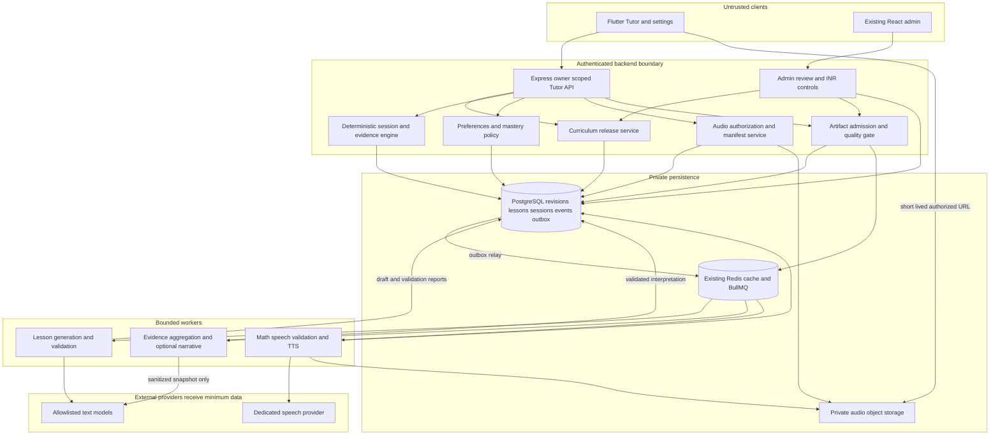

# 04 — High-level design

Status: proposed system. Keep the existing backend codebase and mobile visual system; add skill-oriented domains beside the legacy runtime.

## Components and trust boundaries

The model has no direct DB, Redis, shell, HTTP-fetch or admin tool. A provider gateway accepts bounded typed requests and returns untrusted data. It never receives another learner's context or the application's secret configuration.

## Four principal data flows

**Publish curriculum.** Admin imports one topic JSON → structural/prerequisite/source review → immutable revision and candidate lesson generation → teacher acceptance → one database transaction activates the release pointer. JSON authoring and published persistence are distinct. New imports cannot overwrite pinned sessions.

**Start/resume skill.** Authenticate learner → resolve owned progress and published skill revision → effective language/preferences → exact compatible artifact lookup → start/resume pinned session. Cache hit does not bypass publication/quarantine checks. Miss → deduplicated generation request → approved compatible fallback or truthful preparation state. No generation under a session lock.

**Teach and assess.** Continue/answer calls use client action identity + session revision → lock current session → grade with private answer/verified expression → store attempt/outcome event and next state/receipt/outbox atomically → return next visible screen. No LLM/TTS call is needed to advance an existing lesson. Private help returns beside the pinned lesson, never mutates the artifact used by other learners.

**Analyze and narrate.** Committed evidence drives a debounced analysis snapshot and rule-based mastery projection. Optional model insight cites facts; the service validates and stores an interpretation, not truth. Narration is generated only for verified speech text and requested/likely-next steps; store metadata in PostgreSQL and audio bytes in object storage. Text progression never waits for analysis, speech or animation.

## Synchronous versus asynchronous responsibilities

| Synchronous | Asynchronous |
|---|---|
| Auth, owner checks, preference read | New shared lesson composition |
| Cache/status/compatibility lookup | Mathematical/teaching release checks |
| Session action/attempt and receipt commit | Teacher review workflow |
| Deterministic grade and evidence update | Optional narrative analysis |
| Existing content and audio manifest delivery | TTS synthesis and audio validation |
| Creating idempotent generation/help request | Bounded lookahead and cache warming |
| Short validated doubt delivery when ready | Outbox reconciliation and usage reconciliation |

Use HTTP 202 resources and polling initially; optional SSE can notify completion with reconnectable event IDs. Polling is not an instruction to generate again. Existing WebSockets remain outside this design's feature work.

## Deployment shape

Pilot: one existing API/realtime owner and one jobs owner, PostgreSQL, Redis, private object storage. Tutor queues are added to the jobs role with explicit concurrency and a durable spend admission service. Do not activate the prepared PM2 example or deploy anything in this assignment.

Growth: add stateless `BACKEND_ROLE=http` replicas for Tutor HTTP, retain one existing realtime owner and one scheduler/outbox owner, and run bounded worker pools with database-fenced job leases. Separate lesson/voice/analysis concurrency limits prevent noisy-neighbor effects. Before changing singleton jobs to distributed workers, explicitly redesign their ownership; multiple jobs owners are not automatically safe because BullMQ supports concurrency.

A proposed dedicated `backend/src/workers/tutor-worker.ts` bootstrap can run only the Tutor generation/help/analysis/audio consumers and their bounded provider gateway. It must not start book sync, cron, realtime recovery or the existing singleton jobs owner. This entry point does not exist yet; add its explicit readiness/drain/pool configuration in Phase 3 before scaling worker replicas.

At 10,000 concurrent learners, provider throughput and review availability can limit feature admission before API CPU does. Document 10 supplies rate arithmetic. Database connection pools are allocated across every replica/worker; adding replicas without a fixed connection budget can reduce reliability.

## Durable state and cache policy

PostgreSQL is authoritative for curriculum release, artifact content/status, sessions, attempts, mastery evidence, analysis provenance, audio metadata and INR holds. Redis is a bounded performance/queue layer. Loss of Redis must not lose acknowledged progress, publish a draft or duplicate a paid dispatch. The outbox and generation job record permit replay after restoration; if spend/lease ownership cannot be established, paid calls fail closed.

Public shared lesson bodies may be cached internally, but mobile API responses are owner-scoped/no-store. Audio keys use immutable content hashes; private doubt narration has owner-scoped access and retention. Do not put protected answers or private audio into a publicly listable CDN bucket.

## Reliability and observability

Correlate `requestId`, `jobId`, `artifactId`, `sessionId` and provider usage record. Metrics use coarse, non-identifying labels: queue wait, approved cache-hit ratio, first useful content, provider completion/validation latency, invalid math/answer references, stale-action conflicts, hint/remediation rates, analysis lag, speech startup/failure, INR reserved/settled/uncertain and budget denials. Do not use user IDs or prompt text as metric labels.

Target 99.9% monthly availability for serving already published text/acknowledged session actions; third-party new generation and speech have separate objectives. This is a future target, not evidence of current uptime. PostgreSQL failure stops progress commits; the client retains content and an uncertain action ID. Provider failure leaves published lessons available. Quarantine removes incorrect content from admission and pauses affected current screens rather than continuing known bad mathematics.

Backups/PITR, encryption, access roles and restore drills belong to the authorized infrastructure phase. The architecture proposes RPO ≤5 minutes for catastrophic database loss with tested PITR and RTO ≤60 minutes; it does not equate replication with backup or promise these before a restore exercise.
