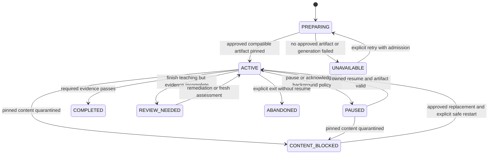
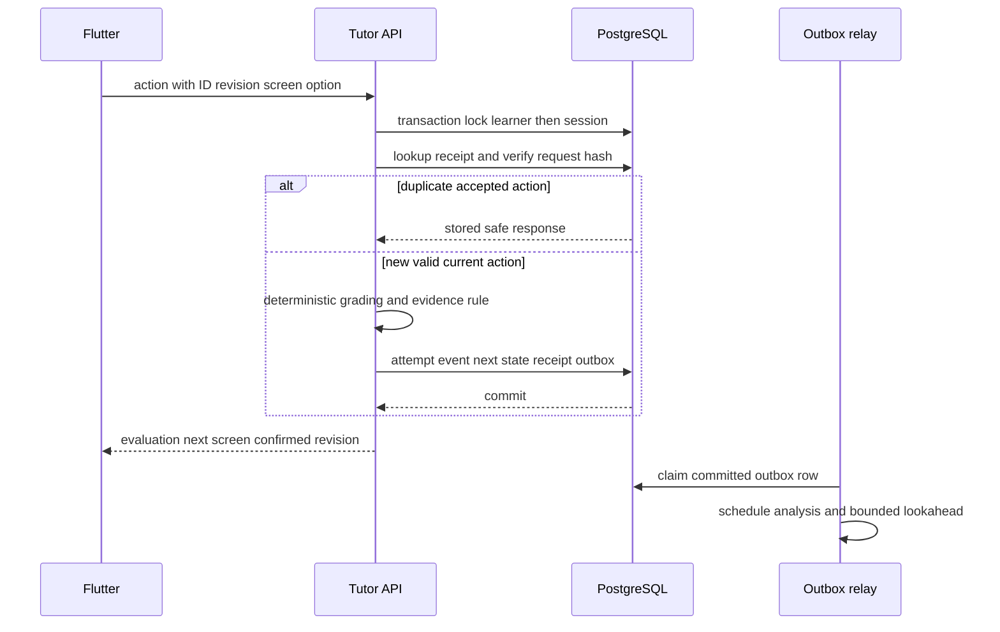
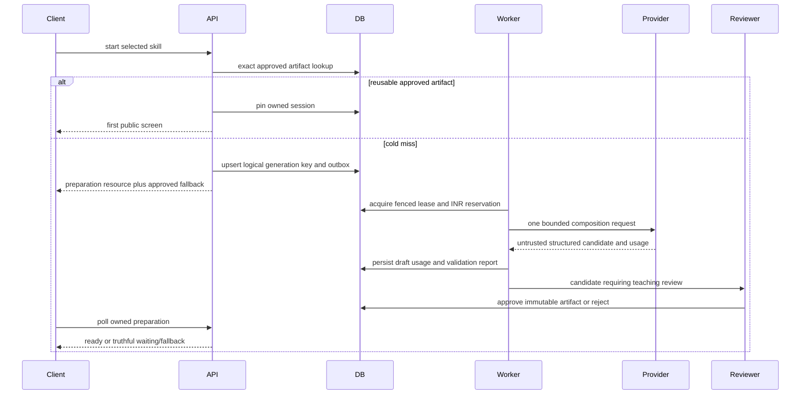

# 05 — Low-level design and API contracts

All modules/routes/types in this document are proposed unless labelled existing. Existing `/api/v1/lessons` contracts remain available for legacy sessions. New Tutor contracts use `/api/v1/tutor`; do not create a second backend application.

## Module boundaries

| Proposed path beneath `backend/src/modules/` | Responsibility / allowed dependencies |
|---|---|
| `curriculum/` | Topic import/export, prerequisite validation, immutable revisions, publication; Prisma and editor permissions |
| `tutor/tutor.routes.ts`, `tutor.controller.ts`, `dtos/` | Owner-scoped HTTP DTO validation; no provider calls or grading in controllers |
| `tutor/services/session.service.ts` | Start/resume/action state machine, receipt/CAS, pinned artifact and outcome evidence |
| `tutor/services/artifact.service.ts` | Compatible published lookup, quarantine check, public/private DTO projections |
| `tutor/services/assessment.service.ts` | Exact numeric/choice grading, hint exposure, outcome evidence policy |
| `tutor/services/help.service.ts` | Typed private help requests, context snapshots, deduplication and stale delivery guards |
| `tutor/services/generation.service.ts` | Logical job identity, input digest, dispatch lease, acceptance status |
| `tutor/quality/` | Schema/graph/outcome/answer checks, independent math verifier and review reports |
| `learner/` | Explicit preferences, deterministic aggregates, versioned interpretation proposals |
| `narration/` | Math-to-speech compiler, audio manifests/access policy, provider adapter |
| `ai/gateways/`, `ai/services/spend-admission.service.ts` | Provider-specific adapters, token ceilings, usage/cost holds, safe errors |

Keep runtime contract types alongside validation schemas and generate the Flutter transport fixtures from approved JSON examples. TypeScript types alone do not validate model/network data. Use discriminated unions; reject unknown node/action types and fields rather than loosely casting provider objects. No new generic agent tool framework is needed.

## Session state and artifact state



UI exit normally pauses rather than abandons. A learner can revisit completed instruction; repeating an exposed item cannot create new independent evidence. “I understand” opens an optional diagnostic, never a completion transition by itself.

Artifacts: DRAFT→VALIDATING→REVIEW→PUBLISHED. Failure enters REJECTED; discovered defects enter QUARANTINED; superseded content becomes RETIRED for new admission but may resume if still safe. No transition into PUBLISHED occurs solely from provider completion. Published bodies/checksums are immutable; corrections create another artifact. A withdrawn safety-critical artifact is not served even to an old pinned session.

## API overview

All paths below are beneath `/api/v1`. Bearer auth is mandatory. `userId` comes from verified token, never a request field. IDs in examples are illustrative opaque strings; production uses UUIDs for entities and stable curriculum strings where defined. Request validation must enforce actual identifier formats.

| Method/path | Request and response | Errors / behavior |
|---|---|---|
| GET `/tutor/curriculum?subjectId=...` | Ordered published topics/subtopics/skills with outcome summaries and available languages | 200 with known availability; no hidden answer data |
| GET `/tutor/skills/:skillId` | Current compatible revision, prerequisites, learner evidence summary | 404 if unavailable; no forced model call |
| POST `/tutor/sessions` | `{clientActionId, skillId, mode: start_or_resume|restart, expectedCurriculumReleaseId?}` | 200 owned existing session; 201 new ACTIVE; 202 PREPARING with owned `preparationId`; 409 stale release |
| GET `/tutor/preparations/:id` | QUEUED/GENERATING/VALIDATING/REVIEW/READY/FAILED, compatible fallback offer | Owner-scoped even if underlying job shared; never expose other waiters |
| GET `/tutor/sessions/:id` | Authoritative revision, current visible screen, bounded accepted history, settings/evidence | 404 for non-owner; 410 content withdrawn; 409 incompatible client schema |
| POST `/tutor/sessions/:id/actions` | Client identity/revision/screen and one allowed action | 200 receipt; 409 stale/conflicting identity; 422 invalid option/action; no provider call |
| POST `/tutor/sessions/:id/help` | Client identity, revision, screenId, `kind`, optional text ≤500 characters | 202 help job or 200 existing completed result; 429 budget/rate; content unchanged |
| GET `/tutor/sessions/:id/help/:helpId` | Pending/ready/failed with original screen/revision binding | Owner checks; obsolete reply displayed in original context only |
| POST `/tutor/sessions/:id/pause` | Client identity + expectedRevision | Idempotent commit; pending uncertain action resolved first |
| POST `/tutor/sessions/:id/resume` | Client identity + knownRevision | Return authoritative state; 410 if quarantined |
| GET/PATCH `/learner/preferences` | Language, goal, detail, examples, narration, version/provenance | PATCH uses expectedVersion; 409 conflict; explicit values protected |
| GET `/learner/progress?cursor=...` | Completion, evidence status, review due, grounded feedback | Cursor scoped to learner; no “IQ” score |
| POST `/tutor/sessions/:id/narration` | Screen ID, expected content digest, client identity | 200 READY manifest or 202 pending; never send arbitrary text to a billable endpoint |
| GET `/tutor/sessions/:id/narration/:audioId` | Owned status/short-lived playback URL/text digest/locale | 404 foreign owner, 410 quarantined, 503 optional service unavailable |

Actions: `CONTINUE`, `SUBMIT_CHOICE`, `SUBMIT_NUMBER`, `REQUEST_HINT`, `SELF_EXPLANATION`, `TAKE_DIAGNOSTIC`. Alternative explanations/examples/analogy are help kinds, not implicit progression. Free-form explanation can yield provisional feedback but must not be graded as fully correct by an unvalidated LLM. No timer/deadline property exists in Tutor transport.

### Start and action examples

Start request:

```json
{
  "clientActionId": "6d6748ec-9d9b-4f36-a27e-743fb3f3d93f",
  "skillId": "sim.mul-div-written-order",
  "mode": "start_or_resume"
}
```

Public session response data (inside existing `{success:true,data:...}` envelope):

```json
{
  "sessionId": "20c414ba-54ec-44c3-b06d-4cd804ad4d8d",
  "status": "ACTIVE",
  "revision": 1,
  "skillRevisionId": "sr_illustrative_1",
  "artifactId": "artifact_illustrative_1",
  "lessonSchemaVersion": 1,
  "screen": {
    "id": "first-chain",
    "kind": "teach",
    "blocks": [
      {"kind": "text", "text": "Let's work through one expression, step by step."},
      {"kind": "math", "display": "24 ÷ 4 × 2", "spoken": "Twenty-four divided by four, then multiplied by two."}
    ],
    "allowedActions": ["CONTINUE"],
    "contentDigest": "illustrative-digest"
  },
  "preferences": {"language": "en-IN", "narrationEnabled": false},
  "evidence": {"status": "LEARNING", "coveredOutcomes": 0, "requiredOutcomes": 2}
}
```

Action request:

```json
{
  "clientActionId": "a6e9d55c-010e-4d26-829c-cf5f89620a0a",
  "expectedRevision": 7,
  "screenId": "apply-chain-1",
  "action": {"kind": "SUBMIT_CHOICE", "optionId": "c", "activeDurationMs": 19000}
}
```

Answer response contains an evaluation and the next public screen. `correctOptionId`/solution becomes visible only for the attempted current item after the accepted commit; future keys, retry answers and rubric internals remain private. Multiple sequential events caused by one action use server sequence numbers. Store numbers/units exactly; reject NaN, negative durations and absurd durations; treat durations as optional low-trust analytics.

### Conflict and failure contract

Errors use `{success:false,code,message,requestId,retryAfterSeconds?}` with safe text. For `STALE_SESSION`, return a safe latest revision reference, not another learner's state. Reusing an action identity with a different payload returns `IDEMPOTENCY_CONFLICT`. The client first retries the *same* uncertain payload/identity; a refresh creates no new attempt. Do not ask the client to invent a new action ID after a timeout.

A 202 preparation response includes `preparationId`, status, `pollAfterMs` (initial 1500, backoff to 5000 with jitter), and approved fallback availability. It contains no fictional completion percentage. The underlying shared job can be deduplicated while each learner's preparation/start receipt stays owned. Completion is claimed idempotently to one active session per learner/skill revision; uniqueness and explicit restart semantics resolve competing devices.

## Answer commit sequence



No provider, object store or Redis roundtrip is required inside the answer transaction. Redis failure must not turn a committed answer into a retry that duplicates evidence. New schema may use its own transaction service, but lock ordering and XP/progression writes must remain compatible with `learning-transaction.ts` and existing ledger semantics.

## Generation sequence and paid-call ownership



Logical `generationKey` is unique; each dispatch has a distinct `attemptId`, reservation and fencing token. Use a short DB claim transaction then release locks for the provider call. BullMQ job delivery is at-least-once, not exactly-once. When a worker dies after sending but before saving output, mark dispatch UNCERTAIN; do not automatically send again. Reconciliation may recover provider results when supported, otherwise operator-approved retry spends a fresh reserved attempt. A lease timeout is not proof the provider did not bill.

Worker outcomes: invalid schema/math→REJECTED with codes; quality uncertainty→REVIEW; provider 429/503→retryable status with bounded explicit policy and *one* retry owner; no generic queue retry around an adapter that also retries. Each authorized retry must pass all quota/INR holds again. New runtime generation retries are capped per logical job (initial + at most one repair/transport retry where safe); this is separate from the six-call research harness with zero automatic retries.

## Private help and analyzer interactions

Private help captures `sessionId/artifactId/screenId/revision/outcomeIds` plus minimal recent attempts and the learner's typed question. It excludes full identity, DOB, religion, email and unrelated transcript. Persist pending request before dispatch; return a job resource. After reply validation, store it with its original context even if the learner has moved. Cancellation hides obsolete playback/UI but is not assumed to undo billing.

Analyzer consumes a high-water-mark snapshot of committed event IDs. A deterministic feature builder computes attempts, hints, unique transfer success, exposed retries and recency. Optional LLM output must include claim/evidence IDs and uncertainty; a validator rejects unknown evidence, unsupported counts and preference changes outside policy. An interpretation writes only through the learner service; it cannot update curriculum, attempts, XP or raw observations.

## Failure matrix

| Failure | Server action | Learner behavior / recovery |
|---|---|---|
| Provider slow/down | Deadline, circuit breaker, retain dispatch reservation if uncertain | Continue approved lesson; contextual help unavailable with safe retry later |
| Invalid generation | Quarantine draft, no publication, review failure | Approved compatible fallback or available skill |
| DB unavailable | No optimistic acknowledgment; retain uncertain operation | Read visible text; retry same identity after recovery |
| Redis unavailable | Serve DB-backed published lesson; suspend paid job admission if lease/budget safety unavailable | Existing text/answers continue while DB healthy |
| Answer response lost | Receipt survives committed transaction | Retry same identity, obtain exact response |
| Two devices submit | Serialized revision/CAS and active-session guard | One wins, other refreshes safely |
| Wrong content reported | Quarantine flag checked before read/action/audio URL | Pause affected content, offer reviewed replacement; do not erase previous facts |
| Analysis delayed | Facts committed; queued outbox remains | Deterministic progress shown, no fabricated insight |
| TTS/object failure | Separate failed optional job | Text stays usable, explicit replay/retry, no automatic paid loop |
| App background/language switch | Abort obsolete UI/audio work; authoritative session pinned | Pause audio, re-fetch state; switch at boundary or restart approved language variant |

## Abuse and contract limits

Start with per-learner help admission 6/minute and 30/day, 500 input characters, contextual response cap ~700 output tokens, one active shared generation claim per compatible key and bounded preparation waiters. These are proposed tunable defaults, not source facts. Legitimate accessibility needs must have a reviewable override. No credit is charged to the learner for an internal retry unless product policy explicitly defines it.

Narration endpoint accepts only an owned screen/digest and preset approved voice, never arbitrary speech text/URL. Curriculum import rejects unknown field shapes, oversized JSON, unsafe HTML/URLs, cycles, invalid expression syntax and unsupported locale codes. Generated content is rendered as allowlisted text/math blocks; do not execute code, raw HTML, shell, links or model-selected tools.
