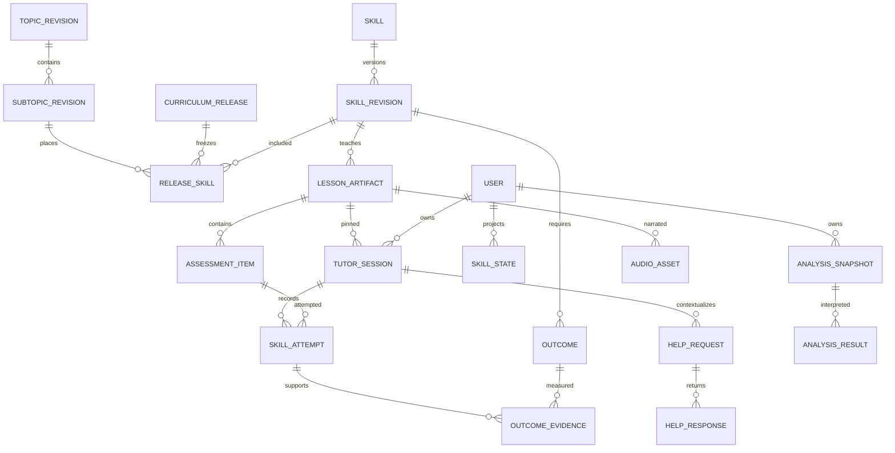

# 06 — Data architecture and curriculum schema

Status: implementable design specification; no schema files, database records or migrations were changed. Use existing PostgreSQL/Prisma and extend `learning`/`users` deliberately. `auth.users` remains identity authority. New table names below are proposed.

## Authority and publication model

One topic JSON is the editable, source-controlled authoring/export unit. It contains the entire topic definition and its subtopics/skills; no manually authored lesson graph is required. Imports create a new immutable topic revision after validation. PostgreSQL published revisions and release pointers are authoritative at runtime. Do not parse repository files during each mobile request.

Edits from dashboard must export the same canonical topic document and retain editor/diff/source lineage, preventing an untracked competing authoring system. A checksum uses canonical normalized UTF-8 JSON with sorted object keys, preserved array order and explicit schema version. Whitespace does not change meaning; order arrays do. Store uploaded source digest and normalized digest separately.

Stable identity survives rename/reorder. A release freezes topic→subtopic→skill placements. `skillRevisionId` changes whenever outcomes, required coverage, prerequisite contract, notation or grading family changes. A typo-only presentation revision may explicitly declare evidence compatibility; never infer compatibility from same display name.

## Proposed topic JSON

Illustrative single-skill slice of a future complete topic export; it is not an approved replacement for the existing Simplification catalog. Field names are normative for the proposed schema, example content remains subject to editorial approval.

```json
{
  "schema_version": 1,
  "topic_id": "rsa.simplification",
  "revision": 1,
  "subject_ids": ["quantitative-aptitude"],
  "name": "Simplification",
  "description": "Work through expressions in a clear and reliable order.",
  "source_refs": [
    {"source_id": "rsa-local-book", "printed_pages": "95–98", "pdf_pages": "104–107", "rights_status": "review_required"}
  ],
  "subtopics": [
    {
      "id": "sim-01-order-of-operations-bodmas",
      "position": 0,
      "name": "Order of Operations: The BODMAS Rule",
      "description": "Apply the correct order so an expression has one intended value.",
      "priority": "high",
      "legacy_catalog_ref": "books/SubTopics/SBT-RSA-04-Simplification/subtopics.json",
      "skills": [
        {
          "id": "sim.mul-div-written-order",
          "position": 1,
          "name": "Multiplication and division in written order",
          "learner_description": "Work through multiplication and division from left to right before adding or subtracting.",
          "prerequisites": ["number.positive-integer-arithmetic"],
          "estimated_minutes": {"minimum": 6, "typical": 10, "maximum": 15},
          "supported_locales": ["en-IN", "hi-IN", "ta-IN", "hi-Latn-IN"],
          "skill_ai_scope": {
            "required_concepts": ["equal priority of multiplication and division", "written order in an unbracketed chain", "multiplication/division before addition/subtraction"],
            "principles": ["regrouping division may change its value", "the next operation acts on the result just found"],
            "rules": [{"id": "md-order", "statement": "Evaluate multiplication and division in written order from left to right."}],
            "sequence": ["concrete operation chain", "compare intended and changed grouping", "guided chain", "independent mixed expression"],
            "outcomes": [
              {"id": "md.sequence", "description": "Identify and carry out the next multiplication/division in written order."},
              {"id": "md.transfer", "description": "Complete a fresh chain followed by addition/subtraction and check the result."}
            ],
            "misconceptions": [
              {"id": "division-always-first", "description": "Treating the mnemonic as division always before multiplication", "repair": "Use a chain starting with multiplication and explain the written sequence."},
              {"id": "regroup-divisor", "description": "Multiplying the divisor and following factor before dividing", "repair": "Compare the values of explicitly grouped expressions."}
            ],
            "example_requirements": ["small concrete story with the quantities mapped", "a division followed by multiplication", "a multiplication followed by division", "two successive divisions"],
            "assessment": {
              "family_ids": ["positive-integer-md-chain-v1"],
              "required_outcome_ids": ["md.sequence", "md.transfer"],
              "minimum_independent_successes_per_outcome": 2,
              "require_transfer_item": true,
              "allow_hinted_item_as_independent": false
            },
            "notation": {"multiplication": "×", "division": "÷", "rounding": "exact-only"},
            "depth": {"core": "small exact chains", "advanced_extension": "longer exact chains within the same outcomes"},
            "exclusions": ["fractions", "powers", "negative results", "unknown-number equations", "implicit multiplication"],
            "source_limitations": ["Do not interpret the book mnemonic as unequal multiplication/division precedence."]
          }
        }
      ]
    }
  ]
}
```

`position:1` anticipates a prerequisite operation-precedence skill; this slice alone is not an import-ready complete topic and must not be run against the current catalog. Existing names/IDs/order remain authoritative during conversion. Full imports must contain all approved subtopics and explicitly map every original scope clause; new skill boundaries do not silently broaden or drop coverage.

### Validation contract

Schema requires stable IDs, positive revision, unique ordered positions, nonempty natural descriptions and structured scope. All prerequisite IDs must resolve in the candidate release or approved existing release; graph must be acyclic. Every required outcome needs a teach/example/practice mapping at artifact validation. Mathematical family IDs must be in the reviewed registry. Advanced extensions cannot silently become mandatory outcomes. Locale presence means planned support; published availability additionally requires a passing localized artifact.

Import is dry-run by default: parse→normalize→diff→validate references→scope coverage review→teacher acceptance→publish transaction. Repeated identical digest is a no-op with a receipt. Deletions are retirement/mapping operations, never cascade deletion of historical sessions. Concurrent edits use a base-revision/digest check and return 409 on conflict.

## Relational model

Use UUID surrogate keys for immutable revisions/artifacts and stable strings for educational identities. All timestamps new to this subsystem are `timestamptz(3)`/UTC instants. Existing timestamp columns are not rewritten by this design. Every owned table has an indexed `user_id`; services scope every read/write by authenticated owner. Data roles and row-level security are defense-in-depth, not substitutes for application authorization.

| Entity / principal fields | Relationships and constraints | Access / lifecycle |
|---|---|---|
| `curriculum_release(id,status,published_at,created_by,digest)` | Unique immutable digest; one active pointer per curriculum/subject policy | Editor draft; publisher activates atomically |
| `topic_revision(id,topic_id,revision,source_json,scope_digest,source_rights)` | Existing Topic stable ID FK; unique `(topic_id,revision)` | Immutable after publication |
| `subtopic_revision(id,subtopic_id,topic_revision_id,name,description,position)` | Unique `(topic_revision_id,position)` and stable subtopic membership | Preserve legacy mapping |
| `skill(id,canonical_subtopic_id,retired_at)` | Stable identity; no progress rows cascade on curriculum retirement | Curriculum service |
| `skill_revision(id,skill_id,revision,scope_json,scope_hash,notation_version)` | Unique `(skill_id,revision)`; typed JSON validated before insert | Immutable published teaching contract |
| `release_skill(release_id,subtopic_revision_id,skill_revision_id,position)` | Composite FK consistency; unique placement/order; one canonical hierarchy and explicit linked placements | Frozen release memberships |
| `skill_prerequisite(skill_revision_id,prerequisite_skill_id,minimum_evidence_policy)` | Unique edge; no self-edge; release-level cycle validator | Editor review |
| `outcome(id,skill_revision_id,stable_code,description,required)` | Unique `(skill_revision_id,stable_code)`; stable code across compatible revisions | Fine-grained mastery linkage |
| `curriculum_mapping(old_kind,old_id,old_revision,new_skill_id,mapping_type,evidence_policy,reviewed_by)` | Explicit one-to-many for splits, many-to-one for merges; no fabricated mastery | Migration provenance |
| `learner_preferences(user_id,version,explicit_json,inferred_json,updated_at)` | One per user; compare-and-swap version | Learner controls explicit fields |
| `preference_change(id,user_id,field,old_value,new_value,source,evidence_ids,consent_state)` | Audit change/proposal/undo; sparse personal data | Own history, restricted reviewer |
| `generation_job(id,generation_key,input_digest,state,lease_token,lease_until,attempt_count)` | Unique generation_key for logical request; fenced writes; finite attempts | Worker-only mutation |
| `generation_waiter(id,user_id,job_id,start_action_id,status)` | Unique user/start identity; private access despite shared job | Delete with user |
| `lesson_artifact(id,skill_revision_id,variant_key,body_json,body_digest,status,schema_version,provenance_id)` | Immutable body; unique body digest scoped to schema; indexed published lookup; no learner FK for shared core | PUBLISH/QUARANTINE audited separately |
| `artifact_review(id,artifact_id,rubric_version,reviewer,findings,decision,created_at)` | Append review evidence; `reviewer` is accountable actor, not assumed model confidence | Teacher/publisher roles |
| `artifact_outcome(artifact_id,outcome_id,teach_ids,example_ids,assessment_ids)` | Outcome belongs to artifact skill revision; references must exist | Validation report |
| `assessment_item(id,artifact_id,outcome_ids,family_id,seed,expression_ast,options_json,solution_json,verification_version)` | Immutable source of truth; private solution, unique semantic options, valid answer FK in validator | Only public projection before attempt |
| `tutor_session(id,user_id,skill_revision_id,artifact_id,status,cursor,revision,started_at,last_activity_at,completed_at)` | FK ensures artifact matches skill revision; one active/paused session per user+skill revision via reviewed partial unique index | Owner reads/actions; delete user data |
| `tutor_action_receipt(user_id,operation,client_action_id,request_hash,session_id,response_json,created_at)` | Unique `(user_id,operation,client_action_id)`; reject changed payload | Durable uncertain retry resolution |
| `learner_event(id,user_id,session_id,sequence,event_type,payload,source_action_id,created_at)` | Unique `(session_id,sequence)`; unique accepted action/event subtype pair | Append facts, redact unnecessary prose |
| `skill_attempt(id,user_id,session_id,item_id,action_id,selected_option,normalized_answer,is_correct,hint_count,exposure_group,active_ms)` | Unique action; matching session/artifact/item FK; hints/exposure server-derived | Immutable facts; correction annotations separate |
| `outcome_evidence(id,user_id,outcome_id,attempt_id,quality_weight,independent,policy_version)` | One evidence unit per distinct eligible attempt/outcome; no duplicate from replay | Rule-derived, recomputable |
| `skill_state(user_id,skill_id,compatible_scope_hash,status,coverage_json,evidence_count,review_due_at,projection_version)` | Unique user/skill; projection from evidence; completion history separate | Rule service writes; not LLM |
| `help_request(id,user_id,session_id,artifact_id,screen_id,session_revision,kind,prompt_text,status)` | Private; idempotent request identity; snapshot pinned | Bounded retention/deletion |
| `help_response(id,help_id,validated_blocks,provider_request_id,validation_status)` | Private; never merged into shared lesson without separate editorial process | Owner only |
| `analysis_snapshot(id,user_id,through_event_id,feature_digest,features,policy_version)` | Deterministic bounded input; explicit evidence set and high-water mark | Analyzer service reads narrow snapshot |
| `analysis_result(id,snapshot_id,model_config_id,prompt_version,interpretations,evidence_refs,status,supersedes_id)` | Unknown evidence rejected; one accepted result/config/snapshot | Interpretation, not raw truth |
| `progress_feedback(id,user_id,result_id,template_version,text,evidence_refs,expires_at)` | Numeric assertions reconciled with snapshot | Owner; invalidate/supersede errors |
| `audio_asset(id,artifact_id,help_response_id,scope,owner_id,screen_id,speech_digest,locale,voice_version,format,object_key,duration_ms,status)` | Exactly one shared artifact screen or private help source; private requires owner; immutable content-key tuple | Signed access; private retention |
| `model_config(id,provider,model_id,resolved_model,settings,price_version,prompt_version,approved_at)` | No secrets; immutable approved config | Privileged controlled change |
| `provider_dispatch(id,job_id,model_config_id,status,reserved_inr,estimated_inr,billed_inr,input_tokens,output_tokens,provider_request_id)` | Monetary values decimal; uncertain hold retained; one dispatch identity | Finance/worker; no key/prompt in ordinary log |
| `outbox(id,type,aggregate_id,payload,available_at,claim_token,processed_at)` | Insert with originating commit; unique logical event identity | At-least-once relay, idempotent consumer |
| `admin_audit(id,actor,permission,resource,before_digest,after_digest,reason,created_at)` | Append and retain; never raw credentials | Publisher/security reviewers |

This is a relational specification, not a claim that a ready Prisma migration exists. Some predicates, CHECKs and fencing guards need reviewed SQL beside Prisma, consistent with the repository's existing native-constraint practice. Avoid unbounded JSON for state that must be indexed, uniquely constrained or joined.

## Entity relationships



## Lesson body contract

Use a versioned structured lesson with an ordered set of sections/screens and named recovery branches, rather than requiring legacy arbitrary graphs. Each screen has ID, kind, outcome IDs, readable blocks and legal transitions. Types: `teach`, `worked_example`, `prediction`, `assessment`, `correction`, `recap`. Prediction with an immediately visible answer is not independent evidence.

Math blocks hold an allowlisted expression AST or reviewed formula representation, display notation, computed value/unit and speech representation. Assessment records live separately with a body reference. Generate wording around supplied verified items; do not ask the model to invent four answer IDs and then trust them. A screen can reference a hint/correction/retry bundle. The validator proves referenced screens exist, success/remediation paths are reachable, recovery loops have a learner-controlled exit, and no completion path bypasses required outcome evidence.

Do not equate the legacy 30–50 subtopic-node guide with a skill-length quota. A narrow skill may need 10–20 connected screens; broad subtopics split into several coherent skills. Reviewer checks actual expected work and reading, not word-count duration claims. Current authoring standards still govern source legacy edits; no existing script is modified here.

## Reuse key and invalidation

Canonical generation input:

`skillRevisionId + scopeHash + lessonSchemaVersion + teachingPolicyVersion + rubricVersion + verifierVersion + promptVersion + approvedModelConfigId + locale + scaffoldingBand + detailMode + materialExampleStyle + goalOutcomeVariant`.

Exclude learner identity/history. Include any parameter that changes generated shared content. A narrated asset adds speech compiler/lexicon version, exact speech digest, voice/model/version, locale and codec. Playback speed handled by the client does not require another synthesis key if the bytes are identical.

Compatibility registry may let a new prompt/model reuse an older accepted artifact, but only through explicit reviewed equivalence; a cache lookup must not silently ignore changed validation policy. Publication status/quarantine is checked outside body caching on reads and actions. Redis TTL is not a correctness boundary. Invalidate status caches immediately on quarantine; fail closed if status freshness cannot be established.

## Indexes and transaction policy

- Session reads: `(user_id,status,last_activity_at DESC)`; action receipt unique identity; event `(session_id,sequence)`; attempts `(user_id,item_id,created_at DESC)`.
- Catalog reads: release/placement order indexes, `(skill_id,revision)` unique and artifact published variant lookup. Avoid fetching JSONB bodies in list queries.
- Jobs/outbox: `(state,available_at,id)` with claim token; partial indexes for pending work; bounded `SKIP LOCKED` relay batches and idempotent consumers, subject to authorized implementation tests.
- Analyzer: `(user_id,created_at,id)` keyset; bounded snapshot evidence IDs; no unbounded transcript joins per action.
- Audio: unique source/speech/voice/locale/format tuple; scoped owner index for private objects; expired URL refresh does not create audio again.

Atomic boundaries: publish release pointer + audit; answer + event/evidence/projection + receipt + outbox; preference change + audit/outbox; reserve cost + dispatch claim; result commit + usage settlement. No remote inference/TTS/network under an interactive DB transaction. Use bounded lock waits and short transactions. Retry a transaction only when no external side effect has occurred; receipts keep progress and XP idempotent.

## Progress preservation and correction

Existing LessonSession/QuestionAttempt/ConceptMastery remain interpretable. Legacy script completion maps to `legacy_completed`, not automatic mastery for each new skill. Exact verified item/outcome mapping may import evidence with provenance; unknown mappings remain “not assessed.” Rename/reorder preserves stable IDs. Split: distribute only matching evidence, require checks for new outcomes. Merge: union nonduplicated compatible evidence and re-evaluate policy. Changed mathematical scope creates a new evidence compatibility boundary.

Wrong published item: quarantine, annotate affected attempts as invalid-for-mastery, rebuild affected projections and supersede feedback. Preserve raw learner choice and historical action receipt; do not alter the event to pretend it was never answered. Rewards already committed require a separately approved compensation policy; do not silently claw them back. Correctness repair should not punish a learner for faulty content.

## Retention and deletion proposal

Proposed defaults for product/legal approval: raw typed doubt text 30 days; minimized help/analysis snapshots 90 days; accepted learning evidence for account lifetime with annual inactivity review; technical logs 14–30 days; private audio ≤30 days; shared artifacts until retired plus reference/rollback need. Retain only necessary billing/audit evidence for applicable statutory periods with pseudonymous references where possible. These are design defaults, not declarations of legal retention periods.

Account deletion immediately blocks access and queues owned events/help/audio/preferences/projections for verified deletion; provider-retention limitations are disclosed. Backup restore must reapply an erasure manifest until the deletion ages out of backup retention. Shared identity-free lessons do not need deletion per learner. Existing immutable competitive/XP references mean a blanket cascading delete is unsafe: reconcile anonymization and legal retention without redesigning game behavior here. Document 14 sets the child-data and access policy gates.
