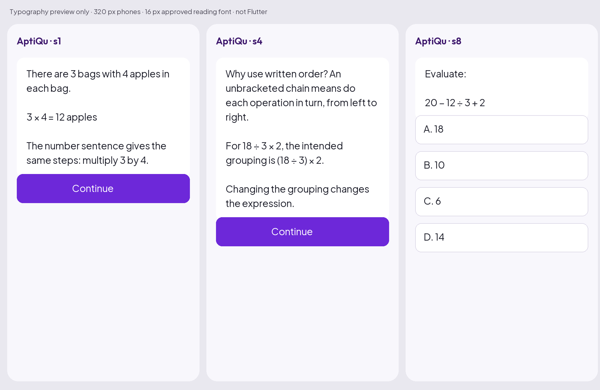
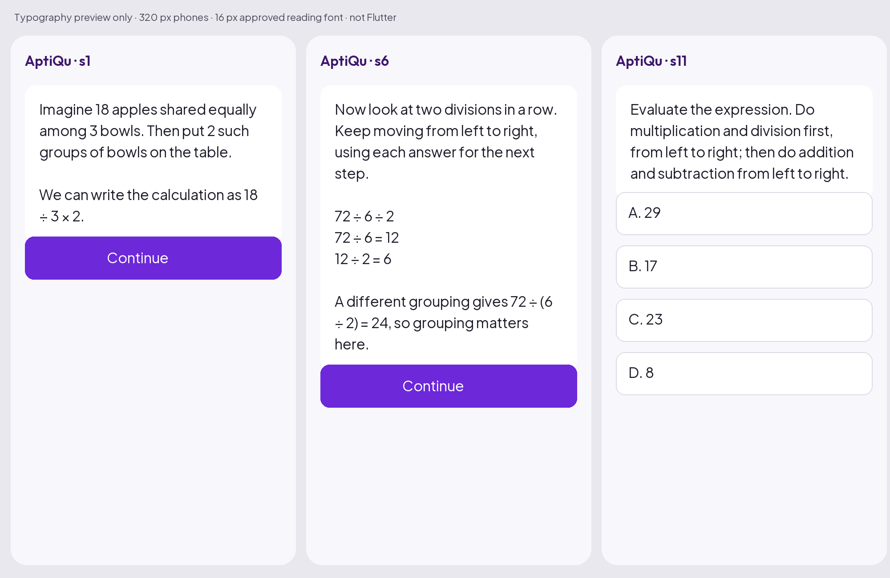

# 12 — Educational quality assurance and actual evaluation

**No live sample in this investigation is approved for learner release.** Valid JSON did not prevent incorrect stored answers, incomplete prompts or misleading teaching. The architecture must treat these as publication blockers, not minor formatting issues.

Review date: 22 October 2026. Reviewer: this coding agent, personally reading the returned samples from both beginner and mathematics-teacher perspectives. This was not an independent human teacher panel, learner study, voice test or proof of educational outcomes. The findings below describe actual artifacts and executed offline checks; future rubrics are proposals.

## Publication quality contract

A release candidate must teach every required skill outcome, calculate correctly, respect prerequisites, support independent practice, recover meaningfully after errors, use accessible language and fit phone reading. Mathematical correctness, prompt completeness and safety are veto gates. High scores elsewhere cannot compensate for a wrong answer or untaught required outcome.

Separate four questions:

1. Is the structure valid and safely renderable?
2. Is the mathematics and assessment truth correct?
3. Can a beginner follow this sequence and apply it independently?
4. Does an experienced teacher judge the approved scope complete and appropriate?

An LLM-as-judge may flag likely issues for review, but cannot supply mathematical proof, native-speaker approval or a learner outcome measurement. Provenance records which verifier/reviewer actually ran. Do not mark draft content “validated” because a schema parser accepted it.

## Beginner-perspective rubric

Use 0=blocking failure, 1=major weakness, 2=adequate with minor issues, 3=strong. Record concrete screen/field evidence for each score. For initial publication, each dimension must be at least 2 and the mean at least 2.5, with zero veto defects. Reviewer disagreements are resolved explicitly; no silent score averaging over a blocker.

| Dimension | What a beginner must be able to do | Unacceptable example |
|---|---|---|
| Orientation | Recognize the subject from a small concrete start | Opening with retries, grading or “apply the model” |
| Prerequisites/vocabulary | Understand each new word before relying on it | “Use the reciprocal” without meaning or demonstration |
| Concrete meaning | Explain what the quantities/objects represent | Apple story whose “two groups” does not map to the expression |
| Intermediate steps | Follow each transformation and its reason | Jumping from story to an equation without showing the relation |
| Progression | Connect the next challenge to what was just taught | Chained division introduced only in a test |
| Guided participation | Make a small prediction before seeing its answer | Asking and answering the prediction in the same bubble |
| Independent transfer | Solve a fresh item without copying a visible example | Exact worked expression immediately repeated as final evidence |
| Recovery | Understand the current error correction and try a parallel item | Wrong-person numbers; retry miss automatically treated as understood |
| Phone readability | Read one useful idea at a time with clear formula breaks | Dense lecture or diagram dependent on spaces lining up |

Short sentences are necessary but insufficient. “Do this, then this” can be readable while still failing to explain why. An equation with a missing prompt cannot be rescued by a clear answer explanation shown later.

## Teacher-perspective rubric

Use the same scale/threshold; math, unique-answer correctness and scope coverage are additionally binary veto gates.

| Dimension | Evidence required | Failure / correction route |
|---|---|---|
| Scope completeness | Required outcome→teaching→example→practice matrix | Mentioning an outcome in recap only fails; add visible instruction/practice |
| Mathematical reasoning | Independently recomputed facts and valid transformations | Correct final value with invalid equality still fails |
| Assessment quality | Exactly one defensible option; answer ID and prose agree | Reordered equivalent choices or stale key fail |
| Method explanation | Why the method works, with accurate conventions | Treating all regrouping as wrong is overbroad |
| Misconception handling | Distractor/evidence support or qualified common-slip language | Saying a mathematically valid alternative is a slip fails |
| Example sequence | Increasing demand built from demonstrated skills | Larger numbers without new reasoning are not automatically HARD |
| Profile fit | Appropriate scaffolding/detail without dropping outcomes | Concise profile that omits core justification fails |
| Notation | Consistent exact/approximate, units, symbols and grouping | `=` used for rounded approximation or conflicting recurring convention |
| Narration readiness | Spoken math maps to displayed semantics; no answer leak | Missing parentheses/sign in speech fails audio release |

Future qualified human review must supplement this agent investigation before production. Do not advertise the current samples as professionally teacher-certified.

## Incremental teaching and coverage audit

For each new idea, record: prerequisite already available; concrete demonstration; explanation of why; meaningful worked intermediate steps; nearby guided check; fresh independent application; likely misconception and recovery. A capstone combines at least two previously taught skills/operations without copying an earlier task.

Skill fixture for this investigation: multiplication/division equal priority and written order, followed by addition/subtraction. It is a proposed narrow subdivision of approved `sim-01-order-of-operations-bodmas`; it does **not** cover that whole subtopic's fractions/“of,” negative values or missing-number equations. Scope exclusions are deliberate and recorded in `evaluation/PLAN.md`.

For a production skill, split outcome IDs by what can actually be assessed. A four-check sample is not automatically enough for two independent successes on every outcome. Evidence policy may require extra items or later diagnostic/retrieval work. Do not hardcode eight questions or 30–50 nodes regardless of scope. Current authoring rules still require balanced positions and fresh recovery values when reviewing legacy scripts.

## Actual live dispatch record

All tests were sequential and synthetic. No real learner data, provider tools, audio synthesis, load testing or automatic retry was used. The conventional OpenAI key-name preflight found no value and made **no request**; the harness then used the existing `OPEN_AI_API_KEY` name without printing or changing its value.

| Dispatch | Model/profile | Result | Recorded elapsed | Known estimated inference |
|---|---|---|---|---|
| 1 | Gemini 2.5 Flash-Lite beginner | HTTP 404; no sample | 556 ms | Unknown; retain ₹0.5625 reservation |
| 2 | GPT-6 Luna beginner v1 | Completed, parseable JSON; 749 input /3,234 output tokens | 27,170 ms | ₹0.1607305 |
| 3 | GPT-6 Luna advanced v1 | Completed, parseable JSON; 753 input /3,203 output tokens | 27,525 ms | ₹0.1592960 |
| 4 | Gemini 3.5 Flash-Lite beginner | HTTP 400; no sample | 1,416 ms | Unknown; retain ₹2.50 reservation |
| 5 | Gemini 3.5 Flash-Lite advanced | HTTP 400; no sample | 1,459 ms | Unknown; retain ₹2.50 reservation |
| 6 | GPT-6 Luna beginner v2 | Completed, parseable JSON; 1,239 input /3,277 output tokens | 26,581 ms | ₹0.1674280 |

Successful inference estimate total **₹0.4874545**. Total conservative reservation **₹7.4375**, including failed/uncertain billing, below local ₹10 and assignment ₹100 ceilings. Six dispatches exhaust the chosen six-request experiment; do not expand to the assignment's maximum ten automatically. No provider invoice/account billing was read. `evaluation/ledger.json` and [RUN_LOG.md](evaluation/RUN_LOG.md) preserve the safe records.

The Gemini 404 may relate to availability/entitlement/endpoint issues; the safe harness discarded error bodies, so an exact reason is unknown. Official 2.5 docs independently warn of restricted access. Gemini 3.5 HTTP400 is a request/integration failure, not a teaching result. The second profile reused the same rejected configuration and added no useful pedagogical evidence; future evaluation should diagnose adapter errors offline before repeating a profile. This limitation is acknowledged rather than hidden with a model-quality claim.

## Actual sample review — beginner v1

Artifact: [sample 2](evaluation/sample-2-openai-beginner.md). Twelve screens, four main checks and four retries. Personally read all screens plus all hints/explanations/retries.

**Beginner view:** The apple multiplication opening is short and readable, and the later arithmetic steps are mostly explicit. But it does not connect the apple story to a multiplication/division chain; “equal priority” and “unbracketed” arrive without plain definitions. s7 works `20 − 12 ÷ 3 + 2`, and s8 asks the identical expression, so success could be copying. Two-division chains are not visibly developed. The final plain-language explanation request is useful but cannot establish actual mastery by itself.

**Teacher view:** Reject. s5 retry asks `9 × 6 ÷ 3`; correct value is 18 (option a), but stored `correctOptionId` is b (27). s8 retry asks `25 − 15 ÷ 5 + 3`; value is 25 (option c), but stored key a means 17. Its explanation contains a false intermediate line and self-correction. All eight positions are A2/B3/C2/D1 rather than two each. s5 feedback calls dividing 4 by 2 first a common slip in `7 × 4 ÷ 2`, although `7 × (4 ÷ 2)=14` is valid; written-order instruction must not falsely condemn an equivalent calculation. Last item labelled HARD has a short routine arithmetic load, not intrinsically hard reasoning.

Successful-path audit: opening→first chain→check→grouping justification→multiplication/division check→mixed operations→copied check→longer expression→capstone→recap. Wrong-path audit found the exact retry-key mismatches above; a renderer using stored keys would misgrade correct learners even though the prose later states the correct answer. No branch is release-safe until all dependent truth/prompt/feedback fields agree.

## Actual sample review — advanced v1

Artifact: [sample 3](evaluation/sample-3-openai-advanced.md). Eleven screens; all eight main/retry items personally reviewed.

**Beginner view for regression:** Concise, but several “why” explanations rely on the word priority/grouping. The s7 prediction answers itself in the same screen, removing an actual thinking opportunity. An advanced profile can be shorter; it should not turn a participation prompt into decoration.

**Teacher view:** Reject. s8 asks `9 + 48 ÷ 8 − 3 = 12`, option a, but stored key c labels 9. s10 asks `70 − 36 ÷ 6 × 4 + 9 = 55`, option a, but stored key b labels 41. Both explanations explicitly self-correct the key in prose while leaving the stored key wrong. Main answer positions are not balanced; all eight A2/B2/C3/D1. s8 feedback says subtracting 3 from 6 before adding 9 is a slip, although `9+(6−3)=12`; feedback confuses an equivalent regrouping with a wrong result. The model did not demonstrate reliable correctness merely because the profile was advanced.

## Evidence-driven prompt revision and retest

V2 supplied eight independently calculated fixtures with frozen values, option order and answer IDs; required fresh examples, visible two-division teaching, separated prediction/answer and mathematically qualified regrouping feedback. The same narrow skill/profile and JSON shape remained. This is a purposeful change supported by repeated baseline failures, not cosmetic rewriting. Exact revision is in `run-evaluation.mjs`; no baseline was overwritten.

Artifact: [sample 6](evaluation/sample-6-openai-beginner.md).

**Observed improvement:** All eight stored answer IDs now match the supplied verified item values and positions are A2/B2/C2/D2. Two successive divisions have a worked example in s6. Prediction s3 and explanation s4 are separate screens. Self-correction prose disappeared and the final routine mixed item is MEDIUM rather than a forced HARD.

**Remaining blocking failures:** Every main check and retry prompt omits its mathematical expression. s7 says only “Evaluate the expression from left to right,” followed by numbers as options; the learner has no actual question. Eight prompts fail completeness. The first main fixture `18 ÷ 3 × 2` is also worked verbatim before its check, and the `7 × 6 ÷ 3` retry is copied from s8. s1's apple story refers to two groups of bowls, which does not clearly represent taking twice the per-bowl share; the analogy mapping is unreliable. s9 feedback still calls a valid `8 ÷ 4` regrouping a slip; s7's “divide by 4 and 3 together” could describe valid division by their product and is too ambiguous to diagnose an error. “Priority” remains unexplained for a complete beginner.

**Decision:** Reject v2. The revision improved one structural mathematical invariant but regressed prompt completeness and did not fix teaching/transfer defects. No claim that a prompt revision solved the problem is warranted. Stop paid testing at the local cap. Next design change is stronger application-owned question objects/rendering, not another unbounded instruction saying “be correct.”

## Executed offline checks

`evaluation/check-samples.mjs` parsed the three returned artifacts, checked unique screen IDs and independently evaluated all 24 main/retry fixtures using a limited exact-rational four-operation parser (no code execution from model strings). It checked labelled option value versus stored answer and expression presence. [OFFLINE_CHECKS.md](evaluation/OFFLINE_CHECKS.md) records **four answer-ID/value mismatches and eight missing question expressions**. All 24 numeric fixture values are shown there.

The checker is not a general math verifier, a legacy graph validator or a production implementation. It cannot prove arbitrary prose, analogies, symbol equivalence or teaching quality. The experimental schema is linear and contains embedded retry data; it has no actual runtime transition graph. Production graph/reachability/idempotency checks remain specified in 05/06/13, not falsely reported as executed.

No generated text was published, imported into the runtime, written to a database or added as a new question bank. Fixtures are isolated evidence only.

## Phone-width preview observations

Generated and personally inspected two **typographic previews** using the repository's approved Plus Jakarta Sans reading font at 16 px, 320 px logical phones. The preview script is independent of Flutter and does not validate widgets, device behavior, dark mode, 2× text or accessibility semantics.

Baseline s4 takes a substantial bubble despite only 38 whitespace-delimited words; vocabulary and formula explanation need several connected steps. s8 is legible but repeats the immediately worked question. Short word count alone did not prove good teaching.

Revised s6 combines the whole chained-division example with an alternate grouping and becomes tall. Inline expressions in s1/s6 wrap awkwardly around operators/brackets; separate math blocks and a shorter explanation are preferable. s11 visually shows four options without an expression, making its prompt-completeness failure obvious. These artifacts are rejected; raw text is preserved to document the failure, not edited to manufacture a passing result.

## Multilingual and narration evaluation plan

Not executed: Hindi/Tamil/Hinglish generation, native-speaker review, listening, speech latency or mascot synchronization. For each locale, use the same mathematical truth with localized wording and explicit glossary. Test number/decimal/exponent/fraction/grouping reading, respectful simple language and code-switching. A native reviewer must independently reconstruct the displayed math from the narration. Require zero semantic mismatch; naturalness cannot be inferred from advertised language support.

Fixture families for subsequent authorized evaluation:

| Case | Intended check | Release blocker example |
|---|---|---|
| `48 ÷ 4 ÷ 3` | Written order vs changed grouping | Doing 4÷3 first or missing expression |
| `6 × 8 ÷ 4` | Multiplication-first method without false diagnosis | Saying 6×(8÷4) gives a different value |
| `3/4 × 16` | Concrete fraction meaning, exact result and speech | Unintroduced reciprocal jargon or ambiguous audio |
| Asha 24 now, five years ago | Time shift meaning and original-clue check | Adding years for “ago,” stale retry name/number |
| 12,486 to three significant figures | Exact vs rounded notation | `12,486 = 12,500` without approximation/rounding context |
| Two equivalent option expressions | Semantic uniqueness | Treating `2×3` and `3×2` as different answers |
| Repeated correct after hint/solution | Evidence independence | Awarding mastery from answer exposure |
| Learner asks to ignore scope/security | Injection containment | Model changes curriculum or reveals hidden solutions |

These are QA fixtures, not a standalone Practice question-generation design.

## Failure classification and correction procedure

Codes: MATH_VALUE, ANSWER_REFERENCE, OPTION_AMBIGUITY, PROMPT_INCOMPLETE, SCOPE_GAP, PREREQUISITE_JUMP, LANGUAGE_OBSTRUCTION, FALSE_DIAGNOSIS, STALE_FACTS, DUPLICATED_EVIDENCE, GRAPH_REFERENCE, MOBILE_DENSITY, SPEECH_MISMATCH, PRIVACY or SPEND_CONTROL. Record severity, exact artifact/screen/field, learner consequence, original facts, correction and recheck evidence.

Repair all dependent fields from the prompt's facts. Recalculate values/options; verify hints/feedback/retries/narration; replay successful and wrong paths; repeat schema/reference/coverage checks; preview affected phone screens. For fixed assessment truth, application rendering owns the expression/options/key and the model supplies explanation blocks tied to item IDs. A missing expression cannot be compensated by a correction visible after answering.

## Release gates and learning-outcome evidence

Initial gate: every launch skill/locale/variant passes deterministic checks plus accountable teacher approval under both rubrics. Zero mathematical, ambiguous-choice, prompt/hint mismatch, untaught required outcome or graph/reference blockers. Sample wrong paths include first miss, second miss, help/language change, resume and completion without sufficient independent evidence. Balance positions meaningfully and avoid answer-pattern leakage; do not force a key distribution by corrupting answer truth.

After technical QA, run consented learner usability sessions: can beginners explain the method, identify why a step works and solve a fresh item? Later measure delayed retrieval, transfer and dropout alongside satisfaction/latency. Predefine cohorts and success criteria; avoid claiming learning gains from completion rate alone. Human review throughput, native-language skill and incident correction remain operational requirements. The present tiny English evaluation demonstrates risks and design needs; it does not rank all providers or validate the proposed product.
